# Thor Thunder Tigress Platform

<p align="center">
  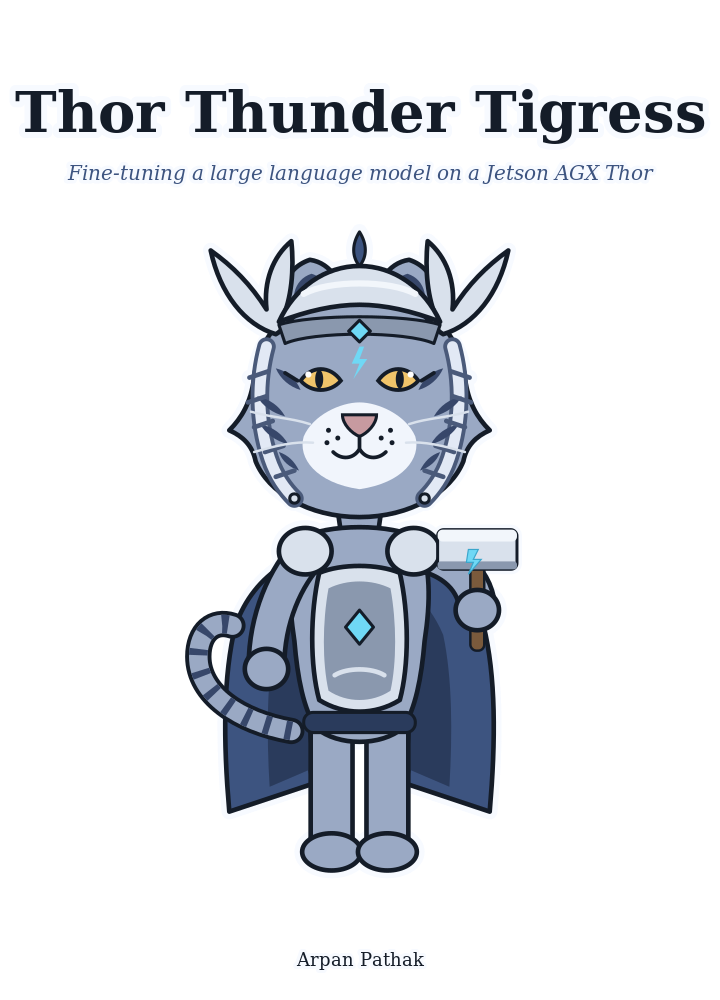
  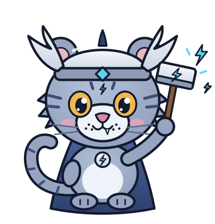
</p>

<p align="center">
  <a href="https://github.com/arpanpathak/thor-thunder-tigress-platform/actions/workflows/ci.yml"></a>
  <a href="https://github.com/arpanpathak/thor-thunder-tigress-platform/blob/badges/history.csv"></a>
  <a href="https://github.com/arpanpathak/thor-thunder-tigress-platform/blob/badges/summary.json"></a>
  <a href="#crates"></a>
  <a href="rust-toolchain.toml"></a>
  <a href="LICENSE"></a>
</p>

<p align="center"><b>Engines</b></p>
<div align="center">
<table>
  <tr>
    <td align="center"><a href="#engines-and-models">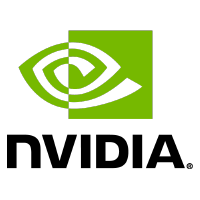</a><br><sub>TensorRT Edge-LLM</sub></td>
    <td align="center"><a href="#engines-and-models"></a><br><sub>TensorRT-LLM</sub></td>
    <td align="center"><a href="#engines-and-models"><picture><source media="(prefers-color-scheme: dark)" srcset="jetson-thor/clients/logos/vllm-dark.png">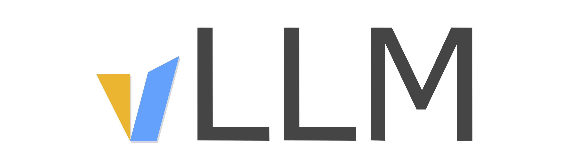</picture></a><br><sub>vLLM</sub></td>
    <td align="center"><a href="#engines-and-models">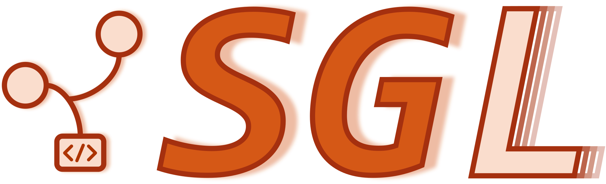</a><br><sub>SGLang</sub></td>
    <td align="center"><a href="#engines-and-models">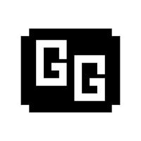</a><br><sub>llama.cpp</sub></td>
    <td align="center"><a href="#engines-and-models"><picture><source media="(prefers-color-scheme: dark)" srcset="jetson-thor/clients/logos/ollama-dark.png"></picture></a><br><sub>Ollama</sub></td>
  </tr>
</table>
</div>

<p align="center"><b>Coding tools</b></p>
<div align="center">
<table>
  <tr>
    <td align="center"><a href="#coding-tools">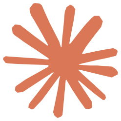</a><br><sub>Claude Code</sub></td>
    <td align="center"><a href="#coding-tools"><picture><source media="(prefers-color-scheme: dark)" srcset="jetson-thor/clients/logos/opencode-dark.svg"></picture></a><br><sub>OpenCode</sub></td>
    <td align="center"><a href="#coding-tools">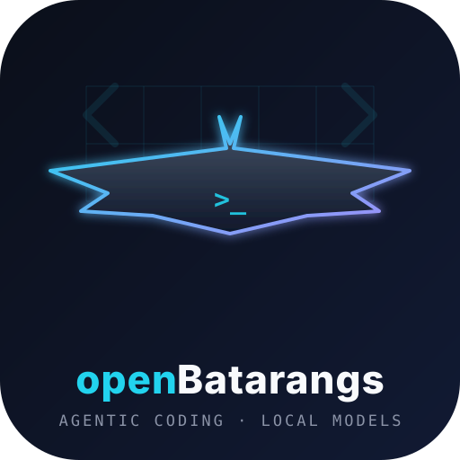</a><br><sub>openbatrangs</sub></td>
    <td align="center"><a href="#coding-tools">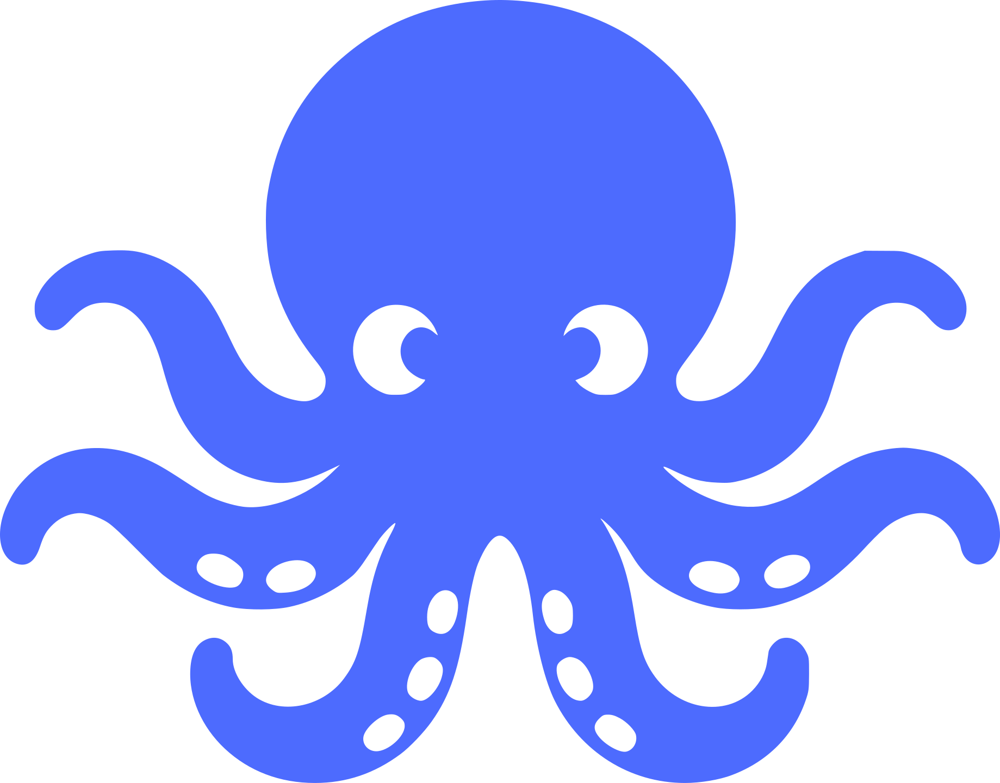</a><br><sub>Deep Code</sub></td>
    <td align="center"><a href="#coding-tools">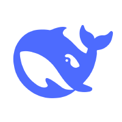</a><br><sub>DeepSeek Harness</sub></td>
  </tr>
</table>
</div>

<p align="center"><b>Models</b></p>
<div align="center">
<table>
  <tr>
    <td align="center"><a href="#engines-and-models">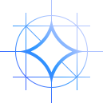</a><br><sub>Gemma 4</sub></td>
    <td align="center"><a href="#engines-and-models"></a><br><sub>Qwen3.8, Qwen3.6, Qwen3.5, Qwen2.5-Coder</sub></td>
    <td align="center"><a href="#engines-and-models"></a><br><sub>Nemotron 3 and 3.5</sub></td>
  </tr>
</table>
</div>

Thor Thunder Tigress Platform runs open language models on an NVIDIA Jetson
AGX Thor and serves them to coding tools and a chat page. One server,
`thor-tigress-agent`, sits in front of every engine and offers OpenAI's and
Anthropic's APIs. A request names a model, and the server sends it to the
engine that runs that model. TensorRT Edge-LLM, vLLM, llama.cpp and Ollama have
all served models on the Thor, and any other OpenAI-compatible server, such as
SGLang or TensorRT-LLM's `trtllm-serve`, connects the same way.

Since October 2026, the Thor has run 10 models from Google, Alibaba and NVIDIA
on these engines, from 12B to 74B parameters; see
[Engines and models](#engines-and-models). It serves Gemma 4 26B-A4B and
Qwen3.6 35B-A3B now. Claude Code, OpenCode, openbatrangs, Deep Code and
DeepSeek Harness each start on these models with one command; see
[Coding tools](#coding-tools). The chat page searches the web, cites the pages
it read, and takes PDFs up to 200 MB.

The platform also measures how the models write. The checker, `spark`, counts
the habits we want to train out. In prose, those are filler, hedging and
sentences about their own importance. In Rust, they are `unwrap`, comments
inside function bodies, index loops and errors kept as strings. On the same
Rust tasks, Qwen2.5-Coder 7B passed all five rules in 1 of 24 answers, and
Qwen3.5 9B in 0 of 22.

The training set holds 13,114 examples, about 6.5M tokens from 35 sources,
picked because they do not have those habits. The fine-tune on the Thor has not
started; [Status](#status) lists each stage.

The [book](https://arpanpathak.github.io/thor-thunder-tigress-platform/) covers
every part with its measurements. `mdbook serve book` shows it locally.

## What is in this repository

| Folder | What it holds |
|---|---|
| `crates/` | The Rust tools: the training-set builder, the checker, the review page, the question generator, and the chat server with its keyring |
| `jetson-thor/` | What runs on the Jetson Thor: the chat page, and `thor-tigress-serve`, which manages the models. `jetson-thor/clients/` holds the commands that start coding tools on the Thor's models |
| `book/` | The book, as an mdBook |
| `train/` | Hand-written teaching conversations, and the script that fetches the open books and docs |
| `projects/`, `tools/` | Related repositories, as git submodules |

The project has two characters. The tigress is the platform: the data, the
checker and the training. The cub is the part people talk to: the chat page
and the API.

## The Thor Tigress Cub

A chat page and an API on the Jetson Thor, for anyone with an invite.

- **Chat.** A model picker, a thinking panel, and a **Web** switch that lets
  the model search with SearXNG and read the pages it cites.
- **API.** OpenAI's `/v1/chat/completions` and Anthropic's `/v1/messages`, so
  the coding tools in [Coding tools](#coding-tools) can use the Thor's models.
- **Keys.** Each person gets their own key, kept in an encrypted keyring.
- **Files.** Images, PDFs up to 200 MB and text files. The text of a PDF is cut
  to what the chosen model can read in one prompt.
- **Models.** Gemma 4 26B-A4B and Qwen3.6 35B-A3B run on TensorRT Edge-LLM.
  GGUF models run on llama.cpp. `thor-tigress-serve` lists, downloads, loads
  and unloads them, and checks the memory first.

Where to read more in the book: "Web chat", "Tool calling", "Bring your own
agent", "Model serving" and "Coding tools on TensorRT Edge-LLM".

## Engines and models

`thor-tigress-agent` takes a TensorRT Edge-LLM model as
`--engine NAME=HOST:PORT` and an OpenAI-compatible server as
`--model HOST:PORT`. [`thor-tigress-serve`](jetson-thor/model-serving/thor-tigress-serve)
starts the engines on the Thor as systemd services and checks the memory
before it loads a model.

| | Engine | Used for |
|---|---|---|
|  | [TensorRT Edge-LLM](https://github.com/NVIDIA/TensorRT-Edge-LLM) | NVFP4 models, with draft models for multi-token prediction. Serves Gemma 4 and Qwen3.6 now |
| <picture><source media="(prefers-color-scheme: dark)" srcset="jetson-thor/clients/logos/vllm-dark.png"></picture> | [vLLM](https://github.com/vllm-project/vllm) | Qwen3.8 Flash Next in NVIDIA's Jetson container, with a 262,144-token window |
|  | [llama.cpp](https://github.com/ggml-org/llama.cpp) | GGUF models, several loaded at once behind one router, with draft models and up to 1M-token windows |
| <picture><source media="(prefers-color-scheme: dark)" srcset="jetson-thor/clients/logos/ollama-dark.png"></picture> | [Ollama](https://github.com/ollama/ollama) | Qwen3.6 27B |
|  | [TensorRT-LLM](https://github.com/NVIDIA/TensorRT-LLM) | The Qwen2.5-Coder 7B baseline on the Orin NX development board, and the teacher endpoint `lasso` is written for |
|  | [SGLang](https://github.com/sgl-project/sglang) | Connects as an OpenAI-compatible server, like vLLM; not run on the Thor yet |

Every model run so far, with the speed of one request. All of them ran on the
Thor except the two `spark` baselines, which ran on the Orin NX development
board.

| Model | Engine | Weights | Tokens/s | Notes |
|---|---|---|---|---|
| Gemma 4 26B-A4B | TensorRT Edge-LLM | NVFP4, MTP draft model | 47–72 | Served. 131,072-token window, 65,536-token prompts |
| Gemma 4 12B | TensorRT Edge-LLM | NVFP4, MTP draft model | 43–53 | Built, 29.5 GB |
| Gemma 4 31B | TensorRT Edge-LLM | NVFP4, MTP draft model | 11–14 | Built; dense, so every token reads all 31B weights |
| Qwen3.6 35B-A3B | TensorRT Edge-LLM | NVFP4 | 62–78 | Served. On 20 Rust tasks, 18 compiled and 14 passed their tests |
| Qwen3.6 27B | Ollama | Q4_K_M | 12 | |
| Qwen3.8 Flash Next | vLLM | NVFP4, MTP draft | 43–45 | 262,144-token window; 16 minutes to load |
| Qwen3.8 27B | llama.cpp | Q8_0 | 8.3 | Edge-LLM 0.11 cannot build its FP8 checkpoint |
| Qwen3.5 9B | llama.cpp | Q4_K_XL | | `spark` baseline, on the Orin NX |
| Qwen2.5-Coder 7B | TensorRT-LLM | GPTQ INT4 | | `spark` baseline, on the Orin NX |
| Nemotron 3 Nano 30B-A3B | llama.cpp and TensorRT Edge-LLM | Q8_0 and NVFP4 | 51–53, about 58 | 1M-token window. On the same 20 Rust tasks, 15 compiled and 14 passed |
| Nemotron 3.5 Lightning 30B-A3B | llama.cpp and TensorRT Edge-LLM | GGUF and NVFP4 | 52.5 | |
| Nemotron 3.5 Bolt 74B-A9B | llama.cpp | IQ2_XXS, DFlash draft model | 40–52 | 27 tokens/s without the draft model |
| Nemotron 3.5 Super VL 120B-A12B | llama.cpp | NVFP4 GGUF | | Not run yet |

## Coding tools

The Thor's models work in these coding tools. Each one talks to the chat
server's API, so the model runs on the Thor and the files stay on your machine.

| | Tool | Start it with | API it uses |
|---|---|---|---|
|  | [Claude Code](https://github.com/anthropics/claude-code) | `claude-thor` | Anthropic `/v1/messages` |
| <picture><source media="(prefers-color-scheme: dark)" srcset="jetson-thor/clients/logos/opencode-dark.svg"></picture> | [OpenCode](https://github.com/anomalyco/opencode) | `opencode` | OpenAI `/v1/chat/completions` |
|  | [openbatrangs](https://github.com/arpanpathak/openbatrangs) | `openbatrangs --thor -m Gemma-4-26B-A4B-NVFP4` | OpenAI `/v1/chat/completions` |
|  | [Deep Code](https://github.com/lessweb/deepcode-cli) | `deepcode-thor` | OpenAI `/v1/chat/completions` |
|  | DeepSeek Harness (`dsh`) | `deepseek-thor` | Anthropic `/v1/messages` |

Each tool must already be installed. To set them up:

1. Put your access key in `~/.config/thor-chat/api-key`.
2. Add `source /path/to/thor-thunder-tigress-platform/jetson-thor/clients/thor-clients.sh`
   to `~/.bashrc`, and open a new terminal.
3. Run `thor-models` to see what the Thor serves, then start a tool from the
   table. `-m NAME` picks another model, for example
   `claude-thor -m Qwen3.6-35B-A3B-NVFP4`.

Each command in [`thor-clients.sh`](jetson-thor/clients/thor-clients.sh) asks
the server for its models when it starts, and sets its tool's context window
to the longest prompt that model accepts. A tool's own settings stay as they
are. Claude Code keeps a separate history in `~/.claude-thor`, and the
DeepSeek keys of Deep Code and `dsh` are never sent to the Thor.

### The models

| Model | Window | Longest prompt | Speed | Memory |
|---|---|---|---|---|
|  Gemma 4 26B-A4B, NVFP4, with Google's draft model | 131,072 tokens | 65,536 tokens | 47–72 tokens/s | about 55 GB |
|  Qwen3.6 35B-A3B, NVFP4 | 65,536 tokens | 32,768 tokens | 62–66 tokens/s (2026-10-20) | about 24 GB |

Both run on TensorRT Edge-LLM 0.11.0. A prompt longer than the limit gets an
HTTP 413 from the engine. Gemma reads a 54,620-token prompt in about 40 s.
Edge-LLM 0.11 has no parser for Gemma 4's tool calls or its thinking, so the
Thor runs it with a patch to Edge-LLM's parsers that is not yet in this
repository.

### Measured on 2026-11-11

Each tool was given the same task on Gemma 4 26B-A4B: write a small Rust
program, compile it with `rustc`, and run it. Every tool finished and the
program printed the right number.

| Tool | Time |
|---|---|
| Claude Code | 12–14 s |
| OpenCode | 26–59 s |
| openbatrangs | 6 s |
| Deep Code | 19–20 s |
| DeepSeek Harness | 10–29 s |

The logos belong to their owners; where each one comes from is listed in
[`jetson-thor/clients/logos`](jetson-thor/clients/logos/README.md).

## Status

| Stage | State |
|---|---|
| 0. Slop and rule checker (`spark`) | Done. It has scored the two baseline models in `runs/` |
| 1. Training data | Done: 13,114 examples, about 6.5M tokens, from 35 sources |
| 2. QLoRA on the Thor: train, merge, quantize, serve, score before and after | Not started |
| 3. Distillation: keep the teacher's answers that pass the checker and compile | The question generator is written and tested against a stand-in server |
| 4. A small trainer in Rust with Candle | Only if it earns its place |

One limit to know about: `spark` reads code, it does not compile it or run
its tests. A block can pass all five rules and still not build.

## Quick start

```bash
cargo build --release
bash train/fetch_corpus.sh                         # clone the open books and docs (~2 GB)
target/release/thor-hammer-trainer data            # build data/train.jsonl and data/stats.md
target/release/reinforcer data/train.jsonl 8787    # review it at http://127.0.0.1:8787
target/release/spark rs crates                     # check Rust code against the five rules
target/release/spark score RUN.jsonl --field text  # score a model's answers
target/release/lasso conversations --dry-run       # plan conversations; needs no model
target/release/thor-tigress-keyring init           # the encrypted registry of invited people
```

`fetch_corpus.sh` reads the licence file of every source, and the trainer
refuses anything that is not MIT, Apache-2.0, BSD, CC BY or CC0.

The pipeline also reads personal inputs: a chat export and hand-written
pairs. Their paths are set in `crates/thor-hammer-trainer/src/build.rs`. They
are not in this repository, and `data/` and `corpus/` are git-ignored.

## Crates

| Crate | Binary | Health | What it does |
|---|---|---|---|
| `thor-spark-safety-eval` | `spark` |   | Scores answers: slop phrases in prose, the five Rust rules in code, and claims of following the rules that the code contradicts |
| `thor-hammer-trainer` | `thor-hammer-trainer` |   | Builds `data/train.jsonl` from books, docs, a chat export and hand-written pairs, with licence checks, clean-up, deduplication and a per-source token cap |
| `thor-tigress-reinforcer-frontend` | `reinforcer` |   | Review page for the training set: syntax-highlighted code, rule-breaking lines tagged, slop phrases suggested, a phrase marked once found everywhere |
| `thor-lasso-distiller` | `lasso` |   | Asks a teacher model, served by `trtllm-serve`, for the question each book section answers, and builds conversations whose answers are the book text |
| `thor-tigress-agent` | `thor-tigress-agent` |   | The Thor Tigress Cub's server: the chat page, the personal keys in the keyring, the registration form, web search with recency, page reading, and the API, in front of the model servers |
| `thor-tigress-keyring` | `thor-tigress-keyring` |   | The encrypted registry of who may use the chat and the key each was given: a name, an email, a status and a key per person, sealed with a passphrase (Argon2id, then XChaCha20-Poly1305) and queried over SSH |

### The five Rust rules

`spark` checks them, and every crate here keeps them:

1. No `unwrap()` or `expect()`, not even in tests.
2. Errors are an enum implementing `Display` and `std::error::Error`, written by hand or derived with `thiserror`; `anyhow` is allowed. No `String` or `Box<dyn Error>` errors.
3. Every `pub` item has a `///` doc comment.
4. No comments inside function bodies.
5. No index loops like `for i in 0..n`.

`cargo test` runs `spark` on this repository's own source, so a crate that
breaks a rule fails its tests.

CI runs on every push to `main`. Each crate's tests run under
`cargo llvm-cov`, and `spark` checks the whole repository. The results are the
badges above, and their history is in
[`history.csv`](https://github.com/arpanpathak/thor-thunder-tigress-platform/blob/badges/history.csv)
on the `badges` branch.

## Related repositories

| Repository | What it is | Here |
|---|---|---|
| [openbatrangs](https://github.com/arpanpathak/openbatrangs) | A coding agent for the terminal. It works with Ollama or any OpenAI-compatible server, the Thor included | `projects/openbatrangs` |
| [local-copilot-codebuddy](https://github.com/arpanpathak/local-copilot-codebuddy) | A terminal coding copilot on TensorRT-LLM or llama.cpp, with no server | `projects/local-copilot-codebuddy` |
| [thor-sync](https://github.com/arpanpathak/thor-sync) | Keeps project folders copied to the Jetson over SSH or Tailscale | `tools/thor-sync` |

They are git submodules: a pointer to one commit, not a copy. Clone with
them, or fetch them later:

```bash
git clone --recurse-submodules https://github.com/arpanpathak/thor-thunder-tigress-platform
git submodule update --init          # in an existing clone
```

## Hardware

The code is written on a Jetson Orin NX 16 GB. The models run, and the
training will run, on a Jetson AGX Thor 128 GB (Blackwell GPU, sm_110,
JetPack 7).

Setting up the Thor, SSH and syncing are covered in
[`jetson-thor/README.md`](jetson-thor/README.md). Models are managed with
[`thor-tigress-serve`](jetson-thor/model-serving/thor-tigress-serve): `list`,
`list-latest` (the newest models on Hugging Face), `download`, `load` and
`unload`, each taking a key from the list or a model's name.

## Licence

Apache-2.0. See [`LICENSE`](LICENSE).
