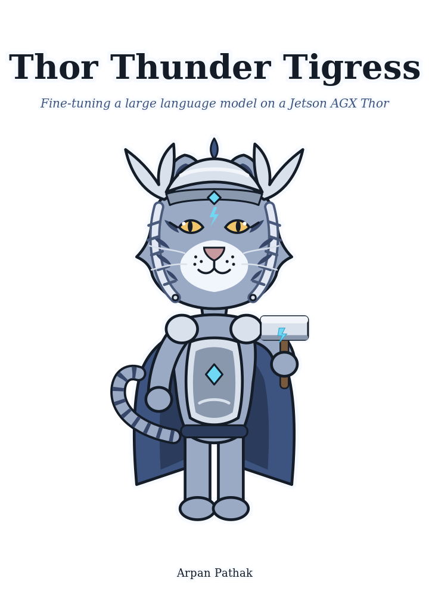
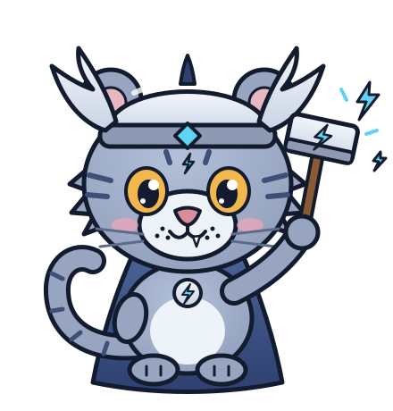

# Thor Thunder Tigress Platform

<p align="center">
  
  
</p>

<p align="center">
  <a href="https://github.com/arpanpathak/thor-thunder-tigress-platform/actions/workflows/ci.yml"></a>
  <a href="https://github.com/arpanpathak/thor-thunder-tigress-platform/blob/badges/history.csv"></a>
  <a href="https://github.com/arpanpathak/thor-thunder-tigress-platform/blob/badges/summary.json"></a>
  <a href="#crates"></a>
  <a href="rust-toolchain.toml"></a>
  <a href="LICENSE"></a>
</p>

Local language models write slop. In prose it is filler, hedging and
sentences that announce their own importance. In Rust it is `unwrap`, comments
inside function bodies, index loops and errors passed around as strings.

This project teaches a model that runs on an NVIDIA Jetson to stop. It builds
a training set from text and code that do not have those habits, and it has a
checker that counts each habit in a model's answers, so a fine-tune can be
judged by numbers. It also runs the models on the device and puts them behind
a chat page and an API.

The data, the checker and the serving are built and in use. The fine-tune
itself has not started; see [Status](#status).

**The book** explains every part, with the measurements:
https://arpanpathak.github.io/thor-thunder-tigress-platform/
(or `mdbook serve book` to read it locally).

## What is in this repository

| Folder | What it holds |
|---|---|
| `crates/` | The Rust tools: the training-set builder, the checker, the review page, the question generator, and the chat server with its keyring |
| `jetson-thor/` | What runs on the Jetson Thor: the chat page, and `thor-tigress-serve`, which manages the models |
| `book/` | The book, as an mdBook |
| `train/` | Hand-written teaching conversations, and the script that fetches the open books and docs |
| `projects/`, `tools/` | Related repositories, as git submodules |

The project has two characters. The tigress is the platform: the data, the
checker and the training. The cub is the part people talk to: the chat page
and the API.

## The Thor Tigress Cub

A chat page and an API on the Jetson Thor, for anyone with an invite.

- **Chat.** A model picker, a thinking panel, and a **Web** switch that lets
  the model search with SearXNG and read the pages it cites.
- **API.** OpenAI's `/v1/chat/completions` and Anthropic's `/v1/messages`, so
  coding tools such as [openbatrangs](https://github.com/arpanpathak/openbatrangs),
  OpenCode and Claude Code can use the Thor's models.
- **Keys.** Each person gets their own key, kept in an encrypted keyring.
- **Models.** Qwen3.6 35B and Nemotron 3.5 Lightning run on TensorRT Edge-LLM.
  GGUF models run on llama.cpp. `thor-tigress-serve` lists, downloads, loads
  and unloads them, and checks the memory first.

Where to read more in the book: "Web chat", "Tool calling", "Bring your own
agent", "Model serving" and "Coding tools on TensorRT Edge-LLM".

## Status

| Stage | State |
|---|---|
| 0. Slop and rule checker (`spark`) | Done. It has scored the two baseline models in `runs/` |
| 1. Training data | Done: 13,114 examples, about 6.5M tokens, from 35 sources |
| 2. QLoRA on the Thor: train, merge, quantize, serve, score before and after | Not started |
| 3. Distillation: keep the teacher's answers that pass the checker and compile | The question generator is written and tested against a stand-in server |
| 4. A small trainer in Rust with Candle | Only if it earns its place |

One limit to know about: `spark` reads code, it does not compile it or run
its tests. A block can pass all five rules and still not build.

## Quick start

```bash
cargo build --release
bash train/fetch_corpus.sh                         # clone the open books and docs (~2 GB)
target/release/thor-hammer-trainer data            # build data/train.jsonl and data/stats.md
target/release/reinforcer data/train.jsonl 8787    # review it at http://127.0.0.1:8787
target/release/spark rs crates                     # check Rust code against the five rules
target/release/spark score RUN.jsonl --field text  # score a model's answers
target/release/lasso conversations --dry-run       # plan conversations; needs no model
target/release/thor-tigress-keyring init           # the encrypted registry of invited people
```

`fetch_corpus.sh` reads the licence file of every source, and the trainer
refuses anything that is not MIT, Apache-2.0, BSD, CC BY or CC0.

The pipeline also reads personal inputs: a chat export and hand-written
pairs. Their paths are set in `crates/thor-hammer-trainer/src/build.rs`. They
are not in this repository, and `data/` and `corpus/` are git-ignored.

## Crates

| Crate | Binary | Health | What it does |
|---|---|---|---|
| `thor-spark-safety-eval` | `spark` |   | Scores answers: slop phrases in prose, the five Rust rules in code, and claims of following the rules that the code contradicts |
| `thor-hammer-trainer` | `thor-hammer-trainer` |   | Builds `data/train.jsonl` from books, docs, a chat export and hand-written pairs, with licence checks, clean-up, deduplication and a per-source token cap |
| `thor-tigress-reinforcer-frontend` | `reinforcer` |   | Review page for the training set: syntax-highlighted code, rule-breaking lines tagged, slop phrases suggested, a phrase marked once found everywhere |
| `thor-lasso-distiller` | `lasso` |   | Asks a teacher model, served by `trtllm-serve`, for the question each book section answers, and builds conversations whose answers are the book text |
| `thor-tigress-agent` | `thor-tigress-agent` |   | The Thor Tigress Cub's server: the chat page, the personal keys in the keyring, the registration form, web search with recency, page reading, and the API, in front of the model servers |
| `thor-tigress-keyring` | `thor-tigress-keyring` |   | The encrypted registry of who may use the chat and the key each was given: a name, an email, a status and a key per person, sealed with a passphrase (Argon2id, then XChaCha20-Poly1305) and queried over SSH |

### The five Rust rules

`spark` checks them, and every crate here keeps them:

1. No `unwrap()` or `expect()`, not even in tests.
2. Errors are a hand-written enum implementing `Display` and `std::error::Error`.
3. Every `pub` item has a `///` doc comment.
4. No comments inside function bodies.
5. No index loops like `for i in 0..n`.

`cargo test` runs `spark` on this repository's own source, so a crate that
breaks a rule fails its tests.

CI runs on every push to `main`. Each crate's tests run under
`cargo llvm-cov`, and `spark` checks the whole repository. The results are the
badges above, and their history is in
[`history.csv`](https://github.com/arpanpathak/thor-thunder-tigress-platform/blob/badges/history.csv)
on the `badges` branch.

## Related repositories

| Repository | What it is | Here |
|---|---|---|
| [openbatrangs](https://github.com/arpanpathak/openbatrangs) | A coding agent for the terminal. It works with Ollama or any OpenAI-compatible server, the Thor included | `projects/openbatrangs` |
| [local-copilot-codebuddy](https://github.com/arpanpathak/local-copilot-codebuddy) | A terminal coding copilot on TensorRT-LLM or llama.cpp, with no server | `projects/local-copilot-codebuddy` |
| [thor-sync](https://github.com/arpanpathak/thor-sync) | Keeps project folders copied to the Jetson over SSH or Tailscale | `tools/thor-sync` |

They are git submodules: a pointer to one commit, not a copy. Clone with
them, or fetch them later:

```bash
git clone --recurse-submodules https://github.com/arpanpathak/thor-thunder-tigress-platform
git submodule update --init          # in an existing clone
```

## Hardware

The code is written on a Jetson Orin NX 16 GB. The models run, and the
training will run, on a Jetson AGX Thor 128 GB (Blackwell GPU, sm_110,
JetPack 7).

Setting up the Thor, SSH and syncing are covered in
[`jetson-thor/README.md`](jetson-thor/README.md). Models are managed with
[`thor-tigress-serve`](jetson-thor/model-serving/thor-tigress-serve): `list`,
`list-latest` (the newest models on Hugging Face), `download`, `load` and
`unload`, each taking a key from the list or a model's name.

## Licence

Apache-2.0. See [`LICENSE`](LICENSE).
