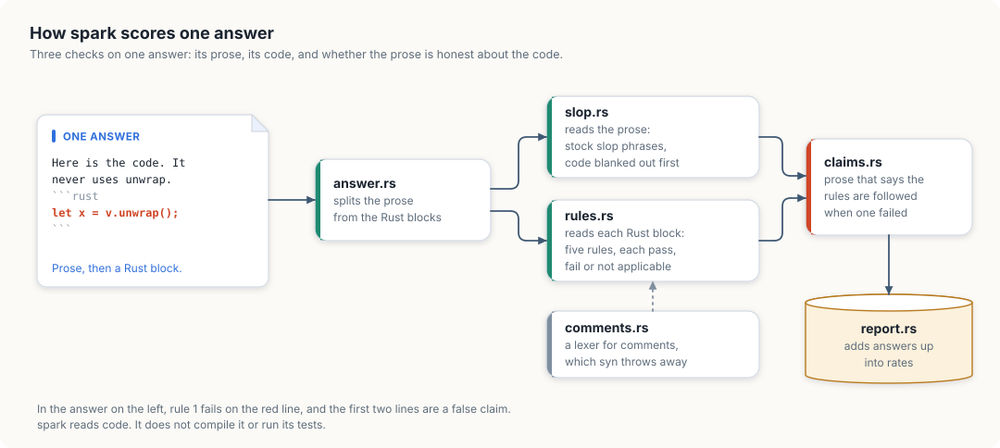

# The checker: spark

`spark` scores an answer on three things.

**The five Rust rules**

1. No `unwrap()` or `expect()`, not even in tests.
2. Errors are a hand-written enum implementing `Display` and `std::error::Error`.
3. Every `pub` item has a `///` doc comment.
4. No comments inside function bodies.
5. No index loops like `for i in 0..n`.

A rule only counts where it applies: code that handles no errors is "not
applicable" for rule 2, not a pass.

**Slop phrases** in the prose, from the slop taxonomy: filler openers, fake
importance, hedging, wrap-ups, rhythm tricks. Code is ignored.

**False claims**: prose that says the rules are followed while the code breaks
them.

```bash
spark rs crates                                   # check Rust files
spark text answer.md                              # slop in a text file
spark score RUN.jsonl --field text                # score a file of model answers
```

## How an answer is scored

<figure>

<figcaption>One answer through <code>spark</code>: three checks, then one line in the report.</figcaption>
</figure>

An answer is prose with Rust blocks in it. `answer.rs` separates the two, and
each goes to its own check.

**The prose goes to `slop.rs`.** Code is blanked out first, fenced blocks and
inline spans both, so a phrase inside code never counts. Blanking replaces
characters without removing them, which keeps every position where it was: a
hit's start and end point into the original text, and the review page can
mark the exact words. What it finds are stock phrases, grouped by the
categories of the slop taxonomy. The taxonomy's own test is "if you can delete
the sentence and lose no information, it is slop", and a phrase list cannot
apply that test. So a clean score means none of the known phrases were found.
It does not mean the answer has no slop.

**Each Rust block goes to `rules.rs`.** Every rule gives one of three
verdicts: pass, fail, or not applicable. The third is what keeps the rates
honest. A ten-line snippet that handles no errors cannot break rule 2, and
counting it as a pass would let short answers inflate the score, while
counting it as a failure would fail every snippet. It is left out of that
rule's rate instead.

Model answers are often fragments, not whole files. Code that does not parse
as a file is tried again as the body of a function, and then as the body of an
`impl`. Rule 4, no comments inside function bodies, is judged only on code
that parses as a whole file: in a one-line teaching snippet a trailing comment
is an annotation, not a comment in a body.

`syn`, the parser `rules.rs` uses, discards ordinary comments, so rule 4 has
its own pass in `comments.rs`. That pass is a small lexer. It knows string,
raw string and character literals well enough that the `//` in
`"http://example.com"` is not mistaken for a comment.

**Then the two are compared, in `claims.rs`.** The baseline models said they
followed the rules in most answers ("The design strictly adheres to the
following constraints") while breaking them. A claim is a sentence of prose
matching one of a set of patterns. It is false when the rule it names failed.
A claim that names no rule is false when any rule failed.

`report.rs` adds the per-answer results up into the rates in the table below.

## Baseline

| Model | All 5 rules | No unwrap | No body comments | False claim |
|---|---|---|---|---|
| Qwen3.5-9B (llama.cpp Q4) | 0% | 14% | 0% | 41% |
| Qwen2.5-Coder-7B (TensorRT-LLM INT4) | 4% | 21% | 8% | 33% |

**Not checked yet:** whether the code compiles or its tests pass.
