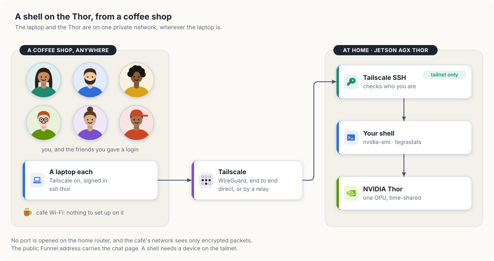
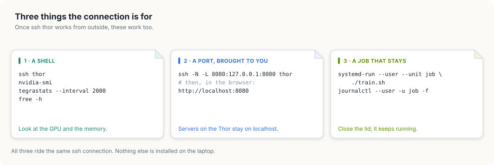
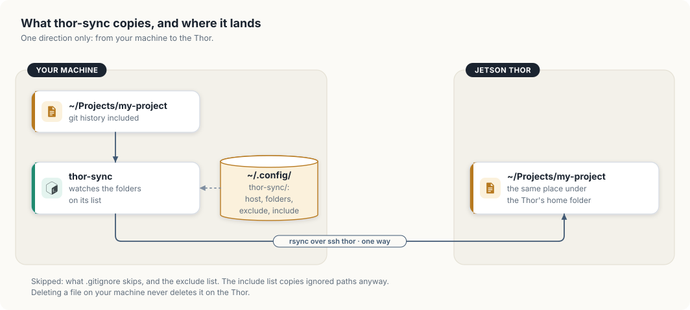

# Access and syncing

## SSH without typing the IP

On your machine, once:

```bash
ssh-keygen -t ed25519 -N "" -f ~/.ssh/id_ed25519     # skip if you have a key
ssh-copy-id <user>@<thor-ip>                         # asks for the password once
cat >> ~/.ssh/config <<'EOF'

Host thor
    HostName <thor-ip>
    User <user>
    IdentityFile ~/.ssh/id_ed25519
    ControlMaster auto
    ControlPath ~/.ssh/cm-%r@%h:%p
    ControlPersist 10m
EOF
```

Then `ssh thor`, `scp file thor:`, or `ssh thor 'command'`.

## From a coffee shop

`ssh thor` above uses the Thor's address on the home network, so it only works
at home. To reach the Thor from anywhere, put the laptop on the same Tailscale
network (the tailnet) as the Thor. The two then talk over an encrypted
WireGuard tunnel, and no port is opened on the home router.

<figure>

<figcaption>The way from a café table to the GPU.</figcaption>
</figure>

### Set it up once

On the laptop, install Tailscale and sign in with the account the Thor is on:

```bash
curl -fsSL https://tailscale.com/install.sh | sh     # Linux; macOS and Windows have an app
sudo tailscale up
tailscale status                                     # the Thor is listed as arpanpathak
```

The Thor already runs Tailscale SSH (`tailscale set --ssh`), so it accepts a
login from a device on the tailnet without a key file. The tailnet's access
rules decide who may log in as whom. The default lets you into your own
devices, and may ask you to confirm in a browser first. Inside the tailnet the
Thor is `arpanpathak`, at `100.84.254.65`.

Point the `thor` alias at that name and it works at home and away:

```bash
cat >> ~/.ssh/config <<'EOF'

Host thor
    HostName arpanpathak
    User <user>
    ControlMaster auto
    ControlPath ~/.ssh/cm-%r@%h:%p
    ControlPersist 10m
EOF
```

Check it before you leave the house:

```bash
ssh thor hostname          # prints the Thor's name
tailscale ping arpanpathak # says "via <address>" (direct) or "via DERP" (a relay)
```

A relay is what you get on a café network that blocks direct connections. It
is slower to type on and still encrypted from end to end.

### What the public address does not do

| Way in | Who can use it | What it reaches |
|---|---|---|
| `https://arpanpathak.taildb9a39.ts.net` (Funnel) | anyone with a key | the chat page and its API, nothing else |
| `ssh thor` over the tailnet | your devices, and logins you gave to friends | a shell, and through it the GPU |

Funnel forwards HTTPS to one port. It does not carry `ssh`. A friend who wants
a shell needs their own login and their device shared into the tailnet; that is
[Sharing is caring](ch27-sharing-is-caring.md).

### Using the GPU once you are in

<figure>

<figcaption>A shell, a forwarded port, and a job that outlives the connection.</figcaption>
</figure>

**Look at it.** `nvidia-smi` shows how busy the GPU is and which processes
hold it. Its memory column reads `N/A` on the Thor, because the GPU shares the
board's 128 GB with the CPU. Read memory with `free -h` or `tegrastats`.

```bash
nvidia-smi
tegrastats --interval 2000     # one line every 2 s: RAM, GPU load, temperatures, power
free -h
```

**Bring a port to the laptop.** The model servers listen on the Thor's
`127.0.0.1` only. Forward one and it opens in the laptop's browser:

```bash
ssh -N -L 8080:127.0.0.1:8080 thor     # then open http://localhost:8080
```

**Start a job that stays.** A program started in the shell dies when the
connection drops. Hand it to systemd and it keeps running after the lid closes:

```bash
ssh thor
systemd-run --user --unit job ./train.sh
journalctl --user -u job -f            # follow it now, or tomorrow
systemctl --user stop job              # stop it
```

`tmux` is not installed on the Thor; `systemd-run` does the same job here and
also survives a logout.

The GPU is shared with the live chat. Look at `nvidia-smi` before starting
something heavy, or the chat slows down for everyone using it.

## thor-sync

Keeps folders on your machine copied to the Thor. One way: your machine to
the Thor.

```bash
thor-sync host thor      # once: which device
cd ~/Projects/my-project
thor-sync add            # add this folder and sync it
thor-sync on             # keep syncing in the background, also after reboot
```

<figure>

<figcaption>What <code>thor-sync</code> copies, and where it lands.</figcaption>
</figure>

`thor-sync` is one bash script around `rsync`, run over the `ssh thor` alias
above. Three choices in it are worth knowing before you rely on it.

- **It copies one way.** Your machine is the source and the Thor is the copy.
  That is why a commit made on the Thor is lost: the next sync replaces the
  Thor's `.git` with yours.
- **It never deletes.** `rsync` is run without `--delete`, so a file you remove
  locally stays on the Thor until you remove it there. A renamed file exists
  under both names on the Thor.
- **It follows `.gitignore`.** Build output and model files are not copied.
  Something ignored that the Thor does need, such as `data/`, goes in the
  include list.

| Command | Does |
|---|---|
| `thor-sync` | sync everything on the list |
| `thor-sync ls` / `rm` | show the list / remove the current folder |
| `thor-sync off` / `log` | stop background sync / follow it |

- Folders land at the same place under the Thor's home folder.
- Git history is copied, so `git` works there. Commit on your machine; a
  commit made on the Thor is overwritten by the next sync.
- Skipped: whatever `.gitignore` skips, plus `~/.config/thor-sync/exclude`
  (build output, model files). `~/.config/thor-sync/include` copies ignored
  paths anyway, e.g. `/data/***`.
- Deleting a file locally never deletes it on the Thor.
