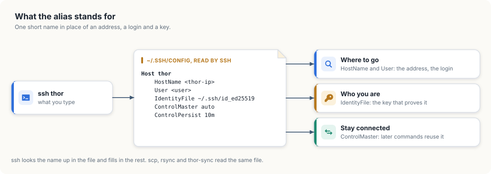
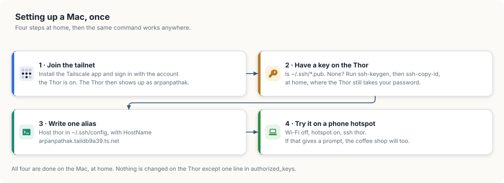
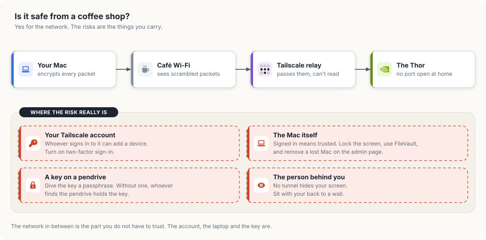

# Access and syncing

This is the first chapter about the Jetson Thor itself. The Thor has no
keyboard and no screen attached, so every later chapter assumes you can open a
terminal on it from another machine and that your project files are already
there. This chapter sets up both. By the end, one command opens a shell on the
Thor from home or from anywhere else, and a file you save on your own machine
appears on the Thor two seconds later.

<div class="covers">

This chapter covers

- SSH keys, and an alias that replaces the address, the login and the password
- reaching the Thor from outside the house over Tailscale
- what a public network can and cannot see of that connection
- using the GPU over SSH: looking at it, forwarding a port, leaving a job running
- `thor-sync`, which keeps folders on your machine copied to the Thor

</div>

Three terms come up throughout. **SSH** is a program that opens an encrypted
terminal session on another machine. A **key** is a pair of files that proves
who you are to that machine, in place of a password. A **tailnet** is the
private network that Tailscale builds between your own devices, wherever they
are. Each is explained in the section that first uses it.

## SSH without typing the IP

SSH connects a terminal on your machine to a shell on another one. You run
`ssh` with a login and an address, and the commands you type from then on run
on the other machine. Everything that passes between the two is encrypted.

Without any setup, connecting to the Thor looks like this:

```bash
ssh <user>@<thor-ip>
<user>@<thor-ip>'s password:
```

That asks you to remember three things: the login, the address and the
password. This section replaces all three with the single word `thor`. It
takes three steps, and you do each one once.

### A key in place of the password

An SSH key is a pair of files made together. The **private key** stays on your
machine. The **public key** can be copied to any machine you want to log in
to. When you connect, the other machine uses the public key to check that you
hold the private one. The private key itself is never sent.

Look in `~/.ssh` to see whether you already have a pair:

```bash
ls -l ~/.ssh
-rw------- 1 you you  411 id_ed25519
-rw-r--r-- 1 you you   97 id_ed25519.pub
```

The file ending in `.pub` is the public key, and the one without an ending is
the private key. If both are there, you can skip to the next heading.
Otherwise, make a pair:

```bash
ssh-keygen -t ed25519
```

`ssh-keygen` asks two questions. The first is where to save the key; pressing
Enter accepts `~/.ssh/id_ed25519`, the place `ssh` looks by default. The
second is a passphrase, which encrypts the private key file on disk. With a
passphrase, a copy of the file is useless to anyone who does not know it. I
recommend one on any laptop that leaves the house. macOS and most Linux
desktops remember it in their keychain after the first use.

### The public key, on the Thor

The Thor has to hold your public key before it can check it. The command
`ssh-copy-id` puts it there, and it needs the Thor's address to do so. Running
`hostname -I` on the Thor prints the address, and your router's list of
connected devices shows it as well. On a home network it usually begins with
`192.168.`.

```bash
ssh-copy-id <user>@<thor-ip>
```

`ssh-copy-id` logs in with the Thor's password, for the last time, and adds
your public key as one line to the file `~/.ssh/authorized_keys` on the Thor.
That file is the list of keys the Thor accepts for your login. From now on the
Thor lets you in without a password, because you hold the private half of a
key on that list.

NOTE: The first time you connect to a machine, `ssh` prints that machine's
fingerprint and asks `Are you sure you want to continue connecting?`. Answer
`yes`. `ssh` stores the fingerprint in `~/.ssh/known_hosts` and compares it on
every later connection, so it can warn you if a different machine answers at
the same address.

### A name in place of the address

`ssh` reads the file `~/.ssh/config` each time it runs. An entry in that file
gives a group of settings a name. The entry below names the Thor's settings
`thor`:

```bash
cat >> ~/.ssh/config <<'EOF'

Host thor
    HostName <thor-ip>
    User <user>
    IdentityFile ~/.ssh/id_ed25519
    ControlMaster auto
    ControlPath ~/.ssh/cm-%r@%h:%p
    ControlPersist 10m
EOF
```

<figure>

<figcaption><b>Figure 7.1</b> What <code>ssh</code> fills in when you type the name.</figcaption>
</figure>

When you type `ssh thor`, `ssh` finds the entry and uses its settings as if
you had typed them. Table 7.1 lists what each line supplies.

| Line | What it supplies |
|---|---|
| `Host thor` | the name you type; any word will do |
| `HostName` | the address to connect to |
| `User` | the login on the Thor, so you do not type `user@` |
| `IdentityFile` | the private key to prove yourself with |
| `ControlMaster auto` | share one connection between commands |
| `ControlPath` | where the file that represents the shared connection is kept |
| `ControlPersist 10m` | keep the shared connection open for 10 minutes after its last use |

The last three lines make repeated commands faster. Opening an SSH connection
takes several network round trips while the two machines agree on encryption
and check your key. With these lines, the first `ssh thor` opens the
connection, and later commands reuse it for the next 10 minutes. `thor-sync`,
later in this chapter, runs a command on the Thor every 2 seconds and relies
on this.

The name now works everywhere SSH is used:

```bash
ssh thor                     # a shell on the Thor; exit or Ctrl+D ends it
ssh thor 'hostname'          # run one command there and return
scp notes.txt thor:          # copy a file to your home folder on the Thor
scp thor:results.json .      # copy a file back
```

`scp`, `rsync` and `git` read the same configuration file, so each of them
accepts `thor` as a machine name.

### If the connection fails

`ssh` reports why it could not connect, and each message points to a different
cause. Table 7.2 lists the ones you are likely to meet.

| Message | Cause | Remedy |
|---|---|---|
| a password prompt | the Thor does not hold your public key, or `ssh` offered a different key | run `ssh-copy-id` again, and check the path after `IdentityFile` |
| `Permission denied (publickey)` | the same, on a Thor set to refuse passwords | add the key from a machine that can still log in |
| `Connection timed out` | no machine answered at that address | check that the Thor is on and that you are on the same network; its address may have changed |
| `Connection refused` | a machine answered, but no SSH server runs on it | the address belongs to a different device |
| `REMOTE HOST IDENTIFICATION HAS CHANGED` | the machine at that address is not the one `ssh` remembers | after reinstalling the Thor, run `ssh-keygen -R <thor-ip>` and connect again; in any other case, find out what answered before going on |
| `Bad owner or permissions on ~/.ssh/config` | other users can write to the file | `chmod 600 ~/.ssh/config` |

A home router assigns addresses to devices and may give the Thor a different
one after a restart. When that happens, `ssh thor` times out although nothing
is wrong with the Thor. There are two remedies. You can reserve the Thor's
address in the router's settings, so it never changes. Or you can use the
Thor's Tailscale name as the `HostName`, which stays the same on any network.
The next section sets up Tailscale.

## Reaching the Thor from outside the house

The address in the alias belongs to your home network. A machine on another
network, such as a café's, cannot reach it, because the home router does not
pass incoming connections to the devices behind it. The usual workaround is to
open a port on the router, which exposes the Thor's SSH server to the whole
internet. Tailscale avoids that.

Tailscale connects your devices into a private network called a **tailnet**.
Each device in the tailnet gets a name and an address that only the other
devices in it can reach. Traffic between two devices travels in a WireGuard
tunnel: it is encrypted on one device and decrypted on the other. Both devices
connect outward to find each other, so no port is opened on either router.

<figure>

<figcaption><b>Figure 7.2</b> The path from a laptop in a café to the GPU at home.</figcaption>
</figure>

Figure 7.2 shows the path. The laptop runs Tailscale and is signed in to the
tailnet. Tailscale carries the SSH connection to the Thor. On the Thor,
Tailscale SSH identifies the person connecting and starts a shell for them.
From that shell, the GPU is available as it would be at a keyboard plugged
into the Thor.

### Setting up a Mac

The setup has four steps, shown in figure 7.3. I suggest doing them at home.
The Mac can already reach the Thor there, so if a step fails you can still
log in the earlier way and correct it.

<figure>

<figcaption><b>Figure 7.3</b> The four steps on the Mac.</figcaption>
</figure>

**Step 1: join the tailnet.** Install Tailscale from the Mac App Store, or
with `brew install --cask tailscale`, and open it. Choose **Log in** and sign
in with the account the Thor is signed in to. Signing in is what adds the Mac
to the tailnet; there is no separate registration. The Tailscale menu in the
menu bar then lists the Thor as `arpanpathak`. If the Thor is missing from the
list, the Mac is signed in to a different account.

**Step 2: put a key on the Thor.** This repeats the first two steps of the
previous section on the Mac. A Mac that already logs in to the Thor at home
without a password has a key there, and you can move on to step 3.

```bash
ls ~/.ssh/*.pub                            # lists a public key if you have one
ssh-keygen -t ed25519                      # makes a pair; set a passphrase
ssh-copy-id <user>@<thor-ip>               # asks for the Thor's password once
```

The Mac reaches the Thor directly on the home network, so the key does not
have to be carried to it on a USB stick. A private key is safest when it is
made on the machine that uses it and never leaves that machine.

**Step 3: point the alias at the tailnet name.** Inside the tailnet, the
Thor's full name is `arpanpathak.taildb9a39.ts.net`. That name resolves on any
network the Mac is on, home included.

```bash
cat >> ~/.ssh/config <<'EOF'

Host thor
    HostName arpanpathak.taildb9a39.ts.net
    User <user>
EOF
```

If `~/.ssh/config` already has a `Host thor` entry from the previous section,
change its `HostName` line instead of adding a second entry. For each
setting, `ssh` keeps the first value it finds, so a second entry would not
replace the address in the first.

**Step 4: test from another network.** A phone hotspot is a different network
from your home Wi-Fi, which makes it a good stand-in for a café. Turn the
Mac's Wi-Fi off, join the hotspot, and connect:

```bash
ssh thor hostname
arpanpathak
```

The first connection by the new name prints the Thor's fingerprint and asks
you to accept it, as in the previous section. Tailscale may also open a
browser page that asks you to confirm the login. After you approve it there,
the terminal continues.

### Two ways in, and what each one checks

The Thor accepts SSH connections in two ways, and they identify you
differently. Table 7.3 compares them.

| You connect to | Checked by | Using |
|---|---|---|
| the Thor's home address, `192.168.…` | the Thor's own SSH server | your SSH key |
| the Thor's tailnet name, or `100.84.254.65` | Tailscale SSH | your Tailscale sign-in |

The Thor runs Tailscale SSH, which was turned on with `tailscale set --ssh`.
For a connection that arrives over the tailnet, Tailscale already knows which
device it comes from and who is signed in on that device. The tailnet's access
rules then decide whether that person may log in, and as which user. The
default rules let you log in to your own devices. Your SSH key is therefore
what admits you on the home network, and your Tailscale account is what admits
you from outside.

On Linux, the same setup uses the command-line client:

```bash
curl -fsSL https://tailscale.com/install.sh | sh
sudo tailscale up
tailscale status                     # lists the Thor as arpanpathak
tailscale ping arpanpathak           # reports the route taken
```

`tailscale ping` reports the route between the two devices. `via` followed by
an address means they reach each other directly. `via DERP` means the traffic
passes through one of Tailscale's relay servers, which happens on networks
that block direct connections, as cafés and hotels often do. A relayed session
responds a little more slowly. It is encrypted between your laptop and the
Thor in both cases, and the relay cannot read it.

### What a public network can see

A café's Wi-Fi is run by someone you do not know and shared with strangers, so
it is reasonable to ask what they can see. Figure 7.4 answers in two parts:
what the network sees, and what remains at risk.

<figure>

<figcaption><b>Figure 7.4</b> What the network sees, and what remains at risk.</figcaption>
</figure>

The network sees encrypted packets and nothing else. WireGuard encrypts each
packet on the Mac and decrypts it on the Thor. The café's router, other people
on its Wi-Fi, and a Tailscale relay all handle packets they cannot read. They
can tell that the Mac is using Tailscale, but not which commands you type or
what the Thor answers.

Nothing at home is exposed either. No port is open on the home router, so a
scan of your home address from the internet finds no SSH server. The Thor's
SSH server answers only on the home network and on the tailnet.

The remaining risks are in what you carry, and table 7.4 lists them with a
precaution for each.

| Risk | Precaution |
|---|---|
| someone signs in to your Tailscale account | turn on two-factor sign-in for the account you use with Tailscale |
| the Mac is lost, or left unlocked | set a login password, turn on FileVault, lock the screen; a lost Mac can be removed on the Tailscale admin page, which ends its access at once |
| a private key on a USB stick is found | protect the key with a passphrase, or do not carry it |
| someone reads the screen over your shoulder | encryption does not help here; choose where you sit |

### What the public address is for

The Thor also has a public address, and it is natural to expect `ssh` to work
there too. It does not. The public address is provided by Tailscale Funnel,
which forwards HTTPS requests from the internet to one port on the Thor: the
port the chat page listens on. Funnel carries web traffic and no other kind.
Table 7.5 sets the two ways in side by side.

| Way in | Open to | Reaches |
|---|---|---|
| `https://arpanpathak.taildb9a39.ts.net` (Funnel) | anyone who holds an access key | the chat page and its API |
| `ssh thor` over the tailnet | your devices, and logins you have given to friends | a shell, and through it the GPU |

A friend who wants a shell needs a login of their own on the Thor and their
device shared into the tailnet. Chapter
[Sharing is caring](ch27-sharing-is-caring.md) describes that arrangement.

## Using the GPU over SSH

An SSH connection to the Thor does three jobs, shown in figure 7.5. It gives
you a shell, it can carry a network port from the Thor to your laptop, and it
can start a program that keeps running after you disconnect.

<figure>

<figcaption><b>Figure 7.5</b> A shell, a forwarded port, and a job that outlives the connection.</figcaption>
</figure>

### Seeing what the GPU is doing

`nvidia-smi` reports how busy the GPU is and which processes are using it.
This is its output on the Thor while both chat models are loaded, shortened to
the lines that carry information:

```text
| GPU  Name                 Persistence-M | Bus-Id          Disp.A | Volatile Uncorr. ECC |
| Fan  Temp   Perf          Pwr:Usage/Cap |           Memory-Usage | GPU-Util  Compute M. |
|   0  NVIDIA Thor                    Off |   00000000:01:00.0 Off |                  N/A |
| N/A   35C  N/A               2W /  N/A  | Not Supported          |      0%      Default |

|  GPU   GI   CI              PID   Type   Process name                        GPU Memory |
|    0   N/A  N/A          180041      C   ...hare/edge-llm/venv/bin/python      24286MiB |
|    0   N/A  N/A          180072      C   ...hare/edge-llm/venv/bin/python      39286MiB |
```

`GPU-Util` is the share of the last second in which the GPU was working; 0%
here means nobody was chatting at that moment. The process list shows what
each program holds: about 24 GiB for one model and 39 GiB for the other.

`Memory-Usage` reads `Not Supported`, and that is expected on this board. A
desktop graphics card has memory of its own, and `nvidia-smi` reports how full
it is. The Thor's GPU has none. It shares the board's 128 GB with the CPU, so
there is no separate total to report. `free -h` shows the shared memory:

```text
               total        used        free      shared  buff/cache   available
Mem:           122Gi        68Gi        13Gi        61Mi        12Gi        54Gi
```

`available` is the figure to read before starting something large. It is the
memory a new program can use, 54 GiB in this example.

`tegrastats` prints one line of readings at an interval you choose. It is
NVIDIA's monitor for Jetson boards and reports memory, the load on each of the
14 CPU cores, temperatures and power draw together:

```bash
tegrastats --interval 2000
```

```text
RAM 99570/125749MB ... CPU [1%@972,5%@972,...] cpu@33.5C ... gpu@35.6C
```

### Bringing a port to your laptop

The model servers on the Thor listen on `127.0.0.1`. That address means "this
machine only", so a browser on your laptop cannot reach them. SSH can forward
such a port to the laptop:

```bash
ssh -N -L 8080:127.0.0.1:8080 thor
```

The option `-L 8080:127.0.0.1:8080` reads, from left to right: port 8080 on my
laptop leads to `127.0.0.1` port 8080 as seen from the Thor. `-N` asks for the
forwarding alone, without a shell. While the command runs, opening
`http://localhost:8080` on the laptop shows the page served on the Thor.
Ctrl+C ends the forwarding.

### Leaving a job running

A program started from a shell belongs to that shell. When the SSH connection
ends, because the laptop sleeps or the Wi-Fi drops, the shell ends and takes
the program with it. A training run that needs hours would be lost at the
first interruption.

`systemd-run` starts the program as a service instead. A service belongs to
the Thor's service manager, not to your shell, so it continues after you
disconnect:

```bash
systemd-run --user --unit job ./train.sh     # start it; "job" is a name you choose
journalctl --user -u job -f                  # read its output, now or tomorrow
systemctl --user stop job                    # stop it
```

The name after `--unit` identifies the job in the later commands. Many guides
use `tmux` for this purpose. `tmux` is not installed on the Thor, and
`systemd-run` covers the same need.

WARNING: The GPU is shared with the live chat. A heavy job slows the chat for
everyone using it. Check `nvidia-smi` and `free -h` before starting one.

## Keeping your files on the Thor: thor-sync

Code for this project is written on one machine and run on another. You edit
on your own machine, where your editor and settings are, and the code runs on
the Thor, where the GPU is. Each change therefore has to be copied across
before it can run. Copying by hand is easy to forget, and running a stale copy
produces confusing results.

`thor-sync` does the copying. It keeps a list of folders, and it copies each
one from your machine to the Thor whenever its contents change. It copies in
one direction only: from your machine to the Thor.

### Setting it up

```bash
thor-sync host thor      # which device to copy to: the alias from this chapter
cd ~/Projects/my-project
thor-sync add            # put this folder on the list and copy it now
thor-sync on             # keep copying in the background, also after a reboot
```

`thor-sync host` records the device once. `thor-sync add` adds the current
folder to the list and copies it immediately. `thor-sync on` starts a
background service that checks every folder on the list every 2 seconds and
copies what has changed. The service starts again by itself after a reboot.

You can confirm that it works with a test file:

```bash
echo hello > ~/Projects/my-project/sync-test.txt
ssh thor 'cat ~/Projects/my-project/sync-test.txt'
hello
```

<figure>

<figcaption><b>Figure 7.6</b> What <code>thor-sync</code> copies, and where it lands.</figcaption>
</figure>

A folder arrives at the same path under the Thor's home folder. The folder
`~/Projects/my-project` on your machine becomes `~/Projects/my-project` on the
Thor, so a path you know on one machine is valid on the other.

### How it decides what to copy

`thor-sync` is a short bash script. It runs `rsync`, a standard tool for
copying only the files that differ, over the `ssh thor` alias. Three of its
rules affect how you work, and each has one consequence that is easy to
overlook.

**It copies in one direction.** Your machine holds the original and the Thor
holds a copy. The Git history is copied along with the files, so `git log`
and `git status` work on the Thor. The consequence is that a commit made on
the Thor does not last: the next sync replaces the Thor's history with yours,
which does not contain it. Make commits on your own machine. If you edit a
file on the Thor and want to keep the change, copy it back with `scp` first.

**It never deletes on the Thor.** `rsync` is run without its `--delete`
option, so removing a file on your machine leaves the Thor's copy in place.
This protects files that exist only on the Thor, such as results written by a
job. The consequence is that a renamed file exists under both names on the
Thor. In a Rust project this can stop a build. Moving `teacher.rs` to
`teacher/mod.rs` leaves both on the Thor, and the compiler refuses a module
defined twice. When a build passes on your machine and fails on the Thor, look
for a file that no longer exists locally and remove it there:

```bash
ssh thor 'rm ~/Projects/my-project/src/teacher.rs'
```

**It skips what Git ignores.** Files matched by the folder's `.gitignore` are
not copied. That leaves out build output, virtual environments and model
files, and keeps each sync short. Two files in `~/.config/thor-sync/` adjust
the rule, as table 7.6 shows.

| File | Effect | Example line |
|---|---|---|
| `exclude` | skips more than `.gitignore` does | `target/` |
| `include` | copies a path although it is ignored | `/data/***` |

The consequence concerns how patterns match. A pattern without a leading
slash, such as `corpus/`, matches a folder of that name at any depth. It was
written to skip a large data folder at the top of the project, and it also
skips a source folder named `src/sources/corpus/`. `thor-sync` reports
nothing when it skips a folder. If a file does not arrive, read both lists:

```bash
cat ~/.config/thor-sync/exclude ~/.config/thor-sync/include
```

WARNING: A saved file reaches the Thor within about 2 seconds. If a service on
the Thor runs a script from a synced folder, its next restart runs the version
you saved last, whether or not it was finished. Keep unfinished changes to
such scripts in a folder that is not synced.

### Commands

| Command | Effect |
|---|---|
| `thor-sync` | copy every folder on the list once, now |
| `thor-sync add [DIR]` | add a folder, the current one by default, and copy it |
| `thor-sync ls` | print the list |
| `thor-sync rm [DIR]` | take a folder off the list; its copy on the Thor stays |
| `thor-sync on` / `thor-sync off` | start or stop the background service |
| `thor-sync log` | follow what the background service is doing |
| `thor-sync host [NAME]` | print or set the device: an SSH alias, `user@ip`, or a Tailscale name |

### If a file does not arrive

| Symptom | Cause | Remedy |
|---|---|---|
| nothing is copied | the background service is off, or the Thor cannot be reached | run `thor-sync log`, then `ssh thor` to test the connection |
| one file or folder is missing | `.gitignore` or the `exclude` list skips it | read both; add the path to `include` if the Thor needs it |
| an old file is still on the Thor | it was deleted or renamed on your machine | remove it on the Thor |
| an edit made on the Thor is gone | a sync replaced the file | edit on your machine |
| copying stops away from home | the device is set to a home address | run `thor-sync host` with the Thor's Tailscale name |

## Summary

- An SSH key replaces the password. The private key stays on your machine,
  and the public key is listed in `~/.ssh/authorized_keys` on the Thor.
- An entry in `~/.ssh/config` replaces the login and the address with the
  name `thor`, which `ssh`, `scp`, `rsync` and `git` all accept.
- Tailscale puts your devices in one private network. With the alias pointed
  at the Thor's tailnet name, `ssh thor` works from any network, and no port
  is opened at home.
- A public network sees encrypted packets only. The risks that remain are the
  Tailscale account, the laptop, and any private key you carry.
- Over SSH you can read the GPU's state, forward a port to your laptop, and
  start a job with `systemd-run` that continues after you disconnect.
- `thor-sync` copies folders to the Thor in one direction, never deletes
  there, and skips what Git ignores.

The next chapter, [Model serving](ch21-model-serving.md), describes the
services that run the models on the Thor.
