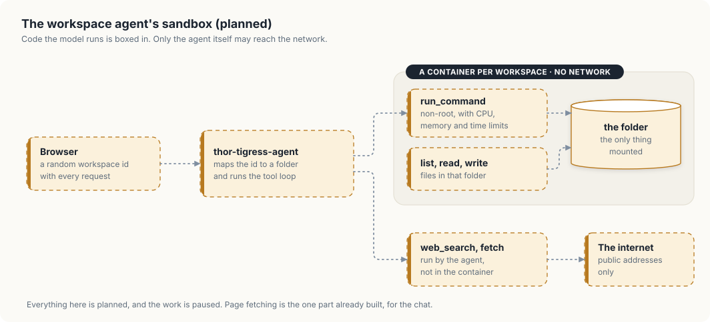

# Workspace agent (planned, paused)

The web chat can search the web today (chapter "Web chat: Thor Tigress Cub"). The next step was a
workspace: each user gets a folder on the Thor, and Nemotron works in it as an
agent, reading and writing files and running commands such as `cargo build`,
from the browser instead of a terminal IDE. It is paused; this chapter records
what was decided so it can resume without starting over.

## Decided

| Question | Decision |
|---|---|
| Who can use it | anyone with the shared chat key (no personal keys for now) |
| Keeping users apart | each browser creates a random workspace id and sends it with every request; the server maps it to a folder |
| Storage | one shared directory on the Thor, a subfolder per workspace, no reserved space; cleared by hand when needed (1 TB disk) |
| Server | `thor-tigress-agent`, which already fronts the chat |
| Web search | SearXNG on the Thor (built) |

## Design

| Part | Plan |
|---|---|
| Tools | `list_files`, `read_file`, `write_file`, `run_command`, `web_search`, `fetch_page_content_recursive` |
| Commands | run in a container per workspace, as a non-root user, with only that workspace mounted, CPU, memory, process and time limits, and **no network** |
| Page fetching | done by the agent, not the container; refuses private, loopback, link-local, Tailscale (100.64.0.0/10) and other local addresses, so no one can reach the home network through it |
| Page | a file panel beside the chat; tool calls shown as they run |

<figure>

<figcaption>The planned sandbox: where each tool runs, and what it can reach.</figcaption>
</figure>

The design separates two kinds of risk. Code the model writes and runs could
do anything a program can, so it gets a container with no network and one
folder. Fetching a page needs the network, so it is done by the agent itself,
which runs code we wrote and checks every address first. Neither side holds
both powers: nothing in the container can reach the home network, and nothing
that reaches the network runs the model's code.

## Before it can run on the Thor

- Docker needs sudo for the `arpanpathak` user. Options: rootless Docker or
  Podman (no sudo for daily use), or one-time sudo to set up a service that
  starts containers. Adding the user to the `docker` group is ruled out: it
  gives root to anything running as that user.
- `fetch_page_content_recursive` comes first, on its own: it improves search
  answers (the model otherwise sees snippets only) and has no sandbox to build.
  It is built and tested in `thor-tigress-agent` for the chat; its design and
  safety rules are in chapter "Tool calling".

## Not decided

- Container runtime: rootless Docker, Podman or gVisor.
- Command time limit and memory limit per workspace.
- How long idle workspaces are kept.
