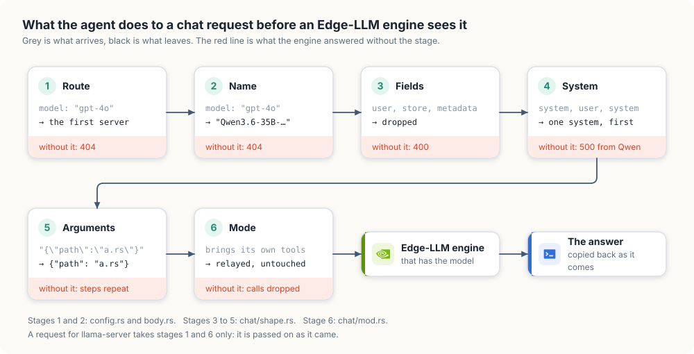
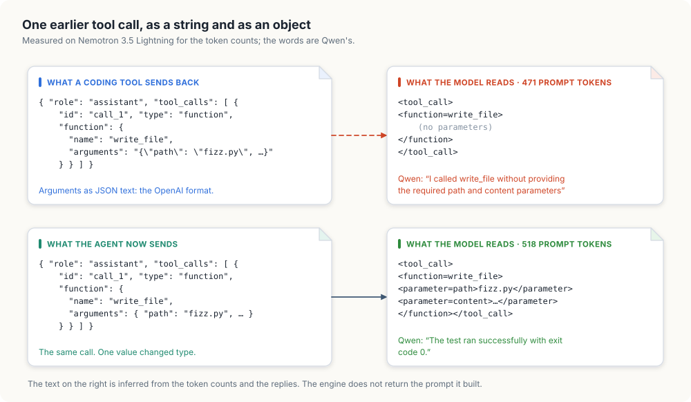
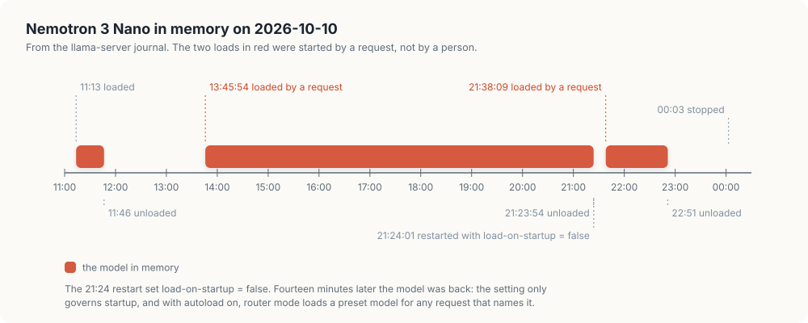

# Coding tools on TensorRT Edge-LLM

A coding tool such as openbatrangs, OpenCode or Claude Code runs a loop: it
sends the conversation and a list of tools, the model asks for a tool, the tool
runs on the user's machine, and the result goes back with the whole history.
On the Thor that loop kept failing. The model repeated steps it had already
done, some requests were refused outright, and a model nobody had asked for
kept returning to memory.

This chapter is the record of what was wrong, how each cause was measured, and
what `thor-tigress-agent` and `thor-tigress-serve` do about it now.

Status, 2026-10-11: built, tested, and running on the Thor. Both served models
finish a small coding task through openbatrangs over the Tailscale address.
The numbers are in "Measured" below.

<div class="covers">

This chapter covers

- which server answers a request now, and how that was decided before
- the six things the agent does to a chat request before an Edge-LLM engine
  sees it
- why a model stopped seeing the arguments of its own tool calls
- why Nemotron 3 Nano kept loading itself
- the three changes to `thor-tigress-serve`, and the wrong turn before them
- the three faults on the client's side, in openbatrangs
- the measurements, how to repeat them, and what is still not done

</div>

## What was wrong

| What the user saw | Cause | Where |
|---|---|---|
| The model redoes a step it just did, or loops until the step limit | Its earlier tool calls reach it with no arguments | engine's chat template |
| `400 Extra inputs are not permitted` | A request field the engine does not know | engine's request schema |
| `500 Failed to handle generation request` from Qwen | A second system message, or one that is not first | Qwen's chat template |
| `404 model '…' is not served by this process` | The tool sends its own model name | engine |
| 35 GB of memory taken by a model that was unloaded | llama-server's router loads a model when a request names it | llama-server |
| `openbatrangs --thor` cannot connect | It pointed at the llama-server port | openbatrangs |
| The model is cut off or forgets early steps | The context window was read as 8,192 tokens | openbatrangs |
| `absolute paths are not allowed` on a path inside the workspace | The path check refused every absolute path | openbatrangs |

The first row cost the most. It produced no error anywhere: every request
returned 200, every tool call parsed, and the model still could not finish.

## What serves a request

<figure>

<figcaption><b>Figure 28.1</b> The servers behind <code>thor-tigress-agent</code>, before and after.</figcaption>
</figure>

The Thor has two kinds of model server, and the agent knows which is which.

| Kind | Started as | Answers for | Called with |
|---|---|---|---|
| TensorRT Edge-LLM engine | `--engine MODEL=HOST:PORT`, one per model | that one model name | no key; it listens on localhost only |
| llama-server in router mode | `--model HOST:PORT` | the ids and aliases of the models it has loaded | the access key |

On 2026-10-11 the Thor runs these:

| Unit | Serves | Port | Context window | Longest prompt |
|---|---|---|---|---|
| `thor-edge-llm` | `Qwen3.6-35B-A3B-NVFP4` | 8081 | 65,536 | 32,768 |
| `thor-edge-llm-nvidia-nemotron-3-5-lightning-30b-a3b-nvfp4` | `NVIDIA-Nemotron-3.5-Lightning-30B-A3B-NVFP4` | 8082 | 1,048,576 | 131,072 |
| `thor-tigress-agent` | the page and the API | 8080 | | |
| `thor-chat` | llama-server; installed, not running | 8079 | | |

Before, the agent had one rule: a request naming an engine's model went to that
engine, and every other request went to llama-server. Two faults came from that
rule. A name llama-server knew loaded a model, wanted or not. And when the
default was pointed at an engine instead, with `AGENT_DEFAULT=edge`, the agent
still treated that engine as llama-server: it sent it llama-server's fields and
the tool's own model name.

Now a server is one of two kinds in the code, and nothing treats one as the
other:

```rust
pub enum Engine {
    Edge { model: String, endpoint: Endpoint },
    Llama { endpoint: Endpoint },
}
```

Every function that shapes a request matches on the kind, so adding a third
kind would not compile until each of them said what to do with it.

## The path of a request

<figure>

<figcaption><b>Figure 28.2</b> What happens to <code>/v1/chat/completions</code> between the client and the engine.</figcaption>
</figure>

### 1 and 2: route, then name

`Upstreams::serving` asks each server, in command-line order, whether it has
the model:

```rust
pub fn serving(&self, model: Option<&str>) -> &Engine {
    self.engines()
        .find(|engine| engine.serves(model))
        .unwrap_or(&self.default)
}
```

An engine has a model when the name is its own. llama-server has one when the
name is the id or an alias of a model it lists as `loaded`; the agent asks its
`/v1/models` to find out. A model llama-server only has on disk is nobody's.

A name nobody has, such as `gpt-4o` or `claude-sonnet-5-5`, goes to the first
server on the command line. On the Thor `AGENT_DEFAULT=edge` puts the engines
first, so that is Qwen. Without the setting llama-server is first, as it
always was.

When the answer comes from an engine, the `model` field is rewritten to the
engine's own name, because an engine answers any other name with 404.
llama-server is sent the name as it came.

Refusing unknown names would be stricter, and for a few hours it was what
happened. It also means every tool needs its model name configured before the
first request works, and Claude Code sends more than one name: a small model
for titles and a large one for the work. Routing to a default was chosen so
that a tool pointed at the address works at once. The cost is that a typo in a
model name is answered by the default model instead of an error. The reply's
own `model` field says which model answered.

### 3: only the fields the engine knows

Edge-LLM's `ChatCompletionRequest` is declared with `additionalProperties:
false`. A field outside its list is refused:

```json
{"error": {"message": "Extra inputs are not permitted", "type": "invalid_request_error", "param": "user", "code": 400}}
```

The agent used to carry a deny-list: 33 fields that llama-server understands
and the engine does not. A deny-list only covers the clients someone has
already tested. `user`, `store`, `metadata` and `service_tier` are sent by
ordinary OpenAI clients and were not on it.

The list is now the other way round. `ENGINE_FIELDS` in `chat/shape.rs` holds
the 34 fields from the engine's own `/openapi.json`, and a request on its way
to an engine keeps only those. A request for llama-server is not filtered: it
understands its own samplers, and ignores what it does not know.

```text
add_generation_prompt   apply_chat_template   audio                  cache_generated_tokens
chat_template_kwargs    disable_spec_decode   enable_thinking        frequency_penalty
guided_decoding         logit_bias            logprobs               max_completion_tokens
max_tokens              messages              min_p                  modalities
model                   n                     parallel_tool_calls    presence_penalty
reasoning_effort        repetition_penalty    response_format        reuse_context
seed                    stop                  stream                 stream_options
temperature             tool_choice           tools                  top_k
top_logprobs            top_p
```

A dropped field is ignored, not honoured. `grammar` and `json_schema` from a
llama.cpp client do nothing on an engine. The list has to be read again from
`/openapi.json` when Edge-LLM is upgraded; a test fails if the constant and
the kept fields disagree, but nothing compares the constant with the server.

### 4: one system message, first

Qwen's chat template raises an error unless the system message is the first
message and the only one. The engine's log says so:

```text
[ERROR] [chatTemplate.cpp:755:apply] Failed to apply chat template: raise_exception: System message must be at the beginning.
```

and the client gets a 500. Nemotron 3.5 Lightning accepts the same request.
Coding tools send two system messages, or add one late in the conversation as
a reminder, and newer OpenAI clients call the role `developer`.

For an engine, `gather_system` takes every `system` and `developer` message
out of the conversation, joins their text with a blank line, and puts one `system`
message at the top. Content given as a list of parts is reduced to its text
parts. A conversation with no system message is left as it is.

### 5: arguments as objects

<figure>

<figcaption><b>Figure 28.3</b> One earlier tool call, and what the model reads of it.</figcaption>
</figure>

In OpenAI's format a tool call's arguments are a string holding JSON:

```json
"function": { "name": "write_file", "arguments": "{\"path\": \"fizz.py\", \"content\": \"…\"}" }
```

The model's reply arrives that way, and a coding tool sends it back unchanged
in the history of the next request. The engine parses its own output into that
string correctly, which is why a single request with tools always looked
healthy.

The fault is on the way back in. The chat templates of both models walk the
arguments as a mapping, one parameter at a time. Given a string, they find no
parameters and render the call empty. The model reads its last step as
`write_file()` with nothing in it, followed by a tool result saying the file
was written.

The evidence is the prompt size, which the engine reports, and what the models
said. The same four-message history was sent to each engine twice, once with
string arguments and once with objects:

| Model | Arguments as | Prompt tokens | First line of the model's thinking |
|---|---|---|---|
| Nemotron 3.5 Lightning | string | 471 | "I've created fizz.py but I need to check what's in it" |
| Nemotron 3.5 Lightning | object | 518 | "The command `python3 test_fizz.py` ran successfully with exit code 0" |
| Qwen3.6 35B | string | 458 | "I called `write_file` without providing the required `path` and `content` parameters" |
| Qwen3.6 35B | object | 510 | "The test ran successfully with exit code 0." |

The missing 47 and 52 tokens are the arguments of the two calls in that
history. Qwen states the problem in its own words.

The engine does not return the prompt it built, so the rendered text in figure
28.3 is inferred from the token counts and the replies, not read from a log.

llama-server does not have this fault; its templates are given the parsed
arguments. `unpack_call_arguments` fixes the request on its way to an engine:

```rust
fn unpack(arguments: &mut Value) {
    let object = arguments
        .as_str()
        .and_then(|text| serde_json::from_str::<Map<String, Value>>(text).ok());

    if let Some(object) = object {
        *arguments = Value::Object(object);
    }
}
```

Only text that parses as a JSON object is replaced. Arguments that are already
an object, text that is not JSON, and JSON that is not an object are left
alone, so a malformed call from a client is passed on as it came.

Sent through the agent, the string form now costs 518 and 510 prompt tokens,
the same as the object form.

The chat page's own web-search loop builds its history inside the agent
(`Round::as_message` in `chat/mod.rs`) and still writes string arguments. It
has the same fault and is not fixed yet; see "Not done".

### 6: who runs the loop

The agent answers a chat request in one of three ways:

| Web search on | Streamed | Brings its own tools | Mode | What the agent does |
|---|---|---|---|---|
| yes | either | either | Search | runs its own tool loop with `web_search` and the page reader |
| no | yes | no | Stream | forwards tokens, takes out tool calls written as text, cuts a round at 48 KB |
| no | yes | yes | Relay | copies the engine's answer back as it comes |
| no | no | either | Relay | copies the engine's answer back as it comes |

The third row is new. A streamed request used to go through the Stream path
whatever it carried. That path was written for the chat page: it removes a
`<tool_call>` block the model writes into its text and keeps the call for the
agent's own loop. For a coding tool there is no agent loop, so a call caught
that way was dropped and the client saw an empty turn. A request that lists
tools now belongs to the client: status, content type and body are copied
back, and a server's error reaches the client as the HTTP error it is. This
stage is the same for both kinds of server.

## Anthropic's API

Claude Code calls `/v1/messages` and `/v1/messages/count_tokens`. Both kinds of
server serve them. `messages::forward` routes as above, and then:

| | Edge-LLM engine | llama-server |
|---|---|---|
| Model name | rewritten to the engine's own | as sent |
| `{"role": "system"}` inside the conversation | moved to the top-level `system` field | left where it is |
| Thinking | off unless asked for | off unless asked for |

The engine answers `messages[i].role must be user or assistant`, and Claude
Code puts parts of its system prompt both at the top level and in the
conversation. llama-server reads them in either place.

Thinking is turned off through `chat_template_kwargs` unless the request asks
for it with `"thinking": {"type": "enabled"}` or `"adaptive"`, or sets the
template settings itself. Neither server reads Anthropic's `thinking` field.

Tool calls need no rewrite on this path. Anthropic's `tool_use` block carries
its `input` as an object already, and the engine takes the body with
`additionalProperties: true`, so no field list is needed either.

## The model that kept coming back

<figure>

<figcaption><b>Figure 28.4</b> Nemotron 3 Nano in memory on 2026-10-10, from <code>journalctl --user -u thor-chat</code>.</figcaption>
</figure>

llama-server in router mode starts with this line:

```text
starting server in router mode. models will be automatically loaded on-demand
```

It lists every model in its preset file whether or not the model is in
memory, and loads one on the first request that names it or one of its
aliases. Unloading a model frees its memory until the next such request.

Three attempts were made to keep the Nano out, and each closed one door:

| Attempt | What it stopped | What still loaded the model |
|---|---|---|
| `MODEL_ON_STARTUP=false`, which writes `load-on-startup = false` | loading when llama-server starts | any request naming it |
| Leaving unloaded models out of the agent's `/v1/models` | the chat page's picker offering it | any client that names it without asking the list |
| `AGENT_DEFAULT=edge`, and stopping the `thor-chat` unit by hand | requests through the agent reaching llama-server | the next `thor-tigress-serve install`, which enabled and restarted `thor-chat` |

Figure 28.4 shows the first attempt failing: the restart at 21:24:01 carried
`load-on-startup = false`, and the model was loading again at 21:38:09.

The journal records that a request caused each load, not who sent it. The
likely sender is `openbatrangs --thor`, which pointed at port 8079 and so
reached the router directly, past the agent and past the filtered model list.
That is an inference from the configuration; the requests themselves were not
traced.

The fix is one option on llama-server's command line:

```text
llama-server --models-preset … --models-max 2 --no-models-autoload --host 127.0.0.1 --port 8079
```

With it the router loads a model in two cases only: at startup, for a preset
that says `load-on-startup = true`, and when `thor-tigress-serve load` posts to
`/models/load`. A request naming a model that is not in memory is refused
without touching the disk:

```json
{"error":{"code":400,"message":"model is not loaded","type":"invalid_request_error"}}
```

This was tested on the Thor with a router on a spare port, under a 6 GB
memory limit so that a load would have been killed. Requests naming the model's
id and its alias both got the 400, and the router's log has no line about
starting a model process. Its startup line still says "models will be
automatically loaded on-demand"; the line is printed whatever the option says.

The agent adds a second guard. It sends llama-server only requests for models
that llama-server lists as loaded, so a request for an unloaded model does not
reach the router at all when another server can take it.

### The wrong turn

The first version of this fix removed llama-server altogether: its unit, its
part of the agent, and with it the commands `list-latest`, `download`,
`context` and `run`. That solved the reloading and threw away working
features to do it. It was reverted the same day. The lesson is in the size of
the two diffs: the removal changed 961 lines of `thor-tigress-serve`, and the
fix that kept everything changes 53.

## thor-tigress-serve

Every command and setting in chapter "Model serving" still works: `list`,
`list-latest`, `load`, `unload`, `download`, `context`, `install`. Three
things changed.

**The router does not load on demand.** `run` passes `--no-models-autoload`,
as above.

**The agent is told which server is which.** `agent` passes llama-server as
`--model` and each Edge-LLM model as `--engine`. The order on the command line
decides the default:

| `AGENT_DEFAULT` | Command line | A name nobody has goes to |
|---|---|---|
| unset | `--model 127.0.0.1:8079 --engine Qwen…=127.0.0.1:8081 --engine …Lightning…=127.0.0.1:8082` | llama-server |
| `edge` | `--engine Qwen…=127.0.0.1:8081 --engine …Lightning…=127.0.0.1:8082 --model 127.0.0.1:8079` | Qwen, the first engine |

Before, `AGENT_DEFAULT=edge` passed the first engine's address as `--model`
and dropped it from the `--engine` list. The agent then believed Qwen was
llama-server.

**The engines get named parsers.** An engine is told how to read the model's
reasoning and tool calls:

| Model name contains | `--reasoning-parser` | `--tool-call-parser` |
|---|---|---|
| `qwen` | `qwen3` | `qwen3_xml` |
| `nemotron` | `nemotron` | `nemotron` |
| anything else | `auto` | `auto` |

These are the pairs the two engines were running with when every probe in
this chapter was taken. The script had been passing `auto` for both, while the
running processes had been started by an earlier, uncommitted version with
explicit names. `auto` was not tested, so the table reproduces what was
measured and leaves `auto` for models that have no row.

`install` restarts the engines as well as the agent, and Qwen spends about
half a minute on its weights alone before it answers again. To deploy a change
to the agent alone, replace the binary and run `systemctl --user restart
thor-tigress-agent`.

## The client's side: openbatrangs

Three faults were in the coding tool, and would have shown against any
Edge-LLM server.

**The context window.** openbatrangs asked llama-server's `/props` for the
window. Edge-LLM has no `/props`, so the lookup failed and the minimum, 8,192,
was used to budget each reply. Edge-LLM reports the window in its model list
as `max_model_len`. `show_from_models` reads it from there and `/props` is
kept as the second try, so both servers work. The window is now 65,536 for
Qwen and 1,048,576 for Lightning.

**Absolute paths.** The opening message tells the model the workspace root as
an absolute path, and models hand it straight back: `list_files
/home/…/project`. The path check refused every absolute path, so the first
call of many runs failed. `resolve_in_root` now strips the workspace root, in
the form given or its canonical form, and treats the rest as relative. A path
outside the workspace is still refused, and so is `..`.

**Parallel calls.** `Turn::absorb` resized the list of calls to the index of
the piece it had just received. When a piece of call 0 arrived after call 1
had started, the list shrank and call 1 was lost. It now only grows.

`--thor` uses `https://arpanpathak.taildb9a39.ts.net/v1` with the key in
`~/.config/thor-chat/api-key`.

## Measured

The task, given to openbatrangs with `--thor --max-steps 14`: create
`fizz.py` with `fizzbuzz(n)`, create `test_fizz.py` with three assert-based
tests, run it, and report.

| Model | Before | After the client fixes only | After the server fix as well |
|---|---|---|---|
| Qwen3.6-35B-A3B-NVFP4 | 6 steps, 18 s | 4 steps, 14 s | 3 steps, 13 s |
| Nemotron 3.5 Lightning | no answer in 14 steps, no files written | both files written, then 9 steps re-running the test, no answer | 7 steps, 23 s |

One run per cell; times include the round trip over Tailscale. The middle
column is why the arguments fault was found: with the paths and the window
fixed, Lightning wrote correct files and then ran the passing test nine times.

Requests sent to the live agent on port 8080, each to both models unless it
names another:

| Request | Result |
|---|---|
| streamed, with tools | 200, one call |
| with `user`, `store`, `metadata`, `n_predict`, `cache_prompt`, `stream_options` | 200, one call |
| two system messages | 200, one call |
| `developer` first, a system message after the user's | 200, one call |
| history with a tool result, streamed | 200, answer in text |
| "read three files at once" | 200, three calls |
| streamed, no tools (the chat page's shape) | 200, text |
| `/v1/messages` with tools | 200, `tool_use` |
| model `gpt-4o`, `nemotron`, `claude-sonnet-5-5`, or none, with llama-server holding nothing | 200, answered by Qwen |
| `/v1/messages`, streamed, `claude-haiku-5-5`, a system message in the conversation | 200, `tool_use` |
| `/v1/messages/count_tokens` with a Claude name | 200, `{"input_tokens":14}` |
| no key | 401 |

### Repeat the arguments measurement

On the Thor, against an engine directly and then through the agent:

```bash
body='{"model":"Qwen3.6-35B-A3B-NVFP4","max_tokens":50,"messages":[
  {"role":"user","content":"Create fizz.py."},
  {"role":"assistant","content":"","tool_calls":[{"id":"c1","type":"function",
    "function":{"name":"write_file","arguments":"{\"path\":\"fizz.py\",\"content\":\"x = 1\\n\"}"}}]},
  {"role":"tool","tool_call_id":"c1","content":"wrote fizz.py"}],
  "tools":[{"type":"function","function":{"name":"write_file","description":"Create a file.",
    "parameters":{"type":"object","properties":{"path":{"type":"string"},"content":{"type":"string"}},"required":["path","content"]}}}]}'

curl -s 127.0.0.1:8081/v1/chat/completions -H 'Content-Type: application/json' -d "$body" \
  | python3 -c 'import json,sys; print("engine:", json.load(sys.stdin)["usage"]["prompt_tokens"])'

curl -s 127.0.0.1:8080/v1/chat/completions -H 'Content-Type: application/json' \
  -H "Authorization: Bearer $(cat ~/.config/thor-chat/api-key)" -d "$body" \
  | python3 -c 'import json,sys; print("agent: ", json.load(sys.stdin)["usage"]["prompt_tokens"])'
```

Measured on 2026-10-11: `engine: 319`, `agent:  347`. The 28 tokens between
them are the arguments of that one call, which the engine drops when it is
handed the string.

## Tests

`thor-tigress-agent`: 196 tests, `cargo clippy --all-targets -- -D warnings`
clean, and spark finds 0 problems in 86 files.

| Test | Pins down |
|---|---|
| `keeps_every_field_the_engine_knows_and_no_other` | the 34 fields survive, five foreign ones do not |
| `system_messages_become_one_at_the_top` | `system` and `developer`, strings and parts, joined in order |
| `earlier_tool_calls_carry_their_arguments_as_objects` | JSON-object text is unpacked; objects, non-JSON and JSON arrays are left |
| `a_coding_tools_request_is_fitted_and_relayed` | name, fields, system and relay together, on one streamed request |
| `a_named_model_goes_to_its_engine_and_any_other_name_to_the_first` | routing between engines |
| `llama_server_gets_the_models_it_has_loaded` | routing by id and alias; a model on disk is nobody's |
| `the_first_server_named_is_the_default` | command-line order |
| `with_no_server_named_llama_server_on_its_usual_port_answers` | the default when neither option is given |
| `llama_server_gets_a_request_as_it_came` | no renaming, no field filter, no system merge for llama-server |
| `llama_server_offers_only_what_it_has_loaded` | `/v1/models` leaves out a preset that is only on disk |
| `claude_code_is_answered_by_the_engine` | `/v1/messages`: model name and lifted system messages |
| `lists_every_engine_that_answers_the_default_first` | `/v1/models` with a server down, garbled or empty |
| `a_link_with_accented_letters_does_not_stop_the_scan` | a panic in the page reader, found in the agent's journal during this work |

Line coverage by the measure CI uses is 99.76%, up from 99.44%. The 11 lines
it counts as missed are error closures that never run, in `html.rs`,
`http.rs`, `response.rs` and the tests of `config.rs`. The line-by-line report
shows every line executed, and the modules added here are at 100% by both
measures.

openbatrangs: 349 tests, clippy and `cargo fmt --check` clean.

`thor-tigress-serve` has no tests. It was run in a sandbox home directory with
`systemctl` and `loginctl` replaced by scripts that record their arguments.
The engine command lines it printed matched the running processes character
for character, and the llama-server line carried `--no-models-autoload`.

## Not done

- **The page's web-search loop** still writes string arguments into its own
  history, so the model searching the web has the same blind spot about its
  earlier searches. Fixing it changes what the live chat's model reads, and
  that waits for a decision.
- **Codex CLI** needs `/v1/responses`. Edge-LLM does not serve it and the
  agent does not translate it.
- **Claude Code** was tested with requests built by hand in its shape, not
  with the program.
- **Qwen's longest prompt is 32,768 tokens.** A tool with a large system
  prompt and many tool definitions can exceed that, and an unknown model name
  routes to Qwen. Name Lightning explicitly, or raise `EDGE_CONTEXT`; Qwen
  spends about 80 KiB of KV cache per token, so the window is paid for in
  memory.
- **`tool_choice: "required"`** is accepted and not enforced: asked to say
  hello with a tool required, both models answered in text.
- **`auto` parsers** were not tested.
- **The field list** is a constant copied from `/openapi.json` of Edge-LLM
  0.11.0. Nothing checks it against the server at startup.
- **llama-server with a model loaded** was not run during this work: loading
  the Nano takes 35 GB on a shared machine. The routing to it is covered by
  tests against a stand-in server and by the idle router on the Thor, not by a
  live answer from a GGUF model.
- **The model lookup** asks llama-server's `/v1/models` on every request whose
  name is not an engine's. It is a call on localhost; it is not cached.
