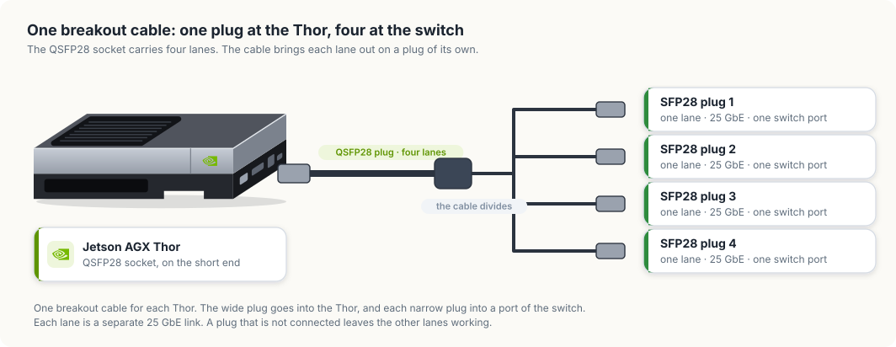
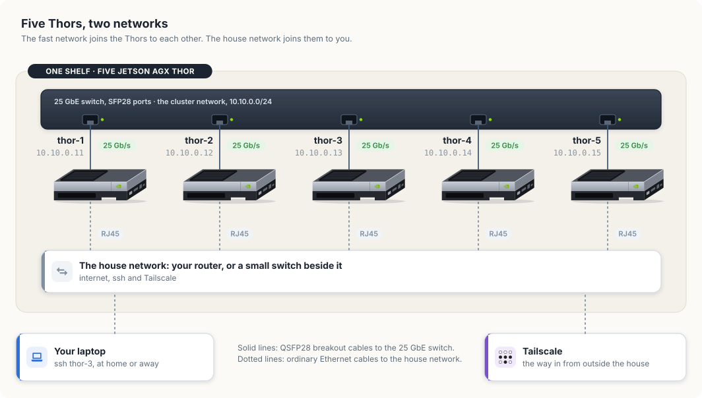
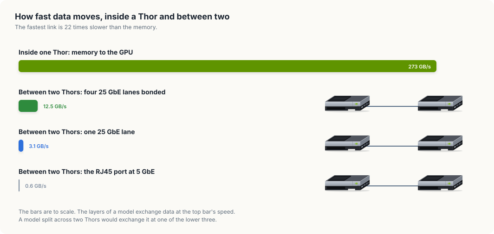
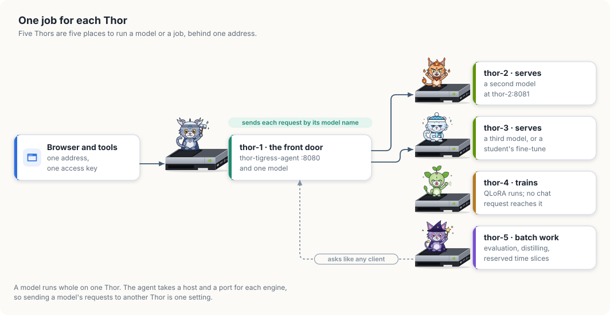

# A cluster of five Thors

This chapter shows you how to build a GPU cluster from five Jetson AGX Thor
developer kits. You will join them with 25-gigabit Ethernet, give each one a
name and an address, and divide the work of the platform among them. At the end
several people can train, evaluate and serve models at the same time, each on a
Thor of their own.

<div class="covers">

This chapter covers

- what a cluster adds, and the one thing it does not add
- the network ports on a Thor, and which one the cluster uses
- choosing a 25 GbE switch and the cables for it
- setting up the hardware: the shelf, the power, the cables and the first checks
- wiring five Thors into two networks
- addresses and names, so `ssh thor-3` works
- bonding the four lanes of a port into one faster link
- why a model stays whole on one Thor
- one job for each Thor, behind one address
- time slices: a whole Thor for one person for a window of time

</div>

## The cluster you will build

Figure 29.1 shows the finished cluster. Five Thors stand on one shelf, and one
cable from each leads to a switch. Each Thor has a name, from `thor-1` to
`thor-5`, and a job of its own. Each Thor also has a cub of its own, so that
you can tell the five apart in the figures of this chapter: Volt, Ember, Frost,
Leaf and Nova.

<figure>

<figcaption><b>Figure 29.1</b> The cluster: five Thors, one switch, and a job for each.</figcaption>
</figure>

The chapter builds this picture from the bottom up. It starts with the terms,
then the ports and the parts, then the hardware on the shelf. The network
settings come after the hardware, and the division of work comes last, because
each layer depends on the one before it.

## What a cluster is

A cluster is a group of computers on one network that are used as one resource.
Each computer in it is called a node. Here a node is one Thor: 14 CPU cores,
one GPU, and 122 GiB of memory that the CPU and the GPU share.

Computers on a network exchange data in packets. A packet is a small block of
data, about 1,500 bytes on Ethernet, that carries the address of the machine it
is going to. A file or a request larger than one packet is cut into many
packets by the sender and put together again by the receiver.

The nodes are joined by a switch. A switch is a box with network sockets,
called ports. It reads the destination of each packet that arrives and sends
the packet out of the port that leads there. Two nodes on the same switch reach
each other without the packet leaving the shelf.

A cluster gives you more places to run work. It does not make any one place
larger. Five Thors hold 610 GiB of memory between them, and the largest model
you can load is still one that fits in 122 GiB, because a model's weights have
to sit in the memory of the GPU that reads them. Section "Why a model stays
whole on one Thor" gives the numbers behind that. Table 29.1 lists what changes
and what stays the same.

| | One Thor | Five Thors |
|---|---|---|
| Models loaded at once | as many as fit in 122 GiB | as many as fit in 122 GiB, on each of five |
| Largest single model | one that fits in 122 GiB | the same |
| Training while the chat serves | the two compete for one GPU | training has a Thor to itself |
| People working at once | they take turns on one GPU | each can hold a whole Thor |
| Power at full load | up to 130 W | up to 650 W, plus the switch |

## The network ports on a Thor

The developer kit has two wired network ports. You can list them with `ip`,
which prints one line for each network interface. An interface is the operating
system's name for one link.

```console
$ ip -br link | awk '$1 ~ /^(enP2p1s0|mgbe)/ {print $1, $2}'
mgbe0_0 DOWN
mgbe1_0 DOWN
enP2p1s0 UP
mgbe2_0 DOWN
mgbe3_0 DOWN
```

`enP2p1s0` is the RJ45 socket, the kind an ordinary network cable fits. It is
`UP` here because a cable connects it to a router.

The four `mgbe` interfaces belong to the QSFP28 socket. QSFP28 is a wider
socket that carries four separate links, called lanes, through one connector.
NVIDIA lists each lane at 25 GbE, which means 25 gigabits a second. All four
are `DOWN` in this listing because no cable is plugged in.

Table 29.2 compares the two ports.

| Port | Interfaces | Speed | Cable |
|---|---|---|---|
| RJ45 | `enP2p1s0` | up to 5 GbE | ordinary Ethernet cable, Cat 6 |
| QSFP28 | `mgbe0_0` to `mgbe3_0` | four lanes of 25 GbE, 100 gigabits a second together | a QSFP28 breakout cable |

The cluster uses both. The QSFP28 port carries the traffic between Thors,
because it is twenty times faster than the RJ45 port. The RJ45 port connects
each Thor to your house network, for internet access and for `ssh` from your
laptop.

## Choosing the switch and the cables

A 25 GbE switch has SFP28 ports. An SFP28 port is a narrow socket that carries
one 25 GbE lane. The Thor's QSFP28 socket carries four lanes, so the two are
joined by a breakout cable: one QSFP28 plug at the Thor's end, and four SFP28
plugs at the switch's end. Each SFP28 plug is one lane.

The number of switch ports you need depends on how many lanes you connect.
Table 29.3 gives the two choices.

| Lanes connected on each Thor | Switch ports for five Thors | Speed between two Thors |
|---|---|---|
| 1 | 5 | 25 gigabits a second |
| 4 | 20 | 100 gigabits a second, shared among several transfers |

Start with one lane on each Thor if the switch has fewer than 20 ports. The
other three plugs of each breakout cable stay unconnected, and you can plug
them in when you have the ports.

Table 29.4 is the list of parts.

| Part | How many | What to check before buying |
|---|---|---|
| 25 GbE switch | 1 | SFP28 ports: at least 5, or 20 for all four lanes; support for link aggregation (LACP) if you plan to bond lanes |
| QSFP28 to 4×SFP28 breakout cable | 5 | a passive copper cable, called a DAC, of 1 to 3 metres |
| Cat 6 Ethernet cable | 5 | one from each Thor to the house network |
| Power strip | 1 | five power supplies and the switch |

NOTE: A 25 GbE link uses forward error correction, shortened to FEC, which lets
the receiver repair damaged bits. Both ends of a cable have to use the same FEC
mode or the link stays down. If a lane does not come up, compare the mode on
the switch port with the output of `ethtool --show-fec mgbe0_0` on the Thor.

## Setting up the hardware

This section takes the parts from their boxes to a cluster in which every link
light is on. No software is changed until the section after it.

### The shelf and the air

A Thor developer kit is 243 mm long, 112 mm wide and 57 mm tall. Its fan draws
air through the black ribbed grille that covers half of its top. The grille has
to stay uncovered, so the kits stand side by side or on separate levels of a
shelf, and never one directly on another.

Leave at least the height of one kit free above each grille, and a hand's width
between neighbours. Place the kits so that the short end with the ports faces
the side where the cables will run. A wire shelf suits a cluster better than a
closed cabinet, because warm air leaves it in every direction.

Put the switch on the same shelf, close enough that a cable of 1 to 3 metres
reaches from every Thor. A switch of this class has fans of its own and is
louder than the Thors, which is a reason to keep the cluster out of the room
you work in.

### Power

A Thor draws between 40 W and 130 W, depending on its power mode and its load.
Five at full load draw up to 650 W. A household circuit of 15 A at 120 V
supplies 1,800 W, so one circuit carries the five Thors and the switch.

Use one power strip with a switch and surge protection for the whole cluster.
Plug in the five power supplies and the network switch, and leave the strip off
until the cables are connected. All of the power the cluster draws becomes heat
in the room, about as much as a small electric heater on its low setting.

### Labels

Label each Thor before you connect anything: `thor-1` to `thor-5`, on the top
and on the port end. Label both ends of every cable with the same name. When a
link light is dark later, the labels tell you which cable to follow without
tracing it by hand.

### The breakout cables

Figure 29.2 shows one breakout cable. The wide plug is the QSFP28 end. It goes
into the QSFP28 socket on the port end of the Thor. The four narrow plugs are
the SFP28 ends, and each goes into one port of the switch.

<figure>

<figcaption><b>Figure 29.2</b> A breakout cable: one QSFP28 plug, four SFP28 plugs.</figcaption>
</figure>

Connect each cable in these steps.

1. Remove the dust caps from the plug and from the socket. Keep them, because
   an unused socket should be capped again.
2. Hold the QSFP28 plug with its pull-tab facing the same way as the tab side
   of the socket. The plug enters one way only. If it stops after a few
   millimetres, turn it over. Do not force it.
3. Push the plug straight in until the latch clicks. A plug that is seated does
   not slide out when you pull gently on the cable.
4. At the switch, push SFP28 plug 1 of the cable from `thor-1` into port 1,
   plug 1 from `thor-2` into port 2, and so on to port 5. This order makes the
   port number match the Thor's number.
5. If you connect all four lanes, give each Thor four ports in a row: ports 1
   to 4 for `thor-1`, ports 5 to 8 for `thor-2`, and so on to port 20.

To remove a plug, pull its tab. The tab releases the latch, and the plug slides
out. Pulling on the cable itself does not release the latch and can damage the
plug.

A copper breakout cable is thicker and stiffer than an ordinary network cable.
Lead it in a wide curve, several centimetres across, and do not fold it or tie
it tightly. Let the weight of the cable rest on the shelf and not on the plug.

NOTE: Plugs of this kind can be inserted and removed while the Thor and the
switch are running. You do not need to shut a Thor down to move its cable to a
different port.

### The house network cables

Each Thor also needs one ordinary Ethernet cable, of the Cat 6 kind, from its
RJ45 socket to your router. If the router has fewer than five free sockets, put
a small Ethernet switch beside the router, connect the five Thors to it, and
connect it to the router with one more cable. The plug clicks when it is seated,
and a small lever on the plug releases it.

Figure 29.3 shows the finished wiring.

<figure>

<figcaption><b>Figure 29.3</b> Five Thors on two networks.</figcaption>
</figure>

The two sets of cables form two networks, and each has one purpose. Table 29.5
sets them side by side.

| | Cluster network | House network |
|---|---|---|
| Port on the Thor | QSFP28 | RJ45 |
| Speed | 25 GbE for each lane | the speed of your router, often 1 GbE |
| Carries | requests between Thors, model copies, training data | internet access, `ssh`, Tailscale |
| Addresses | `10.10.0.11` to `10.10.0.15`, set by you | handed out by the router |
| Reachable from | the five Thors only | every device in the house |

Keeping the cluster network separate has a second benefit. A server that
listens on a Thor's cluster address can be reached by the other four Thors and
by nothing else, because no other device is plugged into that switch.

### Setting up the switch

A 25 GbE switch is a managed switch, which means it has settings of its own.
You reach them through a web page or a command line on the switch's management
port, as its manual describes. Three settings concern this cluster.

- **Port speed.** Set every port that leads to a Thor to 25G. On some switches
  the ports are set in groups of four, and a group left at 10G will not link
  with a 25 GbE lane.
- **Error correction.** Set the same FEC mode on the port that the Thor uses,
  as the note in the previous section explains.
- **Link aggregation.** Leave it off for now. Section "Bonding four lanes into
  one link" turns it on.

### Power on, and read the lights

Turn the power strip on. The switch starts first and takes a minute or two.
Each Thor starts when you press its power button.

Every port on the switch has a small light. A light that is on means the switch
and the Thor have agreed on a link. Check the five ports that lead to the
Thors. Table 29.6 lists what a dark light usually means.

| What you see | Likely cause | What to do |
|---|---|---|
| one port is dark | the plug is not fully seated | pull the tab, take the plug out, and push it in until it clicks |
| the port stays dark after reseating | port speed or FEC mode does not match | set the port to 25G and compare the FEC modes |
| every port is dark | the Thors have not started their network yet | wait until each Thor has finished starting, then look again |
| one Thor's port is dark with every plug of its cable | the cable is faulty | exchange it with a cable from a Thor that works, and see which one the fault follows |

### A new Thor's first start

A Thor that is new needs the same first setup as the first one had: a monitor
and a keyboard for the first start, a user account, and a connection to the
house network. Give every Thor the same user name. The `ssh` settings later in
this chapter rely on it.

Install the same JetPack release on all five. JetPack is NVIDIA's software for
the Thor: the operating system, the GPU drivers and the libraries the models
use. Section "Why a model stays whole on one Thor" explains why the releases
have to match.

## Addresses and names

Each Thor needs a name of its own. The names in this chapter are `thor-1` to
`thor-5`. Set the name once on each machine:

```bash
sudo hostnamectl set-hostname thor-2
```

Every machine on a network has an address, written as four numbers such as
`10.10.0.11`. A packet carries the address it is going to, and the switch
delivers it to the machine that holds that address.

On the house network the router hands each Thor an address when it joins, a
service called DHCP. On the cluster network there is no router, so you set each
address yourself. The addresses `10.10.0.11` to `10.10.0.15` come from a range
reserved for private networks, which no machine on the internet uses.
The command below gives `thor-1` its cluster address on the first lane:

```bash
sudo nmcli connection add type ethernet ifname mgbe0_0 con-name cluster \
    ipv4.method manual ipv4.addresses 10.10.0.11/24 ipv6.method disabled
```

`nmcli` is the command for NetworkManager, the service that configures the
network on the Thor. `ipv4.method manual` says the address is fixed. The `/24`
says that every address starting with `10.10.0.` is on this network. Run the
same command on each Thor with its own address.

The Thors then need to find each other by name. The file `/etc/hosts` maps
names to addresses on one machine. Add the same five lines to it on every Thor:

```bash
sudo tee -a /etc/hosts <<'EOF'
10.10.0.11 thor-1
10.10.0.12 thor-2
10.10.0.13 thor-3
10.10.0.14 thor-4
10.10.0.15 thor-5
EOF
```

A program on one Thor that connects to `thor-2` now uses the cluster network,
because the name leads to a cluster address.

Check each link before you build on it. `ethtool` prints the speed a link
settled at:

```bash
ethtool mgbe0_0 | grep -E 'Speed|Link detected'
```

A lane that is up prints `Speed: 25000Mb/s` and `Link detected: yes`.

Then measure what passes between two Thors. `iperf3` is installed on the Thor.
It runs as a server on one machine and as a client on the other, and reports
the bits that pass each second:

```bash
iperf3 -s              # on thor-2
iperf3 -c thor-2       # on thor-1
```

A result near 25 Gbit/s means the lane, the cable and the switch port are
right.

### Reaching the Thors from your laptop

Your laptop is on the house network, so it does not see the cluster addresses.
Chapter "Access and syncing" set up one entry named `thor` in `~/.ssh/config`
and pointed it at the Thor's Tailscale name. A `Host` line accepts several
names, so one entry covers all five:

```bash
cat >> ~/.ssh/config <<'EOF'

Host thor-1 thor-2 thor-3 thor-4 thor-5
    User <user>
    IdentityFile ~/.ssh/id_ed25519
EOF
```

This entry has no `HostName` line, so `ssh` looks up the name you typed.
Install Tailscale on each Thor and turn on MagicDNS in the admin console. The
five names then resolve on every device in your tailnet, and `ssh thor-3` works
at home and away.

## Bonding four lanes into one link

One lane carries 25 gigabits a second. A bond joins several interfaces into one
that carries the sum, 100 gigabits a second for four lanes. The bond has one
address, and the programs that use it need no change.

A bond also survives the loss of a lane. If one plug is pulled or one lane
fails, the bond continues on the remaining three at 75 gigabits a second, and
the lane rejoins when its link returns.

The standard that the Thor and the switch use to agree on a bond is called
LACP. On each Thor, replace the single-lane connection with a bond and add the
four lanes to it:

```bash
sudo nmcli connection delete cluster
sudo nmcli connection add type bond ifname bond0 con-name cluster \
    bond.options "mode=802.3ad,miimon=100,xmit_hash_policy=layer3+4" \
    ipv4.method manual ipv4.addresses 10.10.0.11/24 ipv6.method disabled

for lane in 0 1 2 3; do
    sudo nmcli connection add type ethernet ifname mgbe${lane}_0 master bond0
done
```

`mode=802.3ad` selects LACP. `xmit_hash_policy=layer3+4` tells the bond to
choose a lane from the addresses and ports of each connection. On the switch,
put the four ports that lead to one Thor into one link aggregation group with
LACP turned on. Each Thor has its own group.

A bond sends all the packets of one connection down one lane, so that they
arrive in order. One connection therefore still moves at 25 gigabits a second,
and four connections at once move at 100. Measure the bond with four streams:

```bash
iperf3 -c thor-2 -P 4
```

The file `/proc/net/bonding/bond0` lists the lanes in the bond and whether each
is up.

## Why a model stays whole on one Thor

While a model writes a reply, each of its layers reads the output of the layer
before it. On one Thor that data moves through memory, which the Thor reads at
up to 273 gigabytes a second. If half the layers sat on a second Thor, the data
would cross a cable once for every token.

<figure>

<figcaption><b>Figure 29.4</b> How fast data moves inside one Thor, and between two.</figcaption>
</figure>

Table 29.7 has the arithmetic. A network speed is quoted in bits, and there are
eight bits in a byte, so 25 GbE carries 3.125 gigabytes a second.

| Path | Gigabytes a second | Compared with memory |
|---|---|---|
| Memory inside one Thor | 273 | 1 |
| Four bonded 25 GbE lanes | 12.5 | 22 times slower |
| One 25 GbE lane | 3.125 | 87 times slower |
| The RJ45 port at 5 GbE | 0.625 | 437 times slower |

Each figure is the most the path can carry, and a real transfer is slower. The
fastest link is still 22 times slower than memory. For that reason you load
each model whole on one Thor, and you use the network for the work it suits.

That work is of two kinds. A request to a model is a few kilobytes of text, and
so is the reply, so a request crosses the switch in well under a millisecond. A
model copy is the large transfer. A model folder of 22 GB crosses one lane in
about 7 seconds at the lane's full speed, where the RJ45 port at 5 GbE would
need 35.

NOTE: An Edge-LLM engine is built for one GPU model and one version of
TensorRT. Keep the five Thors on the same JetPack release, and an engine built
on one loads on the others. After you update JetPack on a Thor, rebuild its
engines there, as chapter "TensorRT Edge-LLM" describes.

## One job for each Thor

With five nodes, each kind of work can have a Thor to itself. Figure 29.5 shows
one way to divide them.

<figure>

<figcaption><b>Figure 29.5</b> One job for each Thor, behind one address.</figcaption>
</figure>

`thor-1` is the front door. It runs `thor-tigress-agent`, the server that
checks the access key and passes each request to the model it names. People
and tools use one address and one key, and they do not need to know which Thor
holds which model.

The agent is told where each model is on its command line:

```text
thor-tigress-agent [--listen 127.0.0.1:8080] [--model 127.0.0.1:8079]
                   [--engine MODEL=HOST:PORT]... [--search 127.0.0.1:8888]
```

Each `--engine` names one model and the host and port of the server that holds
it. A model on the same Thor as the agent has the host `127.0.0.1`, which means
"this machine". A model on `thor-2` has the host `thor-2`:

```bash
thor-tigress-agent \
    --engine <first-model>=127.0.0.1:8081 \
    --engine <second-model>=thor-2:8081 \
    --engine <third-model>=thor-3:8081
```

On `thor-2` and `thor-3`, start the model server so that it listens on the
Thor's cluster address, `10.10.0.12` or `10.10.0.13`, and not on `127.0.0.1`. A
server that listens on `127.0.0.1` accepts connections from its own machine
only. A server that listens on the cluster address accepts them from the other
Thors, and from no device outside the cluster switch.

Table 29.8 gives each Thor's job and what the job gains from a machine of its
own.

| Node | Job | What it gains |
|---|---|---|
| `thor-1` | the agent, web search, and one model | one address for everything |
| `thor-2` | a second model | its memory is not shared with the first |
| `thor-3` | a third model, or a student's fine-tuned model | a new model can be tried without unloading one in use |
| `thor-4` | training | a QLoRA run does not slow anyone's chat |
| `thor-5` | batch work and reserved slices | evaluation and distilling run for hours without competing |

The batch tools in this book work over the network. `thor-lasso-distiller` and
`thor-spark-safety-eval` ask a model for answers through an HTTP address. Run
on `thor-5`, they call the agent on `thor-1` the way a browser does, and the
agent sends each request to the Thor that holds the model.

## Time slices

Time-slicing means giving the same hardware to different people at different
times. There are two ways to do it with GPUs.

Inside one Thor, programs that use the GPU take turns on it, a few milliseconds
each. The GPU's time is divided and its memory is not. Two people on one Thor
each see the other's programs in `nvidia-smi`, and either can use up the memory
the other needs. Chapter "Sharing is caring" describes this arrangement for one
friend.

Across a cluster, a slice is a whole Thor for a window of time. A reservation
has three parts: a person, a node, and a start and end time. During the window
nobody else runs anything on that node, so the full 122 GiB and the whole GPU
belong to one person.

<figure>

<figcaption><b>Figure 29.6</b> An example day of reservations on five Thors.</figcaption>
</figure>

Figure 29.6 follows four people through one day. Mira fine-tunes a model on
`thor-3` in the morning, and Kofi curates data on the same Thor in the
afternoon. Ms. Rao's class of six shares `thor-4` during school hours, and the
nightly training run has it from midnight. Yuki draws on the canvas on `thor-5`
after the evaluation batch has finished. No two of them hold the same Thor in
the same hour.

A whole-node slice also keeps people's data apart. Each person has a login of
their own, as chapter "Sharing is caring" sets out, and the files in a home
directory with mode 700 are readable by that login alone. With one person on a
node at a time, no other person's program runs beside theirs in the same
memory.

WARNING: Do not give `sudo` to someone who holds a slice. A person with `sudo`
can read every file on that Thor, including the files of the person who held it
before them.

### A calendar and a time limit

The first schedule can be a shared calendar with one row for each Thor. A
calendar records who has a node. It does not end a job when the window closes.
`systemd-run`, which chapter "Access and syncing" used to start a job that
outlives the connection, takes a time limit:

```bash
systemd-run --user --unit finetune -p RuntimeMaxSec=6h ./train.sh
```

`RuntimeMaxSec=6h` stops the job six hours after it starts. In figure 29.6,
Mira holds `thor-3` from 07:00 to 13:00. She starts her job this way at 07:00,
and the Thor is free for Kofi at 14:00 whether or not she remembers to stop
it.

### A scheduler

A calendar depends on people keeping to it. A scheduler is a program that
keeps the schedule for them. Slurm is the scheduler most university clusters
use. One Thor runs its controller, and every Thor runs a small service that
starts jobs when the controller says so. A person submits a job with the time
it needs:

```bash
sbatch --nodes=1 --exclusive --time=4:00:00 train.sh
```

`--nodes=1 --exclusive` asks for one whole Thor, and `--time` is the window.
Slurm puts the job in a queue, starts it when a Thor is free, and stops it when
the time is used. Move from the calendar to Slurm when two people have asked
for the same window.

## The order to build it

Build the cluster two Thors at a time, and test each layer before you add the
next.

1. Put two Thors and the 25 GbE switch on the shelf, as section "Setting up
   the hardware" describes. Connect one lane of each breakout cable to the
   switch, and each RJ45 port to the house network. Check the link lights.
2. Name the machines `thor-1` and `thor-2`. Give each its cluster address with
   `nmcli`, and add both names to `/etc/hosts` on each.
3. Confirm `Speed: 25000Mb/s` with `ethtool`, and measure the link with
   `iperf3`.
4. Install Tailscale on `thor-2`, add the `Host` entry on your laptop, and
   confirm `ssh thor-2`.
5. Copy one model's engine folder from `thor-1` to `thor-2`. Start its server
   on `thor-2`, listening on `10.10.0.12`.
6. Point one `--engine` on `thor-1` at `thor-2`. Send a chat request for that
   model and compare its tokens a second with the same model run on `thor-1`.
7. Add `thor-3`, `thor-4` and `thor-5` the same way, and give each its job
   from table 29.8.
8. Connect the other three lanes and bond them, if the switch has the ports.
9. Start the calendar, with `RuntimeMaxSec` on every job. Add Slurm when the
   calendar is no longer enough.

## Summary

- A cluster adds places to run work. Five Thors run five times as many models
  or jobs at once, and the largest single model is still one that fits in the
  122 GiB of one Thor.
- The Thor's QSFP28 port carries four lanes of 25 GbE. A breakout cable
  connects it to the SFP28 ports of a 25 GbE switch.
- Each Thor is on two networks: the cluster network for traffic between Thors,
  and the house network for internet access and `ssh`.
- A bond joins the four lanes into one link of 100 gigabits a second. One
  connection still travels on one lane.
- Memory moves data 22 times faster than the bonded link, so a model is never
  split across two Thors.
- `thor-tigress-agent` takes a host and a port for each engine, so one address
  serves models held on several Thors.
- A time slice is a whole Thor for a window of time. A calendar with
  `RuntimeMaxSec` is the first scheduler, and Slurm is the next.

The next chapter, [Memory, context and slots](ch20-memory-and-context.md),
returns to one Thor and counts where its 122 GiB goes while a model is serving.
