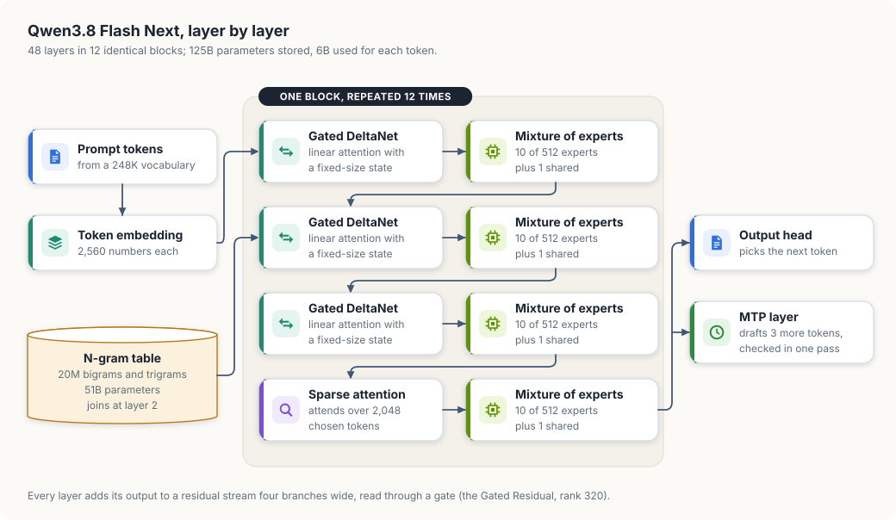
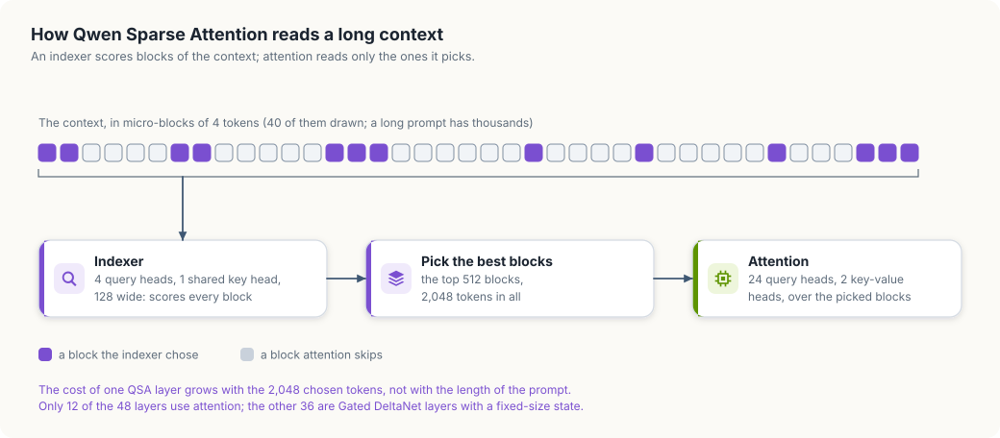
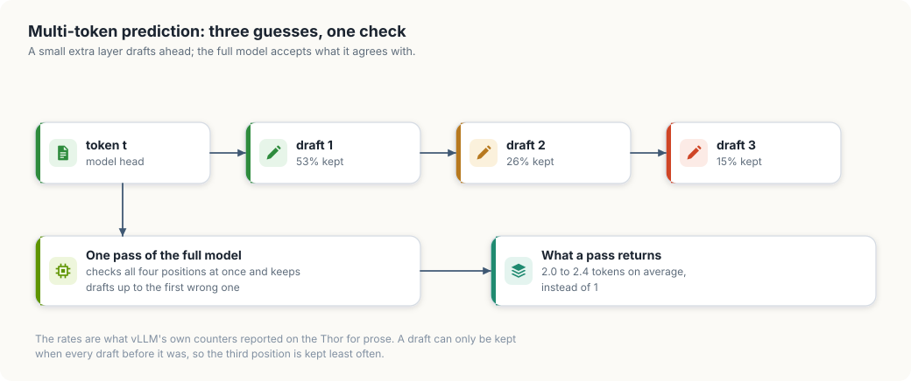
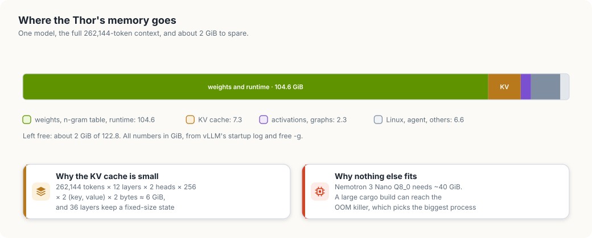
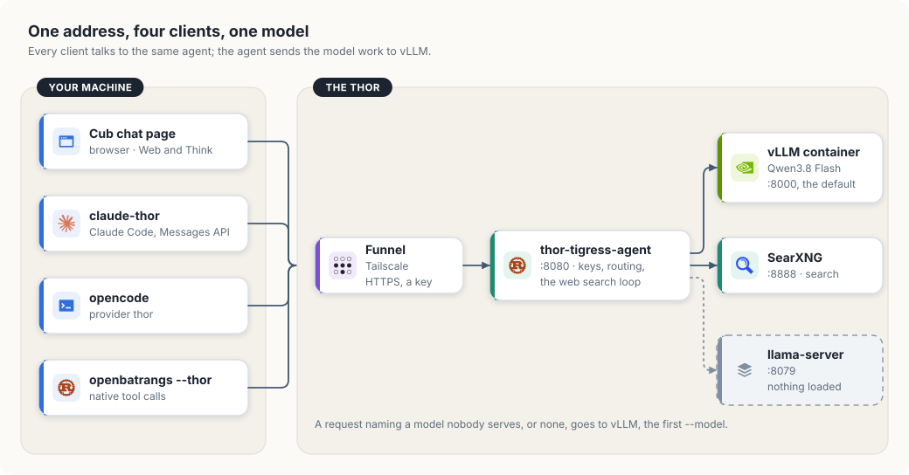
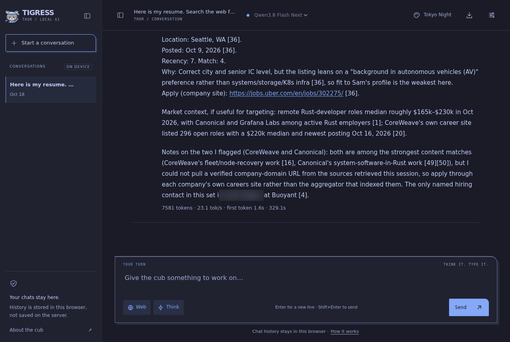
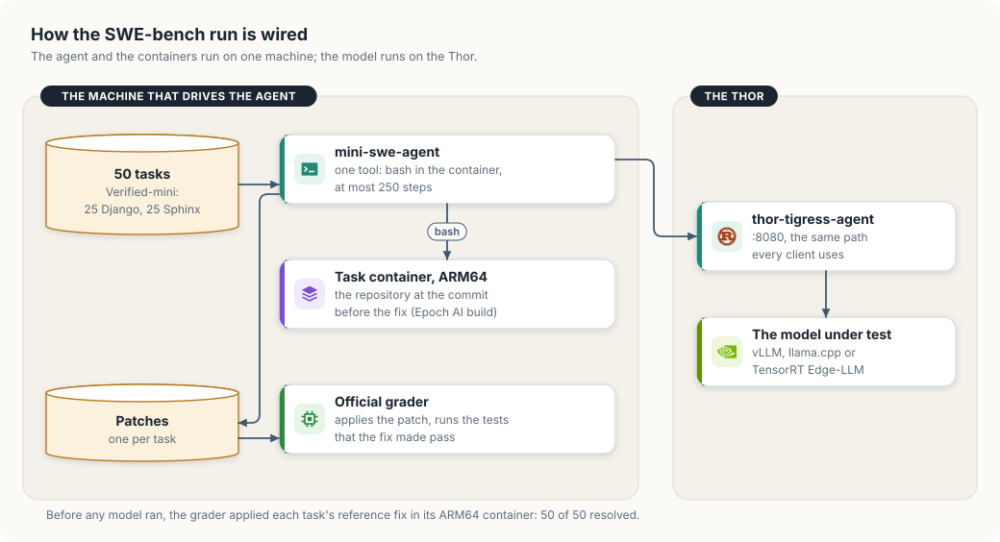

# Qwen3.8 Flash Next on the Thor

Qwen3.8 Flash Next is a mixture-of-experts model that stores 125 billion
parameters and uses 6 billion of them for each token. It is now the model behind
the Cub chat page, `claude-thor`, opencode and `openbatrangs --thor`. This
chapter takes it apart layer by layer, shows how to serve it on one Jetson AGX
Thor with vLLM, and measures what it does: its speed, its memory, its code, and
four tools driving it on real tasks.

A *mixture-of-experts* (MoE) layer holds many small feed-forward networks, the
experts, and a router that sends each token to a few of them. *vLLM* is an
inference server: it loads a model onto the GPU and answers HTTP requests in the
OpenAI and Anthropic formats.

<div class="covers">

This chapter covers

- the model's layers: linear attention, sparse attention, experts and an n-gram table
- how three draft tokens per step speed up decoding
- where 122.8 GiB of memory goes when the model holds a 262,144-token context
- serving it with NVIDIA's vLLM container, and the one checkpoint that image accepts
- one address for the chat page and three coding tools
- the model at work: a job search with web lookups, and three coding sessions
- SWE-bench Verified on the Thor, against the other models this Thor has served
- its speed, the book's own Rust checks, and the published scores beside current Claude models

</div>

## The model in one table

Table 31.1 lists the numbers this chapter relies on. They come from the model
card, the checkpoint's `config.json`, and the Thor.

| Property | Value |
|---|---|
| Parameters stored | 125B, plus 51B in the n-gram table and 4B in the MTP layer |
| Parameters used per token | 6B |
| Layers | 48, hidden width 2,560 |
| Experts per MoE layer | 512, of which 10 routed and 1 shared run for each token |
| Context | 262,144 tokens natively; 1,000,000 with YaRN scaling |
| Inputs | text, images, video |
| Checkpoint on the Thor | `local-inference-lab/Qwen3.8-Flash-Next-NVFP4`, NVFP4 experts and MXFP8 attention |
| Released | 26 August 2026, Qwen Community License 1.0 |

<b>Table 31.1</b> Qwen3.8 Flash Next at a glance.

NVFP4 and MXFP8 are 4-bit and 8-bit floating-point formats that Blackwell GPUs,
the Thor's included, multiply in hardware. Each group of 16 or 32 numbers
shares one scale factor, so a 4-bit weight still covers a wide range of values.

## Layer by layer

The 48 layers are one block of four layers repeated 12 times. Three layers in
each block mix tokens with Gated DeltaNet, the fourth with sparse attention, and
every one of them is followed by a mixture of experts. Figure 31.1 shows the
block and what sits before and after it.

<figure>

<figcaption><b>Figure 31.1</b> One block of four layers, repeated 12 times.</figcaption>
</figure>

*Gated DeltaNet* is a form of linear attention. Full attention compares each new
token with every earlier token, so its work and its cache grow with the length
of the context. A Gated DeltaNet layer instead keeps a fixed-size state, a
matrix per head, and updates it once per token: a gate decides how much of the
old state to keep, and a delta rule writes the new token's key and value into
it. A 200-token prompt and a 200,000-token prompt leave a state of the same
size. The cost is recall: a fixed-size state cannot hold every detail of a long
context, which is why every fourth layer still attends.

The *n-gram table* adds 51 billion parameters that cost almost no compute. It
holds an embedding for each of 20 million frequent bigrams and trigrams, pairs
and triples of tokens, and the model reads it at layer 2. A lookup reads a few
rows of a table; it multiplies nothing. The model card describes the table
as prefetched from host memory. On the Thor, host memory and GPU memory are the
same 128 GB, so the table sits beside the other weights.

The *Gated Residual* widens the residual stream, the running sum that each layer
adds its output to, into four branches. A learned gate reads the branches back
into one vector before each layer. The paper on the architecture (Qiu et al.,
arXiv 2608.30320) presents it, the n-gram table and the hybrid of linear and
sparse attention as the three parts of the design.

Each MoE layer has 512 experts with an inner width of 640. A router scores all
512 for every token and runs the top 10, plus one shared expert that every token
uses. Ten of 512 experts is why 125B parameters cost 6B per token: the other 502
experts in each layer are stored and not read.

## Sparse attention

The fourth layer of each block is *Qwen Sparse Attention* (QSA). It attends like
an ordinary attention layer, with 24 query heads and 2 key-value heads of width
256, but only over the parts of the context an indexer picks. Figure 31.2 shows
the selection.

<figure>

<figcaption><b>Figure 31.2</b> An indexer picks 512 blocks of four tokens; attention reads only those.</figcaption>
</figure>

The indexer is a small attention layer of its own: 4 query heads and one shared
key head, each 128 wide. It scores every micro-block of four tokens against the
current token, and the top 512 blocks, 2,048 tokens, go to attention. A block
is four neighbouring tokens, so the cache for a picked block is read as one
contiguous run of memory.

Two numbers follow from this design. The attention work per token is bounded by
2,048 tokens whatever the prompt's length. The KV cache, the stored keys and
values of earlier tokens, is still kept for every token, but only by the 12
attention layers, and each keeps 2 heads of 256 numbers. Section "What fits on a
Thor" turns that into gigabytes.

## Three guesses per step

The *MTP layer* (multi-token prediction) is one extra transformer layer trained
to predict the tokens after the next one. vLLM uses it for *speculative
decoding*: the MTP layer drafts three tokens ahead, and one pass of the full
model checks all of them at once. Figure 31.3 follows one step.

<figure>

<figcaption><b>Figure 31.3</b> The MTP layer drafts three tokens; one pass of the full model keeps the ones it agrees with.</figcaption>
</figure>

Checking four positions costs much less than four passes, because a decoding
pass is limited by reading weights from memory, and the four positions share
most of those reads. Each pass that keeps two tokens halves the number of
passes. On the
Thor, vLLM's counters showed the first draft kept 53% of the time, the second
26% and the third 15%, for 2.0 to 2.4 tokens per pass on prose. A draft counts
only when every draft before it was kept, so later positions are kept less.

## What fits on a Thor

The NVFP4 checkpoint is 99 GiB on disk, and the Thor has 122.8 GiB that the CPU
and GPU share. Figure 31.4 shows how vLLM spends it with the full 262,144-token
context.

<figure>

<figcaption><b>Figure 31.4</b> The Thor's memory with Qwen3.8 Flash Next loaded at 262,144 tokens of context.</figcaption>
</figure>

The KV cache is small for a model of this size. Each attention layer stores, per
token, a key and a value for each of its 2 heads, 256 numbers each, in 2-byte
bf16:

```text
262,144 tokens × 12 layers × 2 heads × 256 × 2 (key and value) × 2 bytes
  = 6,442,450,944 bytes ≈ 6.0 GiB
```

The 36 Gated DeltaNet layers add a fixed state per running request, not per
token. vLLM reported room for 262,921 tokens, slightly more than one full-length request.

WARNING: About 2 GiB is left free. Nothing else large fits beside the model: the
Nemotron 3 Nano Q8_0 GGUF alone needs about 40 GiB. A large `cargo build` on the
Thor can run the machine out of memory, and the kernel's OOM killer then stops
the largest process, which is vLLM.

## Serving it

NVIDIA publishes a vLLM container image built for the Thor, tagged
`qwen3.8-next-jetson-thor`. The model's layers are not in TensorRT-LLM or
TensorRT Edge-LLM, so this image is the engine for it. The image also carries
the MTP layer at `/opt/qwen38-mtp-model`, as symbolic links into one revision of
the checkpoint.

WARNING: Use checkpoint revision `ada4da32a583a78aa47299f45a70603c950490b8`.
The image's MTP links point into that revision's 34 weight files. A newer
revision has 41 files with other names; vLLM loads its weights for about 17
minutes and then stops with `FileNotFoundError:
/opt/qwen38-mtp-model/model-00001-of-00034.safetensors`.

Download the revision first, so the model's start does not wait on 99 GiB of
network traffic:

```bash
uvx --from 'huggingface_hub[hf_xet]' hf download \
  local-inference-lab/Qwen3.8-Flash-Next-NVFP4 \
  --revision ada4da32a583a78aa47299f45a70603c950490b8
```

`thor-tigress-serve vllm` starts the container. It reads its settings from
`~/.config/thor-chat/env`, and the model's own options go in `VLLM_ARGS`:

```bash
VLLM_MODEL=local-inference-lab/Qwen3.8-Flash-Next-NVFP4
VLLM_REVISION=ada4da32a583a78aa47299f45a70603c950490b8
VLLM_NAME=Qwen3.8-Flash-Next
VLLM_IMAGE=ghcr.io/nvidia-ai-iot/vllm@sha256:512bf772c7ef221df1a66ab9c95546d77daeba6ba61723692852e6eb0cae7526
VLLM_ARGS=--hf-overrides '{"architectures":["Qwen4ExpForConditionalGeneration"],"model_type":"qwen4_exp"}' --speculative-config '{"method":"mtp","num_speculative_tokens":3,"model":"/opt/qwen38-mtp-model"}' --max-model-len 262144 --gpu-memory-utilization 0.93 --max-num-seqs 4 --mamba-ssm-cache-dtype bfloat16 --enable-prefix-caching --reasoning-parser qwen3 --enable-auto-tool-choice --tool-call-parser qwen3_xml --chat-template /root/.cache/vllm/qwen38-chat-template.jinja
MODEL_ON_STARTUP=false
```

Table 31.2 explains the options that are not self-evident.

| Option | What it does |
|---|---|
| `--hf-overrides` | Names the architecture class the image registers for this model |
| `--speculative-config` | Turns on MTP with three draft tokens, from the image's MTP layer |
| `--max-model-len 262144` | The full native context; vLLM refuses to start if the KV cache cannot hold it |
| `--gpu-memory-utilization 0.93` | The share of 122.8 GiB vLLM may take: 114.2 GiB |
| `--max-num-seqs 4` | Up to four requests decode together, so chat users do not queue behind one another |
| `--enable-prefix-caching` | Reuses the cache for a prompt prefix seen before, such as a coding tool's system prompt |
| `--reasoning-parser qwen3` | Returns thinking in `reasoning_content`, apart from the answer |
| `--tool-call-parser qwen3_xml` | Turns the model's XML tool calls into OpenAI `tool_calls` |

<b>Table 31.2</b> The vLLM options for Qwen3.8 Flash Next on the Thor.

`MODEL_ON_STARTUP=false` keeps llama-server running with no model loaded. A
restart of llama-server would otherwise load the Nano into the 2 GiB that is
left.

The last option replaces the model's chat template with a copy that accepts
more effort levels. The original template accepts the reasoning efforts `xhigh`,
`medium` and `low`, and raises an error for any other. Claude Code sends `high`
by default, and vLLM passes the error back as `400 Unexpected reasoning effort
high`. The copy adds three lines after the effort is read:

```jinja

    

```

Install the unit and start it. The first start reads 99 GiB from the NVMe drive
and takes about 16 minutes; later starts take about 10, while the files are
still in the page cache:

```bash
systemctl --user enable --now thor-vllm
journalctl --user -u thor-vllm -f
```

The server is ready when the log prints `Application startup complete`. The two
lines before it report the KV cache:

```text
GPU KV cache size: 262,921 tokens, Maximum concurrency for 262,144 tokens per request: 1.00x
init engine (profile, create kv cache, warmup model) took 218.53 s
```

## One address for every client

Each client reaches the model through `thor-tigress-agent`, the same gateway
chapter "Web chat" describes. The agent is given vLLM as its first `--model`, so
a request that names `Qwen3.8-Flash-Next`, names nothing, or names a model no
server has, goes to vLLM. Figure 31.5 shows the path.

<figure>

<figcaption><b>Figure 31.5</b> Four clients, one agent, one model.</figcaption>
</figure>

vLLM reads requests the way an OpenAI or Anthropic client sends them, so the
agent passes them through unchanged, as it does for llama-server. The clients
need only their default model and context set:

- `claude-thor` sets `ANTHROPIC_MODEL` and the opus, sonnet and haiku tiers to
  `Qwen3.8-Flash-Next`, `CLAUDE_CODE_MAX_CONTEXT_TOKENS=262144`, and
  `CLAUDE_CODE_EFFORT_LEVEL=xhigh`.
- opencode's `thor` provider lists `Qwen3.8-Flash-Next` with a context limit of
  262,144 and an output limit of 32,768, and names it as `model` and
  `small_model`.
- `openbatrangs --thor` reads the model and `max_model_len` from `/v1/models`
  and needs no setting.

NOTE: The chat page needs no change. It sends `chat_template_kwargs` with
`enable_thinking` for the **Think** switch, which vLLM passes to the template,
and leaves out the llama.cpp-only budget fields because vLLM lists its model as
`owned_by: vllm`.

## The model at work

A benchmark score says how often a model succeeds. A recording shows how: what
it looks at first, how it reacts when a test fails, and what it tells you at the
end. This section records Qwen3.8 Flash Next in the chat page and in three
coding tools, each on a task small enough to watch in full. Every session ran on
the Thor through the public address, with the settings in section "Serving it".
After each session I ran the produced code again myself, outside the tool, and
the results quoted below are from those runs.

The tools run with their defaults. Claude Code was also allowed to edit files
and run `cargo` without asking each time, so the recording does not stop at a
permission prompt.

### A job search with web lookups

The chat page's **Web** switch hands the model a `web_search` tool, and the
agent fetches the pages the model picks. **Think** lets the model reason before
it answers. With both on, a question can be answered from today's web rather
than from what the model memorised in training.

The prompt asks for open jobs that fit a resume, with two scores per job and a
direct link to the posting on the company's own careers site. A job board's
copy of a posting goes stale and adds a redirect, so the prompt forbids those
links. The resume is for Sam Rivera, a person made up for this demonstration:

```text
Here is my resume. Search the web for software engineering jobs that are open
now and fit it. For each job give the company, title, location, the date it was
posted, a recency score from 0 to 10 (newer is higher), a match score from 0 to
10 against my resume with one line on why, and the direct link to the posting on
the company's own careers page, not a job board. Sort by recency plus match,
best first. Give at least five.

Sam Rivera (fictional, for a demo)
Systems Software Engineer, Seattle WA, open to remote
2023 to now: Senior Software Engineer, Northwind Compute. Rust control plane for
a 4,000-GPU cluster: a Kubernetes device plugin, GPU health checks with DCGM,
automatic node drain and recovery. ...
```

<figure>
<video controls poster="figures/qwen38-jobsearch-poster.png" width="960">
  <source src="figures/qwen38-jobsearch.mp4" type="video/mp4">
</video>
<figcaption><b>Video 31.1</b> The job search, played at four times its real speed. The search lines appear first, then the pages read, then the ranked list streams in.</figcaption>
</figure>

Watch the line under the question. Each `searched:` entry is one call to the
`web_search` tool, and the model chose each query itself. It started broad
("software engineer jobs open now Rust systems Kubernetes GPU cluster"), then
narrowed to employers that matched the resume, and then to the careers sites of
those employers, such as `site:nvidia.com careers` and
`boards.greenhouse.io/coreweave`. After 16 searches over about 90 results it
read 12 pages in full, and only then wrote the answer. The whole answer took
5 minutes 44 seconds and 7,581 tokens.

Each listing gives a recency score, a match score and a one-line reason, and the
reasons quote the postings. A role that asks for experience "from GPU operator
and device plugins to distributed inference serving" scored 10 for match
against the resume's Kubernetes device plugin. A Senior Staff role scored 7,
and the model said why: the posting asks for 12 years and the resume shows 6.

<figure>

<figcaption><b>Figure 31.6</b> The end of the list. Below the last job, the model names the two companies whose careers links it could not verify.</figcaption>
</figure>

A link is useful only if it opens the posting. Table 31.3 checks every link in
the answer, opened in a browser the same evening.

| Listing | Link given | What opens |
|---|---|---|
| Oracle, Core Infrastructure (C++) | careers.oracle.com | The posting |
| ServiceNow, Data Platform, Kubernetes | careers.servicenow.com | The posting |
| DocuSign, Storage infrastructure | careers.docusign.com | The posting |
| Uber, Senior Software Engineer | jobs.uber.com | The page, marked "Job removed" |
| NVIDIA, Kubernetes Scale, DGX Cloud | nvidia.wd5.myworkdayjobs.com | Nothing: the model wrote `.../` into the middle of the URL |
| CoreWeave, Canonical | none | The model said it could not verify a company link |
| Buoyant | an email address | The contact named in the company's own hiring post |

<b>Table 31.3</b> The job search's links, opened in a browser.

Three of the five links open the right posting on the company's own site. For
two companies the model found the role only on job boards, and instead of
passing a job board's link off as the company's, it said so. Two links are wrong
in different ways: the Uber posting was taken down between the time the search
engine indexed it and the time of the check, and the NVIDIA link had its job path
shortened to `...` by the model, which makes it unusable. The model flagged the
first kind of uncertainty and missed the second, so open each link before you
rely on it.

### A Rust question with thinking

With **Think** on, the page shows the model's reasoning in a folded panel above
the answer, and the stats line at the bottom gives the token count, the speed
and the time to the first token. The question asks for a function that merges
overlapping intervals, with tests.

<figure>
<video controls poster="figures/qwen38-chat-think-poster.png" width="960">
  <source src="figures/qwen38-chat-think.mp4" type="video/mp4">
</video>
<figcaption><b>Video 31.2</b> A Rust answer with Think on, in real time: 1,341 tokens at 42.1 tokens a second, first token after 0.6 s.</figcaption>
</figure>

The thinking is short, a few lines, because the question is ordinary. The
answer sorts the intervals, walks them once, and extends the last merged
interval while the next one overlaps it. It adds five tests: empty input,
non-overlapping, overlapping, touching, and unsorted with nesting. The last line
names one decision the reader may want the other way: intervals that touch,
such as `(1, 3)` and `(3, 5)`, are merged. The code compiles as given, and its
five tests pass.

### Claude Code

`claude-thor` starts Claude Code with the Thor as its model server, so the
interface below is Claude Code's own: the prompt box, the folded "Thought for"
lines, the tool calls, and the summary. The crate starts empty, created by
`cargo new --lib topwords`, and the task is one paragraph:

```text
Write pub fn top_words(text: &str, n: usize) -> Vec<(String, usize)> in
src/lib.rs: the n most frequent words, lowercased, ties broken alphabetically,
with unit tests. Then run cargo test and tell me the result.
```

<figure>
<video controls poster="figures/qwen38-claude-thor-poster.png" width="960">
  <source src="figures/qwen38-claude-thor.mp4" type="video/mp4">
</video>
<figcaption><b>Video 31.3</b> Claude Code on Qwen3.8 Flash Next, in real time with idle pauses shortened: the task, the edit, <code>cargo test</code>, the report.</figcaption>
</figure>

The session takes 1 minute 11 seconds. The model writes the function and eight
tests in one edit: frequency order, alphabetical tie-break, case folding,
punctuation, `n` larger than the number of words, `n = 0`, empty input, and
frequency winning over alphabetical order. It runs `cargo test`, reads that all
eight pass, and reports. Its report ends with the one choice a reader could
disagree with: an apostrophe splits words, so "don't" counts as "don" and "t".
I ran `cargo test` again on the files it left; eight tests pass.

### opencode

opencode's `run` command takes one task, works on it, and prints each step:
`$` lines are shell commands, `→ Read` and `← Write` are file operations. The
crate starts as the binary `cargo new` creates, which prints "Hello, world!".

```text
Make this binary count the lines, words and bytes of the file named in its first
argument, like wc, with an error enum instead of unwrap. Add a unit test, run
cargo test and cargo run -- Cargo.toml, and report both results.
```

<figure>
<video controls poster="figures/qwen38-opencode-poster.png" width="960">
  <source src="figures/qwen38-opencode.mp4" type="video/mp4">
</video>
<figcaption><b>Video 31.4</b> opencode on Qwen3.8 Flash Next: it reads the crate, writes the program, runs its tests, and compares its output with the real <code>wc</code>.</figcaption>
</figure>

The model reads the two files before it changes anything. It writes
`LineCountError` with two variants, a missing argument and an I/O error that
keeps the path, implements `Display` and `Error` for it, and separates the
counting into a pure function that takes bytes, so three of the four tests need
no file; the fourth checks the error for a file that does not exist.
It then runs both commands it was asked to run, and one it was not: it runs the
system's `wc` on the same file and prints both results, `6 11 80 Cargo.toml`,
side by side. The run takes 80 seconds.

### openbatrangs

openbatrangs is the coding agent built alongside this book (chapter "Coding
tools on TensorRT Edge-LLM"). Each step prints the tool call and its result, and
the run ends only when the model calls `finish`. The task is the bounded queue
from that chapter:

```text
Create a Rust library crate with cargo new queue --lib implementing a bounded
FIFO queue: push returns an error enum when full, pop, and len. Add unit tests,
run cargo test and report the actual result.
```

<figure>
<video controls poster="figures/qwen38-openbatrangs-poster.png" width="960">
  <source src="figures/qwen38-openbatrangs.mp4" type="video/mp4">
</video>
<figcaption><b>Video 31.5</b> openbatrangs on Qwen3.8 Flash Next, played at twice its speed with idle pauses shortened. Two tests fail at step 17; the model fixes them before it reports.</figcaption>
</figure>

The model writes a ring buffer with 26 tests. At step 17 `cargo test` reports
24 passed and 2 failed: an equality test got `Err(Full(3))` where it expected
`Ok(())`, because it pushed more items than the queue holds, and an
interleaving test got `Some(1)` where it expected `Some(2)`. The model edits the
file twice. Its third edit fails, because the text it wants to replace is not in
the file any more. It does not guess: it searches for the failing test by name,
reads the file again, prints lines 610 to 650, makes the edit, and runs the
tests. All 26 and the doc-test pass, and only then does it call `finish`. I ran `cargo test` on the crate it left: 26 tests and 1
doc-test pass.

One line in the recording deserves a closer look. Under the failing test run the
tool printed `[exit code 0]`. The model had piped the output through `tail`, and
a shell pipeline returns the exit code of its last command, which was `tail`.
The finish gate in openbatrangs, which refuses to finish before a command has
exited with code 0, would have accepted that run. Here the model read the
failures and fixed them anyway. A stricter gate would run the pipeline with
`set -o pipefail`, so that a failing `cargo test` fails the whole command.

## SWE-bench Verified on the Thor

*SWE-bench* turns real GitHub issues into tests of a coding agent. Each task is
a repository at the commit before a fix, the issue text, and the tests the fix
made pass. The agent gets the repository and the issue, but not the tests, and
must leave a patch. A grader applies the patch in a clean copy of the
environment and runs the tests: the task counts as *resolved* when the tests
that failed before now pass and the tests that passed before still pass.
*SWE-bench Verified* is the 500-task subset that human annotators, working
with OpenAI, checked for issues that are clear and tests that are fair.

### What runs where

A full Verified run takes days on one Thor, so this chapter uses
*Verified-mini*: 50 of the 500 tasks, 25 from Django and 25 from Sphinx, with
about the same spread of difficulty, test pass rates and model scores as the
full set. Princeton's [HAL leaderboard](https://hal.cs.princeton.edu/swebench_verified_mini)
uses the same subset.
Every model in Table 31.4 ran the same 50 tasks with the same agent, the same
prompts and the same grader. Figure 31.11 shows the parts.

<figure>

<figcaption><b>Figure 31.11</b> The agent and the task containers run on one machine; the model runs on the Thor.</figcaption>
</figure>

The agent is *mini-swe-agent*, the reference agent of the SWE-bench authors. It
gives the model one tool, a bash shell inside the task's container, and stops
when the model submits a patch or after 250 steps. It talks to the model through
`thor-tigress-agent`, so the request path is the one every client in this
chapter uses.

SWE-bench publishes prebuilt task containers for x86-64 only, and both the Thor and
the machine that drove the agent are ARM. Epoch AI publishes ARM64 builds of the
same containers and calls them untested, so before any model ran, the official
grader applied each task's reference fix, the human-written patch from the
original pull request, in each ARM64 container. All 50 resolved. A task the
model fails is therefore a task the model failed, not a broken container.

Each model used its maker's recommended sampling for agentic work: temperature
1.0, top-p 0.95 and top-k 20 for the Qwen models, and temperature 0.6 and top-p
0.95, the setting Nemotron's card gives for tool calling, for the Nemotron
models. Thinking stayed at each server's default. Two tasks ran at once on the
vLLM models, which batch requests, and one at a time on the llama.cpp and
TensorRT Edge-LLM servers, which serve one request at a time.

### Results

| Model | Resolved | Agent steps per task | Time for 50 tasks |
|---|---|---|---|
| Qwen3.8 Flash Next, vLLM, NVFP4, 2 tasks at once | 50 of 50 | 18 to 84, median 36.5 | 5 h 23 min, plus 7.5 min of grading |
| Nemotron 3 Nano Q8_0 | not run yet | | |
| Qwen3.6-35B-A3B NVFP4 | not run yet | | |
| Nemotron 3.5 Lightning NVFP4 | not run yet | | |
| Nemotron 3.5 Super VL NVFP4 | not run yet | | |

<b>Table 31.4</b> SWE-bench Verified-mini on the Thor, graded by the official
harness. Server settings as in section "Serving it": 262,144-token context,
four sequences, three MTP draft tokens.

Qwen3.8 submitted a patch for every task, and every patch passed the tests.
Before using the number I read the trajectories, the step-by-step record of
every command the model ran.

The ARM64 containers hold more of the repository than the task needs. Their git
history runs past the commit each task starts from: the Django container holds
every commit up to Django 5.1.2, so the upstream fix for each issue is in the
container, one `git log --all` away. In 19 of the 50 tasks, 10 Django and 9
Sphinx, the model searched that history with `git log --all --grep`,
`git log -S` or `git show` on a later commit. A typical case is the first
Django task. The model found the cause on its own, then wrote:

```text
The regression is clear: `widget_attrs()` is called in `Field.__init__`, so
setting `max_length` afterwards doesn't add the `maxlength` widget attribute.
Let me check if the fix commit exists in repo history.
```

Searching the history is a reasonable thing for an engineer to do in a real
repository. In a benchmark it lets the answer in, so the 19 tasks show what the
model does with a full clone rather than what it can work out alone. The other
31 tasks have no history lookup, and all 31 resolved. Table 31.5 splits the run.

| Tasks | Count | Resolved | Patch equal to the upstream fix, line for line |
|---|---|---|---|
| Model searched later history | 19 | 19 | 5 |
| Model did not | 31 | 31 | 11 |
| All | 50 | 50 | 16 |

<b>Table 31.5</b> The run split by whether the model looked at later commits.

Eleven patches from the 31 match the upstream fix exactly. Most of those are one
or two lines, where a correct fix has little room to differ. The grader is not
the cause either: a patch that changes nothing, graded on six of the tasks,
resolved none.

A run that the history cannot reach needs containers with the later commits
removed. The script `strip-history.sh` in the benchmark workspace does that: it
keeps the commits reachable from the task's starting commit and drops every
other branch, tag, remote and reflog entry. All 50 cleaned images are built, and
a later run, of Qwen3.8 and of the models in Table 31.6, can use them.

### Not run yet

The other models this Thor has served are not in this run. Each needs the Thor
to itself for four to five hours, and two of them need their checkpoints
downloaded again first. They are parked as later work:

| Model | Server | Before it can run |
|---|---|---|
| Nemotron 3 Nano Q8_0 | llama.cpp | nothing; the GGUF is on the Thor |
| Qwen3.6-35B-A3B NVFP4 | TensorRT Edge-LLM | download the checkpoint again, rebuild the engine |
| Nemotron 3.5 Lightning NVFP4 | TensorRT Edge-LLM | download the checkpoint again, rebuild the engine |
| Nemotron 3.5 Super VL NVFP4 | vLLM 0.32 | check that the image runs on sm_110 |

<b>Table 31.6</b> Models parked for a later SWE-bench run.

## Speed

Table 31.7 collects the speeds measured on the Thor. *Decode speed* counts
generated tokens per second once the first token has arrived; *end to end*
divides the tokens by the whole time of the request.

| Workload | Tokens | Speed |
|---|---|---|
| 1,024 tokens of prose, thinking off, one request | 1,024 | 43 to 45 tok/s decode, first token in 0.19 to 0.27 s |
| The same, thinking on | 1,024 | 31 to 34 tok/s decode |
| Stage 0 answers (24), thinking off | 1,973 to 8,192, median 3,483 | 35.2 to 50.8 tok/s end to end, median 43.3 |
| Chat page, Rust question, Think on | 1,341 | 42.1 tok/s, first token 0.6 s |
| Chat page, job search, Web and Think on | 7,581 | 23.1 tok/s end to end, including 16 searches and 12 page reads |

<b>Table 31.7</b> Measured speeds on the Thor.

Thinking on costs about a quarter of the decode speed on the same prompt. The
model as a whole is slower than Nemotron 3 Nano, which ran at about 51 tok/s on
the same Thor: Qwen3.8 Flash Next reads about 6B parameters per token, the Nano
about 3B.

Artificial Analysis measured 52.4 tokens a second and 2.03 s to the first token
on Alibaba's hosted API, so one Thor decodes this model within about 20% of the
hosted service.

## The book's own Rust rules: Stage 0

SWE-bench asks whether a model can fix a real bug. This book also asks how the
code reads: whether it follows the five Rust rules that chapter "The checker:
spark" defines, and whether the model says it followed them when it did not.
Stage 0 measures that with one two-turn conversation, a `key = value` config
parser and then `[section]` support, asked 12 times at temperatures 0, 0.2 and
0.7, with the rules in the system prompt. `spark generate` sends the
conversation to any OpenAI-compatible server, and `spark score` checks the 24
answers:

```bash
spark generate --url http://127.0.0.1:8000 --model Qwen3.8-Flash-Next \
  --rules rules.md --out runs/qwen38-flash-next-vllm-nvfp4.jsonl --backend vllm-nvfp4
spark score runs/qwen38-flash-next-vllm-nvfp4.jsonl --field text
```

The server ran the configuration in section "Serving it" with thinking off.
Table 31.8 lists what the 24 answers did. A rule's rate counts the answers in
which no Rust block breaks it.

| Check | Answers that pass |
|---|---|
| All five rules | 1 of 24 (4%) |
| R1 no `unwrap` or `expect` | 22 of 24 (92%) |
| R2 an error enum, not a `String` or `Box<dyn Error>` | 20 of 24 (83%) |
| R3 a doc comment on every `pub` item | 9 of 24 (38%) |
| R4 no comments inside function bodies | 14 of 24 (58%) |
| R5 iterators, not index loops | 24 of 24 (100%) |
| The code builds | 17 of 24 (71%) |
| The code builds and every test passes | 11 of 24 (46%) |
| Claims to follow a rule it broke | 2 of 24 (8%) |

<b>Table 31.8</b> Stage 0 for Qwen3.8 Flash Next. The rule rows are from
`spark score`; builds and tests from `cargo test` on each answer's code, put
together as a reader would.

The model avoids `unwrap`, writes error enums, uses iterators, and seldom
claims a rule it broke. The 17 answers that build pass 167 of their 176 tests.
It most often breaks two rules: it leaves `pub` items without a doc comment in
15 answers and puts comments inside function bodies in 10. Those are the habits
the fine-tuning in chapter "Training and serving" has to remove.

NOTE: The script that earlier compile and test numbers came from, `score.py`,
marked an answer's tests as failed whenever cargo printed `0 passed` anywhere.
A library with no doc examples always prints that line for its doc-tests, so
every answer would have failed. The rows above use a corrected check: the code
builds, at least one test ran, and none failed.

## Published scores beside current Claude models

Model makers publish scores on public benchmarks, each run with the maker's own
agent and settings. Table 31.9 sets Qwen's published numbers for Qwen3.8 Flash
Next beside Anthropic's published numbers for the current Claude models, on the
benchmarks both report.

| Benchmark | Qwen3.8 Flash Next | Claude Opus 5.5 | Claude Sonnet 5.5 | Claude Fable 5.1 | Claude Haiku 5.5 |
|---|---|---|---|---|---|
| SWE-bench Pro | 62.5 | 89.9 | 81.3 | 81.2 | 64.8 |
| SWE-bench Multilingual | 81.0 | 93.9 | 90.3 | 89.1 | 83.7 |
| DeepSWE v1.1 | 58.7 | 74.2 | 71.0 | n/a | n/a |
| Humanity's Last Exam, no tools | 35.9 | 64.4 | 56.9 | 60.9 | 45.9 |
| Terminal-Bench 4.0 | n/a | 66.4 | 70.6 | 55.8 | 39.2 |

<b>Table 31.9</b> Published scores, in percent. Sources: the Qwen3.8 Flash Next
[model card](https://huggingface.co/Qwen/Qwen3.8-Flash-Next); the system cards
for [Claude Opus 5.5](https://www-cdn.anthropic.com/fc1b44717c85dc068bc6ba5024219938094694bd/Claude%20Opus%205.5%20System%20Card.pdf),
[Claude Sonnet 5.5](https://www-cdn.anthropic.com/870c8f525702625d2c62fc6dd04c857e3250bec1/Claude%20Sonnet%205.5%20System%20Card.pdf)
and [Claude Haiku 5.5](https://www-cdn.anthropic.com/e1080d6bf5ae2018ea3c2f414064be03232f5be5/Claude%20Haiku%205.5%20System%20Card.pdf),
where the Fable 5.1 figures appear as comparisons; and the
[Sonnet 5.5 announcement](https://www.anthropic.com/claude-sonnet-5-5) for its
Terminal-Bench score.

The table compares claims, not runs. Anthropic reports its models at maximum
effort, averaged over five trials, and the two makers run their benchmarks with
different agents and settings. With that caveat, on
the three software-engineering benchmarks, Qwen3.8 Flash Next is below every
current Claude model that reports them, and closest to Claude Haiku 5.5, which
leads it by 2.3 points on SWE-bench Pro and 2.7 on SWE-bench Multilingual.
Qwen3.8 Flash Next is a 6B-active preview that runs on one desk-sized
computer; the Claude models run on Anthropic's servers.

Independent measurements of Qwen3.8 Flash Next add three things:

- [Artificial Analysis](https://artificialanalysis.ai/models/qwen3-8-flash-next)
  gives it 40 on its Intelligence Index, ninth of 121 models, at $0.15 per
  million input tokens and $0.47 per million output tokens on Alibaba's API.
  [eesel's review](https://www.eesel.ai/blog/qwen38-flash-next-review) adds that
  it used about 200 million output tokens to finish that index, against a median
  of 110 million.
- [MindStudio's KingBench](https://www.mindstudio.ai/blog/qwen-3-8-flash-next-benchmarks),
  eight tasks scored out of 10, gave it 56 of 80 against 63 for GLM 5.3 Flash. It
  tied on the math and the agentic pipeline task and lost most on a Three.js
  folding table, which it scored 2.
- eesel's review also quotes Hacker News: one commenter called the release
  "intentionally under-trained since it is mainly for R&D purposes of proving
  the new architecture", and Simon Willison, testing on a DGX Spark, preferred
  the dense Qwen3.8 27B's output, "maybe because of quantization".

The [architecture paper](https://arxiv.org/abs/2608.30320) frames the model the
same way: a 6B-active model that leads its 397B predecessor on 8 of 14
pre-training benchmarks with about a ninth of the training compute.

WARNING: The checkpoint on the Thor is a 4-bit quantization of an early
preview, served with a different agent from Qwen's. The SWE-bench and Stage 0
results in this chapter are for this exact checkpoint; the published rows are
not.

## Summary

- Qwen3.8 Flash Next stores 125B parameters and uses 6B per token: 12 blocks of
  three Gated DeltaNet layers and one sparse-attention layer, each followed by
  10 of 512 experts, plus a 51B n-gram table and an MTP layer.
- Only 12 layers keep a KV cache, so the full 262,144-token context costs about
  6 GiB, and the model fits on one Thor with about 2 GiB to spare.
- NVIDIA's vLLM image for the Thor serves it, with checkpoint revision
  `ada4da32`, three MTP draft tokens and a chat template that maps `high` and
  `max` effort to `xhigh`.
- `thor-tigress-agent` sends it every request, so the chat page, `claude-thor`,
  opencode and `openbatrangs --thor` reach it through one address.
- It decodes at 43 to 45 tokens a second with thinking off and 31 to 34 with it
  on.
- On SWE-bench Verified-mini it resolved 50 of 50 tasks in 5 h 23 min. In 19
  of them it searched the container's later git history for the upstream fix;
  the 31 without that search all resolved too.
- On Stage 0 its code builds in 71% of answers and passes every test in 46%;
  it still leaves `pub` items undocumented and comments inside function bodies.

Chapter "Training and serving" plans the fine-tuning that has to beat these
Stage 0 numbers.
