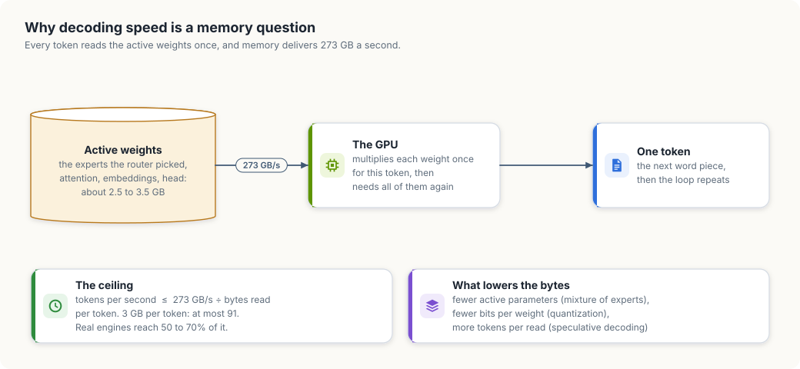
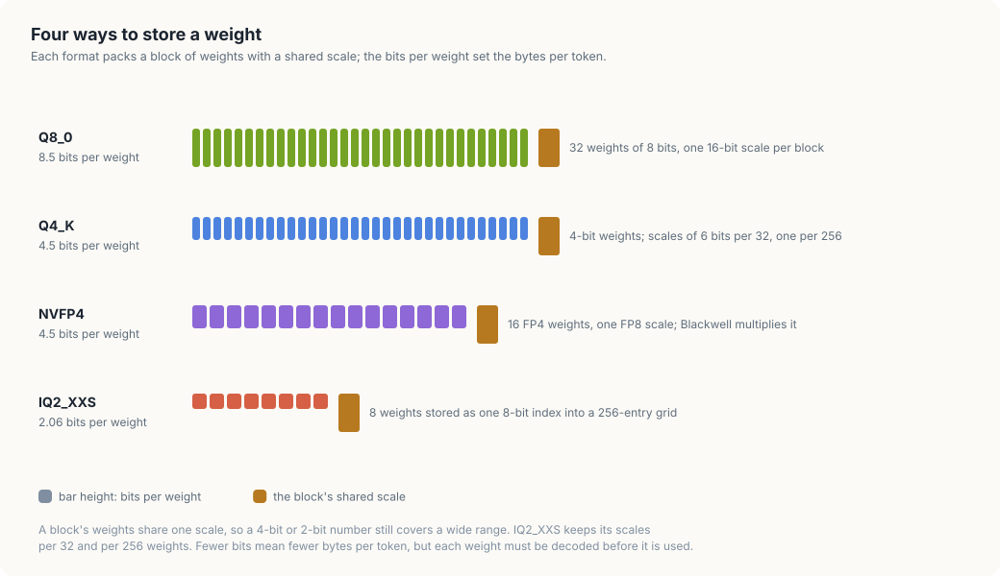
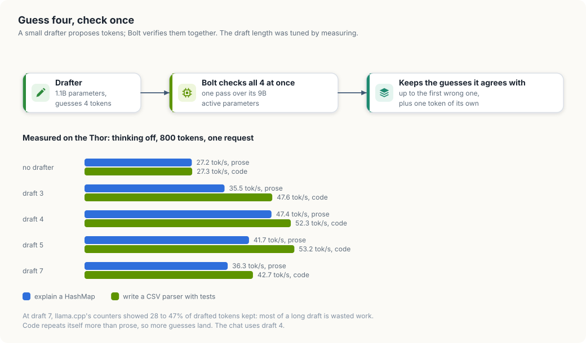
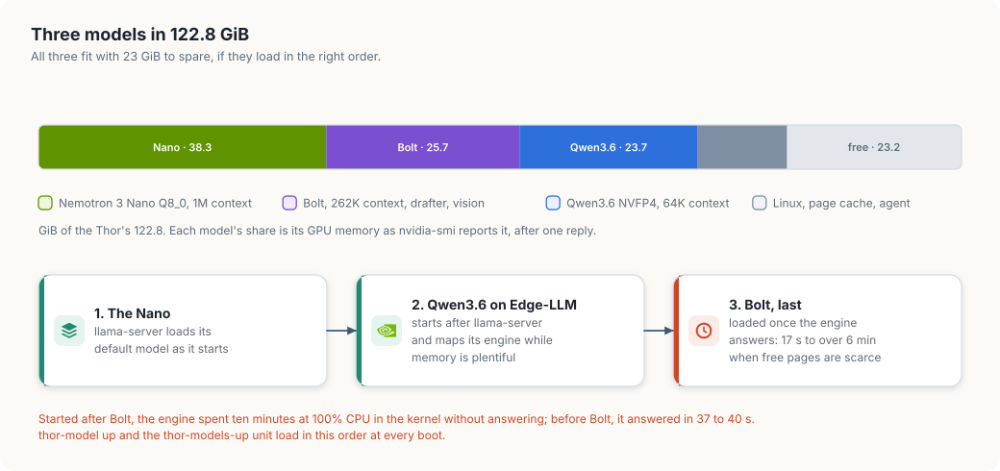
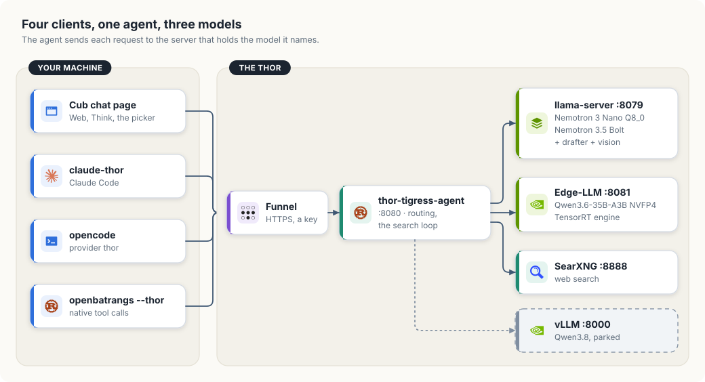
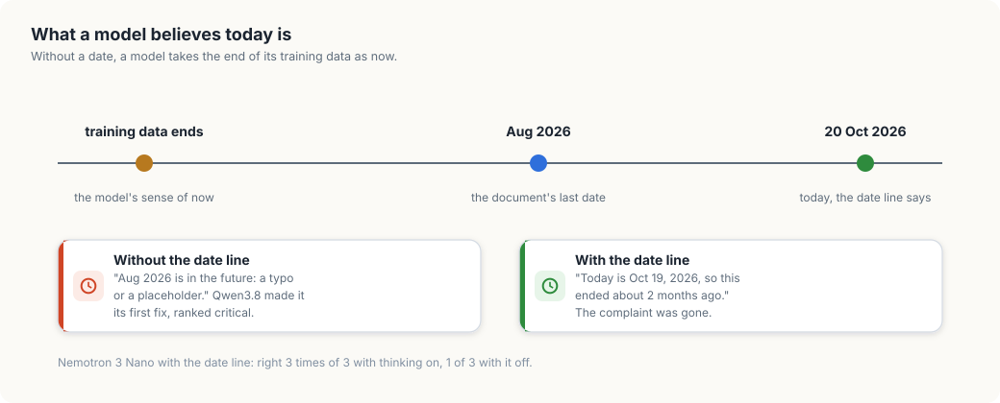

# Three models on one Thor

Chapter "Qwen3.8 Flash Next on the Thor" served one large model that filled the
board's memory. This chapter serves three smaller ones at the same time:
Nemotron 3 Nano, Nemotron 3.5 Bolt and Qwen3.6-35B-A3B. You will work out from
first principles how fast a model can decode on the Thor, see how four weight
formats trade bits for work, speed Bolt up with a drafter, fit all three models
into 122.8 GiB, and switch the board between this set and Qwen3.8 with one
command.

Three terms carry the chapter. A model's *active parameters* are the weights it
reads to produce one token; a mixture-of-experts model reads only the experts
its router picks. *Quantization* stores each weight in fewer bits than the 16 it
was trained in. *Speculative decoding* lets a small model guess several tokens
and the large model check them in one pass.

<div class="covers">

This chapter covers

- why decoding speed on the Thor is set by bytes read per token
- four weight formats: Q8_0, Q4_K, NVFP4 and IQ2_XXS
- Nemotron 3.5 Bolt on llama.cpp, with its vision projector and a DFlash drafter
- Qwen3.6-35B-A3B NVFP4 on TensorRT Edge-LLM, and one request field it mishandles
- where 122.8 GiB goes with three models loaded, and the order they must load in
- `thor-model`, which switches the board between model sets
- telling a model today's date, and what changes when you do

</div>

## Why a token costs what it costs

A model writes text one token at a time. For each token the GPU reads every
active weight from memory once, multiplies, and produces a probability for each
token in the vocabulary. The next token cannot start until this one is chosen,
so the reads repeat for every token.

The Thor's CPU and GPU share 128 GB of LPDDR5X that delivers 273 GB a second.
That gives a ceiling for one request:

```text
tokens per second  ≤  273 GB/s ÷ bytes read per token
```

Figure 32.1 shows the loop and the three ways to lower the bytes.

<figure>

<figcaption><b>Figure 32.1</b> Each token reads the active weights once; memory bandwidth sets the ceiling.</figcaption>
</figure>

Work the ceiling out for Nemotron 3 Nano. The name ends in A3B: about 3 billion
parameters are active per token. At Q8_0, 8.5 bits per weight, that is about
3.2 GB per token, and 273 ÷ 3.2 is 85 tokens a second. The Thor measured 53, 62%
of the ceiling. The rest goes to reading the KV cache, running small kernels
one after another, and choosing the token.

Table 32.1 does the same arithmetic for the three models. The bytes per token
are estimates from each model's active parameters and storage format; the
measured column is a single request writing 800 tokens.

| Model | Active parameters | Stored as | Bytes per token | Ceiling | Measured |
|---|---|---|---|---|---|
| Nemotron 3 Nano 30B-A3B | ~3B | Q8_0, 8.5 bits | ~3.2 GB | ~85 tok/s | 53 tok/s |
| Qwen3.6-35B-A3B | ~3B | experts NVFP4, the rest FP8 | ~2.5 GB | ~109 tok/s | 63 tok/s |
| Nemotron 3.5 Bolt 74B-A9B | ~9B | experts IQ2_XXS, Mamba NVFP4 | ~2.8 GB | ~97 tok/s | 27 tok/s |

<b>Table 32.1</b> The bandwidth ceiling and the measured speed of each model.

Bolt is the outlier. It reads about as many bytes as the others and reaches only
28% of its ceiling. Its experts are stored at 2.06 bits per weight, and each
group of eight weights must be looked up in a table before it can be
multiplied. That decoding work, not memory, sets Bolt's speed. Section "Guess
four, check once" wins most of the gap back.

## Four ways to store a weight

A trained model stores each weight as a 16-bit number. Quantization replaces a
block of those numbers with small integers and one shared *scale*: the weight is
the integer times the scale. Figure 32.2 shows the four formats this chapter
uses.

<figure>

<figcaption><b>Figure 32.2</b> Each format stores a block of weights with a shared scale.</figcaption>
</figure>

Take one Q8_0 block as an example. It holds 32 signed 8-bit integers and one
16-bit scale. With a scale of 0.01, the stored integer −37 means the weight
−0.37. The block costs 32 × 8 + 16 = 272 bits, which is 8.5 bits per weight.

NVFP4 stores each weight as a 4-bit floating-point number that can be 0, 0.5,
1, 1.5, 2, 3, 4 or 6, with a sign. Every 16 weights share an 8-bit
floating-point scale, and the whole tensor shares one more. Blackwell tensor
cores, the Thor's included, can multiply NVFP4 directly. NVIDIA's Qwen3.6
checkpoint marks its experts `W4A16_NVFP4`: the weights are stored in 4 bits,
and the multiplication runs in 16 bits after they are expanded. For decoding
that costs little, because the reads, not the multiplications, set the speed.

IQ2_XXS goes further. It does not store each weight; it stores an 8-bit index
into a grid of 256 patterns, and each pattern gives eight weights at once. Signs
and scales come from separate bits. The format reaches 2.06 bits per weight,
and the price is the lookup in Figure 32.1's GPU box for every group of eight.

Table 32.2 puts the formats side by side.

| Format | Bits per weight | Block | Used here for |
|---|---|---|---|
| Q8_0 | 8.5 | 32 weights, 16-bit scale | Nemotron 3 Nano, all weights |
| Q4_K | about 4.5 | 32 weights, 6-bit scales, 256-weight super-block | Qwen3.6 GGUF, compared in section "Qwen3.6 on TensorRT Edge-LLM" |
| NVFP4 | 4.5 | 16 weights, FP8 scale | Qwen3.6 experts; Bolt's Mamba layers |
| IQ2_XXS | 2.06 | 8 weights per grid index | Bolt's experts |

<b>Table 32.2</b> The weight formats in this chapter.

## Nemotron 3.5 Bolt

Nemotron 3.5 Bolt stores 74 billion parameters and uses about 9 billion per
token. NVIDIA publishes it as a 24 GB GGUF file for llama.cpp: the experts in
IQ2_XXS, the Mamba layers in NVFP4, and the embeddings and output layer in
Q8_0. A separate 1.7 GB *vision projector* turns images into tokens the model
reads, so Bolt answers questions about pictures. It holds up to 262,144 tokens
of context.

Table 32.3 lists the scores NVIDIA's model card gives for Bolt beside
Qwen3.6-35B-A3B. NVIDIA ran Bolt at IQ2_XXS and the other model at BF16, its
full 16-bit precision.

| Benchmark | What it measures | Qwen3.6-35B-A3B | Bolt 74B-A9B |
|---|---|---|---|
| Terminal-Bench 2.1 | agentic work in a shell | 44.4 | 51.0 |
| SciCode | scientific code | 35.3 | 41.0 |
| MCP-Atlas | tool use | 51.2 | 52.2 |
| BrowseComp | research on the web | 48.7 | 66.8 |
| WebArena (vision) | web tasks from screenshots | 36.6 | 50.9 |
| GPQA Diamond | graduate-level science questions | 83.4 | 86.4 |
| PinchBench | agent tasks | 88.1 | 87.8 |
| AA-Omniscience non-hallucination | declining to invent facts | 65.9 | 61.3 |

<b>Table 32.3</b> Published scores from the Bolt model card. Higher is better.

Bolt leads on agentic, research and vision tasks. Qwen3.6 leads on refusing to
invent facts and has the stronger published SWE-bench Verified result, 73.4%;
the card gives no SWE-bench number for Bolt.

### Loading it with llama.cpp

Bolt's layers do not all have the same number of experts, and llama.cpp builds
before commit `23f7aab` cannot load it. Build that commit or a later one for
the Thor's GPU, compute capability 11.0:

```bash
cmake -S ~/.local/src/llama.cpp-nemotron-20261016 \
  -B ~/.local/src/llama.cpp-nemotron-20261016/build \
  -DCMAKE_BUILD_TYPE=Release -DGGML_CUDA=ON \
  -DCMAKE_CUDA_ARCHITECTURES=110 -DLLAMA_BUILD_TESTS=OFF
cmake --build ~/.local/src/llama.cpp-nemotron-20261016/build -j 8 --target llama-server
```

Download the model, the vision projector and the drafter at a fixed revision,
and check them against the SHA-256 hashes Hugging Face lists for each file:

```bash
cd ~/models/gguf/Nemotron-3.5-Bolt-74B-A9B-24GB
base=https://huggingface.co/nvidia
curl -L -C - -o NVIDIA-Nemotron-3.5-Bolt-74B-A9B-24GB.gguf \
  $base/NVIDIA-Nemotron-3.5-Bolt-74B-A9B-24GB-GGUF/resolve/e0fecb69cb3e5e4c5e8a056fa2aec98c78e91246/NVIDIA-Nemotron-3.5-Bolt-74B-A9B-24GB.gguf
curl -L -C - -o mmproj-NVIDIA-Nemotron-3.5-Bolt-74B-A9B-24GB.gguf \
  $base/NVIDIA-Nemotron-3.5-Bolt-74B-A9B-24GB-GGUF/resolve/e0fecb69cb3e5e4c5e8a056fa2aec98c78e91246/mmproj-NVIDIA-Nemotron-3.5-Bolt-74B-A9B-24GB.gguf
curl -L -C - -o dflash-NVIDIA-Nemotron-3.5-Bolt-74B-A9B-24GB-LiLiCorr.gguf \
  $base/NVIDIA-Nemotron-3.5-Bolt-74B-A9B-24GB-LiLiCorr-GGUF/resolve/182d2987939e12f458298b5d5f6ef98912f4ad6c/NVIDIA-Nemotron-3.5-Bolt-74B-A9B-24GB-LiLiCorr.gguf
sha256sum -c SHA256SUMS
```

The drafter is saved with a `dflash-` prefix. `thor-tigress-serve` lists every
GGUF under `~/models/gguf` as a chat model unless its name starts with a helper
prefix such as `dflash-`, `mmproj-` or `draft-`, so the prefix keeps the drafter
out of the chat page's picker.

llama-server runs in *router mode* on the Thor: one server process on port 8079
that starts a child process per model and routes each request by its `model`
field. Each model is a section in `~/.config/thor-chat/models.local.ini`. This is
Bolt's:

```ini
[NVIDIA-Nemotron-3.5-Bolt-74B-A9B-24GB]
model = /home/arpanpathak/models/gguf/Nemotron-3.5-Bolt-74B-A9B-24GB/NVIDIA-Nemotron-3.5-Bolt-74B-A9B-24GB.gguf
mmproj = /home/arpanpathak/models/gguf/Nemotron-3.5-Bolt-74B-A9B-24GB/mmproj-NVIDIA-Nemotron-3.5-Bolt-74B-A9B-24GB.gguf
alias = bolt,nemotron-bolt
parallel = 1
ctx-size = 262144
batch-size = 2048
ubatch-size = 512
cache-type-k = q8_0
cache-type-v = q8_0
temp = 1.0
top-p = 0.95
spec-type = draft-dflash
spec-draft-model = /home/arpanpathak/models/gguf/Nemotron-3.5-Bolt-74B-A9B-24GB/dflash-NVIDIA-Nemotron-3.5-Bolt-74B-A9B-24GB-LiLiCorr.gguf
spec-draft-n-max = 4
spec-draft-ngl = 999
load-on-startup = false
```

Table 32.4 explains the lines that are not self-evident.

| Key | What it does |
|---|---|
| `mmproj` | Attaches the vision projector, so requests can carry images |
| `ctx-size = 262144` | The model's full context; with one slot (`parallel = 1`) one request can use all of it |
| `batch-size`, `ubatch-size` | How many prompt tokens are processed per step; smaller values need smaller buffers |
| `cache-type-k`, `cache-type-v` | Stores the KV cache in 8 bits instead of 16, halving it |
| `temp`, `top-p` | The sampling settings the model card recommends |
| `spec-type = draft-dflash` | Turns on speculative decoding with a DFlash drafter |
| `spec-draft-n-max = 4` | The drafter guesses up to four tokens per step; section "Guess four, check once" picks the number |
| `load-on-startup = false` | llama-server does not load Bolt when it starts; section "Three models in 122.8 GiB" explains why |

<b>Table 32.4</b> Bolt's llama-server settings.

The router reads `models.local.ini` into its own `models.ini` when
`thor-tigress-serve` starts it. After you change a section for a model that is
already listed, make the same change in `~/.config/thor-chat/models.ini`, unload
the model, and ask the router to read its list again before you load it:

```bash
key=$(cat ~/.config/thor-chat/api-key)
curl -s -H "Authorization: Bearer $key" -H 'Content-Type: application/json' \
  -d '{"model":"NVIDIA-Nemotron-3.5-Bolt-74B-A9B-24GB"}' 127.0.0.1:8079/models/unload
curl -s -H "Authorization: Bearer $key" '127.0.0.1:8079/models?reload=1' >/dev/null
curl -s -H "Authorization: Bearer $key" -H 'Content-Type: application/json' \
  -d '{"model":"NVIDIA-Nemotron-3.5-Bolt-74B-A9B-24GB"}' 127.0.0.1:8079/models/load
```

To check the setting took, read the child process's command line. It must show
`--ctx-size 262144`:

```bash
pgrep -af llama-server | grep Bolt | grep -o -- '--ctx-size [0-9]*'
```

### Guess four, check once

Speculative decoding attacks the gap in Table 32.1. A *drafter* is a small model
trained to predict what the large model will write. It guesses several tokens,
and the large model checks all of them in one pass. The check costs about as
much as writing one token, because the weights are read once for all positions.
The large model keeps the guesses up to the first one it disagrees with and adds
one token of its own.

NVIDIA ships a 1.1-billion-parameter DFlash drafter for Bolt. Figure 32.3 shows
one step and what each draft length gave on the Thor.

<figure>

<figcaption><b>Figure 32.3</b> The drafter guesses, Bolt checks; the draft length was chosen by measuring.</figcaption>
</figure>

Longer drafts are not faster. The model card's recipe uses seven, and at seven
llama.cpp reported between 28% and 47% of drafted tokens kept. Each rejected
guess still cost the drafter a pass and Bolt a position in its check. Four
guesses kept most of the gain and wasted less. With four, Bolt writes code at
48 to 52 tokens a second and prose at 40 to 47, measured from the dev box
through the public address.

NOTE: Bolt samples at temperature 1.0, so the same prompt takes a different path
each run, and the drafter's luck varies with it. The figure's numbers are one
run per setting; the order of the settings held across repeats.

Bolt also reads images. Sent the diagram of a GPU health pipeline from another
chapter and asked to describe it in three sentences, it named the title, the
slow path through the health service and the remediation controller, and the
fast path through the scheduler. It misread one label: the diagram's scheduler
places no pod on the broken GPU, and Bolt said it places one on a healthy GPU.

## Qwen3.6 on TensorRT Edge-LLM

Qwen3.6-35B-A3B has 40 layers. Every fourth layer is full attention and the
other 30 are Gated DeltaNet layers, which keep a fixed-size state instead of a
cache that grows with the context. Each layer ends in 256 experts, of which the
router runs 8 plus one shared expert. NVIDIA's checkpoint,
`nvidia/Qwen3.6-35B-A3B-NVFP4`, stores the experts in NVFP4, the linear
attention in FP8 and the KV cache in FP8: 22 GB on disk.

TensorRT Edge-LLM compiles the model into a TensorRT engine for the Thor's GPU.
Download the checkpoint at its revision, then set it as the Edge-LLM model:

```bash
~/.local/share/edge-llm/venv/bin/hf download nvidia/Qwen3.6-35B-A3B-NVFP4 \
  --revision 1355db6a052410cfd62085d94b58866fd0f2c3c5 \
  --local-dir ~/models/edge-llm/Qwen3.6-35B-A3B-NVFP4
```

```bash
EDGE_MODEL=/home/arpanpathak/models/edge-llm/Qwen3.6-35B-A3B-NVFP4
EDGE_CONTEXT=65536
EDGE_PROMPT=131072
```

These lines go in `~/.config/thor-chat/env`. `EDGE_CONTEXT` is the engine's
window. `EDGE_PROMPT` asks for the longest prompt, and `thor-tigress-serve`
caps it at half the window, so this engine takes prompts of up to 32,768 tokens
and leaves the rest of the window for the answer.

The first start builds the language and vision engines and takes nine to ten
minutes; the engines are cached under `~/models/edge-llm/cache` and later starts
take about 40 seconds:

```bash
systemctl --user enable --now thor-edge-llm
journalctl --user -u thor-edge-llm -f
```

The server is ready when the log prints `Engine loaded and ready.` The engine
directory's name records its sizes: `i32768-b1-kv65536` is a 32,768-token
prompt, one request at a time and a 65,536-token window.

On the Thor the engine writes 62 to 64 tokens a second with thinking off or on,
and the first token arrives in 0.08 to 0.15 seconds. An engine built for a
32,768-token window measured the same. Chapter "TensorRT Edge-LLM" reports 78
tokens a second for the same checkpoint and Edge-LLM version; on this board the
engine measured 62 to 66 even with no other model loaded, with the GPU and
memory clocks at their maximum.

The same model as a 22.4 GB `UD-Q4_K_XL` GGUF on llama.cpp measured 54 tokens a
second, with the full 262,144-token context. The NVFP4 engine is faster; the
GGUF holds four times the context.

The checkpoint is multimodal, and the first start also builds a vision engine
beside the language engine. Sent the same pipeline diagram as Bolt, Qwen3.6
described both paths correctly, including the scheduler that places no new pod
on the broken GPU.

### One request field Edge-LLM mishandles

The chat page's **Web** switch runs a search loop in `thor-tigress-agent`.
Its first round offers the search tools with `tool_choice: "required"`, which
asks the model to call a tool before it answers. Table 32.5 shows what Qwen3.6
on Edge-LLM 0.11.0 did with each setting, asked for the Amtrak Coast Starlight's
departure time from Seattle.

| `tool_choice` | Thinking | Result |
|---|---|---|
| `required` | off | a plain-text answer with an invented schedule |
| `required` | on | `web_search("Amtrak Coast Starlight departure time from Seattle schedule")` |
| `auto` | off | `web_search("Amtrak Coast Starlight departure time Seattle today October 20 2026")` |
| `auto` | on | `web_search("Amtrak Coast Starlight schedule Seattle departure time")` |

<b>Table 32.5</b> Qwen3.6 on Edge-LLM, one request per row.

Only `required` with thinking off fails, and that is what the chat sends when
**Think** is off. The agent now never sends `required` to an Edge-LLM engine.
The choice lives in one function, which picks the phase of each tool round from
the round's number and the engine:

```rust
fn of_tool_round(round: usize, engine: &Engine) -> Phase {
    match (round, engine) {
        (1, Engine::Llama { .. }) => Phase::Opening,
        _ => Phase::Searching,
    }
}
```

`Phase::Opening` is the round that sends `required`; `Phase::Searching` offers
the tools with `auto`. With the change, the same question on Qwen3.6 ran four
searches and answered 9:51 AM, the time Amtrak's timetable gives.

## Three models in 122.8 GiB

Figure 32.4 shows the Thor's memory with all three models loaded, each after one
reply, so every buffer has been touched.

<figure>

<figcaption><b>Figure 32.4</b> Three models, 23.2 GiB to spare, and the order they load in.</figcaption>
</figure>

The numbers come from `nvidia-smi`, which lists each process's GPU memory on the
Thor even though the memory is shared:

```bash
nvidia-smi --query-compute-apps=pid,used_memory --format=csv,noheader
```

WARNING: Load Bolt last. With Bolt already loaded, the Edge-LLM engine spent ten
minutes at 100% CPU in the kernel without answering; loaded before Bolt, it
answered in 37 to 40 seconds. Bolt itself, loaded last, took between 17 seconds
and six minutes, depending on how much memory the kernel first had to reclaim
from the page cache.

Two settings that look like fixes are not. `no-mmap = true` makes llama.cpp read
the file into its own memory instead of mapping it; the load was no faster, and
Bolt's process then held 11.7 GB of ordinary memory that the kernel can no longer
reclaim. Setting `load-on-startup = false` keeps Bolt from loading too early,
but then nothing loads it at all. The order needs a step that waits.

That step is `thor-model up`. It waits for llama-server and loads the Nano,
waits for the Edge-LLM engine to answer, and then loads Bolt. A user unit runs
it at every boot:

```ini
[Unit]
Description=Load Nemotron 3.5 Bolt once the Edge-LLM engine answers (thor-model up)
After=thor-chat.service thor-edge-llm.service

[Service]
Type=oneshot
ExecStart=%h/Projects/thor-thunder-tigress-platform/jetson-thor/model-serving/thor-model up
TimeoutStartSec=30min

[Install]
WantedBy=default.target
```

`Type=oneshot` makes systemd wait for the script to finish, and
`TimeoutStartSec=30min` gives Bolt's slowest load room. Install it with:

```bash
ln -s ~/Projects/thor-thunder-tigress-platform/jetson-thor/model-serving/thor-models-up.service \
  ~/.config/systemd/user/thor-models-up.service
systemctl --user daemon-reload
systemctl --user enable thor-models-up thor-edge-llm
```

## One agent, two sets of models

Every client reaches the models through `thor-tigress-agent`, as chapter "Web
chat" describes. The agent knows llama-server as a `--model` and the Edge-LLM
engine as an `--engine`, and it sends each request to the server that holds the
model the request names. Figure 32.5 shows the paths.

<figure>

<figcaption><b>Figure 32.5</b> The agent routes by model name; Qwen3.8's vLLM is parked.</figcaption>
</figure>

A request that names no model, or a model nobody serves, goes to the first
model llama-server has loaded, the Nano. A coding tool still configured for
Qwen3.8 therefore keeps working after Qwen3.8 is parked:

```bash
curl -s https://arpanpathak.taildb9a39.ts.net/v1/chat/completions \
  -H "Authorization: Bearer $(cat ~/.config/thor-chat/api-key)" \
  -H 'Content-Type: application/json' \
  -d '{"model":"Qwen3.8-Flash-Next","max_tokens":20,"messages":[{"role":"user","content":"hi"}]}' \
  | grep -o '"model":"[^"]*"'
```

```text
"model":"NVIDIA-Nemotron-3-Nano-30B-A3B-Q8_0"
```

Qwen3.8 takes 104.6 GiB on its own, so it cannot run beside this set. The
script `thor-model` switches the board between the two sets. Off the Thor it
runs itself there over ssh, so you can switch from your own machine:

```text
thor-model            what is served now, and free memory
thor-model small      Nano and Bolt on llama.cpp, Qwen3.6 NVFP4 on Edge-LLM
thor-model qwen38     Qwen3.8 alone on vLLM
thor-model up         load Bolt once the Edge-LLM engine answers
```

`thor-model small` stops vLLM, comments out `VLLM_MODEL` in
`~/.config/thor-chat/env` so the agent no longer puts vLLM first, starts
llama-server and the engine, runs `up`, and restarts the agent. With the set
already running it finishes in seconds:

```text
waiting for llama-server on :8079 up after 0 s
loading NVIDIA-Nemotron-3-Nano-30B-A3B-Q8_0 ready
waiting for the Edge-LLM engine on :8081 up after 0 s
loading NVIDIA-Nemotron-3.5-Bolt-74B-A9B-24GB ready
waiting for the agent on :8080. up after 10 s
  thor-chat            active
  thor-edge-llm        active
  thor-vllm            inactive
  thor-tigress-agent   active
  served: NVIDIA-Nemotron-3-Nano-30B-A3B-Q8_0 NVIDIA-Nemotron-3.5-Bolt-74B-A9B-24GB Qwen3.6-35B-A3B-NVFP4
  free memory: 22.4 GiB
```

`thor-model qwen38` does the reverse: it stops llama-server and the engine,
restores `VLLM_MODEL`, and waits up to 30 minutes for vLLM, whose weights take
about 16 minutes to load.

## Telling the model the date

A model learns the world up to the day its training data ends, and nothing in a
chat request tells it how long ago that was. Asked to review a document whose
last entry ended in August 2026, Qwen3.8 decided that August 2026 was in the
future. Figure 32.6 shows why.

<figure>

<figcaption><b>Figure 32.6</b> Without a date, the end of the training data is "now".</figcaption>
</figure>

The chat page now opens every system message with the date, read from your
browser's clock:

```js
const today = `Today's date is ${new Date().toLocaleDateString("en-US", { weekday: "long", year: "numeric", month: "long", day: "numeric" })}.`;
```

On 20 October 2026 the line reads `Today's date is Tuesday, October 20, 2026.`
It goes first in both modes: before the formatting line in plain chat, and
before your own system text when **Web** is on, where the agent adds its search
instructions after it.

The date helps only a model that reasons with it. Nemotron 3 Nano, given the
line and asked whether August 2026 is in the future, answered correctly three
times of three with thinking on and once of three with it off. For questions
about dates, turn **Think** on.

## Which model for which job

Table 32.6 collects what this chapter measured.

| | Nemotron 3 Nano | Nemotron 3.5 Bolt | Qwen3.6 NVFP4 |
|---|---|---|---|
| Server | llama.cpp | llama.cpp, DFlash drafter | TensorRT Edge-LLM |
| Speed | 53 tok/s | 40 to 52 tok/s | 62 to 64 tok/s |
| Context | 1,048,576 | 262,144 | 65,536 window, 32,768 prompt |
| Images | no | yes | yes |
| Memory | 38.3 GiB | 25.7 GiB | 23.7 GiB |
| Web search with Think off | searched, answered 09:55 | searched and read pages, answered 9:55 | searched four times, answered 9:51 |

<b>Table 32.6</b> The three models on the Thor.

Each coding tool then got the same task on each model: write `main.rs` with a
function that sums the even numbers of a slice using iterators, compile it with
`rustc`, run it, and report the output. Table 32.7 shows what each run left in
its working folder, and how long it took.

| Tool | Nemotron 3 Nano | Nemotron 3.5 Bolt | Qwen3.6 NVFP4 |
|---|---|---|---|
| `claude-thor` (Claude Code) | `main.rs`, prints 12, 127 s | `main.rs`, prints 12, 145 s | `main.rs`, prints 12, 599 s |
| `oc-thor` (opencode) | wrote `/tmp/main.rs`, two compile errors, 393 s | `main.rs`, prints 12, 82 s | wrote `/tmp/oc_main.rs`, prints 12, 22 s |
| `openbatrangs --thor` | `main.rs`, prints 12, 68 s | `main.rs`, prints 12, 67 s | `main.rs`, prints 12, 36 s |

<b>Table 32.7</b> One small Rust task, three tools, three models, one run each.

Claude Code on Qwen3.6 took ten minutes because it started a subagent, and the
two together sent a `/v1/messages` request every two to three seconds before the
answer came back. opencode on the Nano and on Qwen3.6 put the file in `/tmp`
instead of the working folder; on Bolt it did not.

Qwen3.6 is the fastest and has the strongest published SWE-bench result, but its
32,768-token prompt limit is small for a coding tool that sends its whole
session each turn. Bolt is the all-rounder: it reads images, holds 262,144 tokens
and leads the published agentic and research scores. The Nano holds a million
tokens and stays the default for requests that name no model.

## Summary

- Decoding reads every active weight once per token, so on the Thor tokens per
  second are at most 273 GB/s divided by the bytes read per token. The models
  here reach about 60% of that ceiling, except Bolt without a drafter.
- Quantization stores a block of weights as small integers with a shared scale:
  8.5 bits per weight in Q8_0, 4.5 in NVFP4 and Q4_K, 2.06 in IQ2_XXS. Fewer bits
  mean fewer bytes, and IQ2_XXS pays for them with a lookup per eight weights.
- Bolt runs on llama.cpp from commit `23f7aab`, with its vision projector and a
  DFlash drafter. Four draft tokens beat seven: 47 to 52 tokens a second against
  27 without a drafter.
- Qwen3.6 NVFP4 on TensorRT Edge-LLM writes 62 to 64 tokens a second with a
  65,536-token window. Edge-LLM 0.11.0 ignores `tool_choice: "required"` with
  thinking off, so the agent sends `auto` to it.
- All three fit in 122.8 GiB with 23.2 GiB free, if Bolt loads last;
  `thor-model up` and the `thor-models-up` unit enforce the order.
- `thor-model small` and `thor-model qwen38` switch the board between this set
  and Qwen3.8.
- A model takes the end of its training data as today. The chat page now sends
  the date, and models use it most reliably with thinking on.

Chapter "Memory, context and slots" shows how the KV cache behind each of these
context windows is sized.
