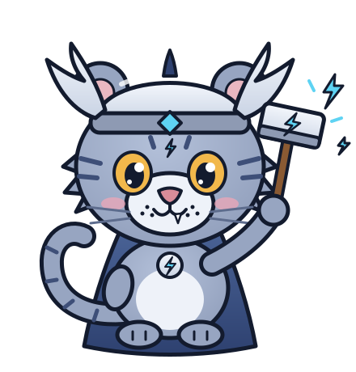

# Choosing an engine and a model: `thor`

A served model occupies memory for as long as it runs. On the Thor, the CPU
and the GPU share one pool of 128 GB, so every model, every engine and every
other program draws from the same place. A model that does not fit fails in
an expensive way. An engine build that runs out of memory takes about half an
hour to fail, and systemd then starts it again every 5 seconds. Choosing a
model is therefore a question of arithmetic before it is a question of
commands.

In this chapter, we study that arithmetic and the command that applies it,
`thor`. The command asks for an engine, a model and a context, checks the
memory, and only then writes the settings and restarts the service. Our
running example is `nvidia/Gemma-4-31B-IT-NVFP4`, the model the Thor serves.
It has a vocabulary of 262,144 tokens, a longest context of 262,144 tokens,
and a draft model for multi-token prediction.

<div class="covers">

This chapter covers

- the three engines and the trade-off each one makes
- the memory a served model needs, from its `config.json`
- the memory a restart makes available
- the build workspace of an Edge-LLM engine with a draft model
- stopping a service that runs in a container
- returning to the previous settings after a failed start

</div>

## Engines

An *engine* is the program that runs the model and answers requests. The
Thor has three. They differ in when they decide the shape of the work.

TensorRT Edge-LLM decides the shape when it builds the engine. The build
fixes the longest prompt and tunes a kernel for each layer at that size, so
each token afterwards runs at the highest speed this hardware offers.
Qwen3.6-35B-A3B in NVFP4 generates 76.0 tokens per second on it. The fixed
shape is also the cost. A prompt longer than the built length is refused,
and a large built length can fail to build at all, as our Gemma 4 31B build
did (chapter "TensorRT Edge-LLM").

vLLM decides the shape at each step. It reads a long prompt in chunks, which
it calls *chunked prefill*, so it fixes no prompt length in advance. It also
keeps the computed start of each prompt, which it calls *prefix caching*. An
agent that sends the same conversation again on every step therefore pays
only for the new part. Its kernels are less specialized than Edge-LLM's, so
each token costs more. Our Gemma 4 31B generates 7.5 tokens per second on
vLLM. With its *draft model*, a small model that proposes several tokens for
the main model to check in one pass, it generates 17.0 tokens per second on
the same 400-token reply.

llama.cpp runs GGUF files, the format of most community quantizations. It
starts in seconds and offers the widest choice of models and sizes, at a
lower speed per token than Edge-LLM on the same model.

| Engine | `--engine` | Model format | Suited to | Service |
|---|---|---|---|---|
| TensorRT Edge-LLM | `edge-llm` | NVFP4 and FP8 checkpoints from NVIDIA Model Optimizer | short and medium prompts at the highest speed | `thor-edge-llm` |
| vLLM | `vllm` | Hugging Face checkpoints, NVFP4 included | long prompts and agent runs | `thor-vllm` |
| llama.cpp | `llama.cpp` | GGUF files | the widest choice of models and sizes | `thor-chat` |

Each engine keeps its models in its own folder. Edge-LLM reads checkpoints
from `~/models/edge-llm/FOLDER` and draft models from
`~/models/edge-llm/drafters/FOLDER`, and it keeps built engines in
`~/models/edge-llm/cache`. llama.cpp reads `~/models/gguf/FOLDER`. vLLM's
container downloads into the Hugging Face cache, `~/.cache/huggingface/hub`.
The settings `EDGE_ROOT`, `GGUF_ROOT` and `HF_HUB_CACHE` move these folders.
`thor engines` prints this table for the machine it runs on, with whether
each engine is installed.

## The memory of a served model

A served model holds two things, its weights and its *key/value cache*. For
every token of context and every attention layer, the cache stores one key
vector and one value vector for each key/value head. Every number this needs
is in the model's `config.json`.

```text
KV bytes per token = layers × 2 × KV heads × head size × bytes per number
```

Our Gemma 4 31B has 60 layers of two kinds. Fifty use sliding-window
attention, which looks back only 1,024 tokens, with 16 KV heads of size 256.
The other 10 use full attention, with 4 KV heads of size 512. The checkpoint
stores its cache in 8-bit numbers (`kv_cache_scheme.num_bits` is 8), so each
number takes 1 byte.

| Layers | Per token | At 262,144 tokens |
|---|---|---|
| 10 full attention | 10 × 2 × 4 × 512 × 1 = 40,960 bytes | 40,960 × 262,144 = 10.7 GB |
| 50 sliding window | 50 × 2 × 16 × 256 × 1 = 409,600 bytes | 409,600 × 1,024 = 0.4 GB |
| total cache | | 11.2 GB |

A sliding window stops growing at its 1,024 tokens, so the full-attention
layers hold almost the whole cache. With 32.6 GB of weights, the model needs
43.8 GB at its longest context. Halving the context to 131,072 tokens halves
the full-attention part, and the total falls to 38.4 GB. Linear-attention and
Mamba layers keep a state of fixed size, so they add nothing that grows with
the context.

## The memory a restart makes available

The memory a new model may use is not the memory free right now. Restarting
a service returns the memory of the model it held, and a margin must stay
free for everything else.

```text
usable = MemAvailable + memory held by the service being restarted − MIN_FREE_GB
```

`MemAvailable` comes from `/proc/meminfo`. The service's memory comes from
systemd, with one exception. vLLM runs in a Docker container, and a
container's memory sits outside its service's cgroup, so systemd reports
about 0 GB for `thor-vllm` while the container holds about 100 GB. For vLLM,
the figure therefore comes from `docker stats`. `MIN_FREE_GB` is 8 by
default, and a service's `MemoryMax` caps the result.

Suppose 4.7 GB is available, `thor-edge-llm` holds 60.0 GB, and
`MIN_FREE_GB` is 25. The usable memory is 4.7 + 60.0 − 25.0 = 39.7 GB. Our
model needs 43.8 GB at 262,144 tokens, so it does not fit, while 131,072
tokens at 38.4 GB does. In this case, `thor serve` changes nothing and states
both numbers, the largest context that fits, and the services that hold
memory.

```text
thor: Gemma-4-31B-IT-NVFP4 at 262,144 tokens needs about 43.8 GB; 39.7 GB can be used.
  4.7 GB available, 60.0 GB held by thor-edge-llm (freed when it restarts), 25.0 GB kept free (MIN_FREE_GB), thor-edge-llm capped at 85.9 GB.
  The largest context that fits is 131,072: --context 131072
  To make room, stop thor-vllm (105.8 GB): thor stop thor-vllm
```

The same check applies to an engine that is not installed, a context above
the model's maximum, and a context too small to leave room for a prompt
after the reply tokens.

## The build workspace of a draft model

The estimate above covers what a running model holds. An Edge-LLM build
needs more for a while, and one part of that grows with the prompt length
and the vocabulary together.

A draft model scores every vocabulary token at every row of the prompt in
its last layer, the *LM head*. TensorRT's autotuner sizes a workspace for
that layer during the build. The workspace holds one entry per row and per
vocabulary token, 6 bytes each, 2 for the FP16 output and 4 for its FP32
copy. The builder profiles half of the longest input, so the rows are half
of that input.

```text
workspace = (longest input / 2) × vocabulary × 6 bytes
```

For our Gemma 4 31B with a longest input of 131,072 tokens, the workspace is
65,536 × 262,144 × 6 = 103,079,215,104 bytes, or 96.0 GiB. That build fails
on the Thor after about 27 minutes. Gemma 4 26B-A4B has the same vocabulary,
and with its draft model at an input of 65,536 tokens its workspace is
32,768 × 262,144 × 6 bytes, or 48.0 GiB. That build succeeds and serves at
about 35 tokens per second. The capacity TensorRT reports in the failures,
35.3 GiB without NVIDIA's PR #229 and 32.6 GiB with it, is therefore not a
fixed limit, and we do not know what sets it.

What we know is two points, so `thor` compares each build with them.
`EDGE_WORKSPACE_BUILT_GIB`, 48 by default, is the largest workspace known to
build here, and `EDGE_WORKSPACE_FAILED_GIB`, 96 by default, is the smallest
known to fail. Below the first point, the plan says nothing. At or above the
second, it states that the build is likely to fail and names the longest
input known to build with this vocabulary.

```text
2 × 48 GiB / (262,144 × 6 bytes) = 65,536 tokens
```

A context of 131,072 keeps that input, because `thor-tigress-serve` caps the
longest input at half the context. Between the two points, the plan states
that the size is untested. A context of 196,608 gives an input of 98,304 and
a workspace of 72.0 GiB, which falls there. Neither note stops the build,
and the two settings move as new builds succeed or fail.

## Choosing with `thor serve`

`thor serve` asks four questions in order: the engine, the model, the
context, and the plan. Each has a flag, so a script can answer them all.

The model list starts with the models already on disk. Below them comes a
live Hugging Face search in the engine's format, most downloaded first, with
`filter=modelopt` for Edge-LLM, `filter=gguf` for llama.cpp and
`filter=safetensors` for vLLM. Each row carries the size from the file list
and the cost at the longest context from `config.json`. Two rows end every
list, one for a new search and one for any repository name or local folder.
A GGUF repository adds a menu of its variants, such as Q4_K_M and Q8_0.

```text
? TensorRT Edge-LLM model (56.8 GB usable now):
> Gemma-4-31B-IT-NVFP4                 32.6 GB   262,144 ctx  43.8 GB at max  fits at max      on disk
  Qwen3.6-35B-A3B-NVFP4                23.4 GB   262,144 ctx  28.8 GB at max  fits at max      on disk
  nvidia/Gemma-4-26B-A4B-NVFP4         18.8 GB   262,144 ctx  21.6 GB at max  fits at max      1771146 downloads
  search for something else
  enter a Hugging Face name or a local folder
```

The context list starts at the model's maximum and halves from there. Each
row carries its memory and the result of both checks, so a row can fit in
memory and still be marked as a likely build failure.

```text
? Context:
>     262,144 tokens    43.8 GB of 56.5 GB usable  fits in memory; the drafter build is likely to fail
      131,072 tokens    38.4 GB of 56.5 GB usable  fits
       65,536 tokens    35.7 GB of 56.5 GB usable  fits
  another size
```

The plan lists every change before it happens: engine and port, download,
context, memory, settings lines and services to restart. After a yes, `thor` downloads any missing files, copies
the settings file to `env.backup-SECONDS`, writes the new lines and restarts
the service. It then follows the service's log until `/v1/models` lists the
model, and restarts `thor-tigress-agent` so the chat page lists it too.

| Engine | Settings written |
|---|---|
| Edge-LLM | `EDGE_MODEL`, `EDGE_CONTEXT`, and `EDGE_PROMPT` as the context minus `--reply-tokens` (8,192 by default) |
| llama.cpp | `MODEL` and `CONTEXT`; the estimate multiplies the cache by `USERS`, because llama-server reserves it per user |
| vLLM | `VLLM_MODEL`, `VLLM_NAME`, and `--max-model-len` inside `VLLM_ARGS`, with its other options kept as written |

`--max-model-len` goes at the end of `VLLM_ARGS` for a reason.
`thor-tigress-serve` strips quote characters from both ends of a settings
value, so a value that ends with a quoted JSON option, such as
`--speculative-config '{...}'`, loses its closing quote, and vLLM's command
line no longer parses. A value that ends with a number keeps the JSON away
from the end.

## Stopping a service in a container

`systemctl --user stop thor-vllm` ends the `docker run` client that the
service started, not the container. The container keeps running and keeps
its memory, about 100 GB on the Thor. `thor stop thor-vllm` therefore stops
the service, then the container, and waits until Docker no longer lists it.
It reports the memory freed from `MemAvailable` before and after. A named
service stops without a question, so the command works over SSH, where no
terminal answers. Without a name, `thor stop` offers a menu and asks first.

## Returning after a failed start

A start fails when systemd reports the service as failed or restarting, or
when `/v1/models` does not list the model within `--wait`. The useful
information is then in two places, the log and the backup. `thor` prints
every log line since the restart that reports an error, followed by the
commands that restore the previous settings.

```text
thor-edge-llm failed. The lines in its log that report errors:
  [TensorRT] ERROR: [virtualMemoryBuffer.cpp::resizePhysical::154] Error Code 2: OutOfMemory (ran out of memory)
  thor-edge-llm.service: Main process exited, code=killed, status=9/KILL

To go back:
  cp ~/.config/thor-chat/env.backup-1794807482 ~/.config/thor-chat/env
  systemctl --user restart thor-edge-llm
To stop it from restarting: thor stop thor-edge-llm
```

A failed Edge-LLM build restarts every 5 seconds, and each attempt takes
memory from the other services. `thor stop thor-edge-llm` is therefore the
first command to run, before the restore.

## Flags

| Flag | Meaning | Default |
|---|---|---|
| `--engine edge-llm\|llama.cpp\|vllm` | the engine | asked |
| `--model NAME\|FOLDER` | a Hugging Face repository or a model on disk | asked |
| `--file VARIANT` | a GGUF variant, matched by the end of its name | asked; with `--yes`, the largest that fits |
| `--context max\|TOKENS` | the context window | asked; the first row is the maximum |
| `--reply-tokens TOKENS` | tokens kept for the reply | 8,192 |
| `--limit COUNT` | Hugging Face results per search | 12 |
| `--wait SECONDS` | how long to wait for `/v1/models` | 3,600 |
| `--no-docs` | fetch no recipes or documentation | off |
| `--yes` | skip the confirmation | off |
| `--settings FILE` | the settings file | `~/.config/thor-chat/env` |

```bash
thor serve --engine edge-llm --model nvidia/Gemma-4-31B-IT-NVFP4 --context 65536 --yes
thor serve --engine vllm --model nvidia/Gemma-4-31B-IT-NVFP4 --context max --yes
```

The Hub token comes from `HF_TOKEN`, `HUGGING_FACE_HUB_TOKEN`, or the file
that `hf auth login` writes. `thor` sends it only to the Hub. `HF_ENDPOINT`
names another Hub, and `HF_HUB_OFFLINE=1` stops every Hub request, as it does
for Hugging Face's own tools.

## What the estimate leaves out

The estimate covers weights and cache, which a running model holds for its
whole life. Three costs fall outside it. An Edge-LLM build holds its
checkpoint, weights and build buffers at once, and reserves activation
buffers for its longest prompt. The draft-model check above covers only the
LM head's share of that. vLLM reserves the share of memory set by
`--gpu-memory-utilization` at start, and on the Thor that share applies to
the whole 128 GB, whatever the model needs. llama.cpp's cache is counted at
2 bytes per number, the size of llama-server's default `f16` cache, so a
quantized cache needs less than the estimate.
